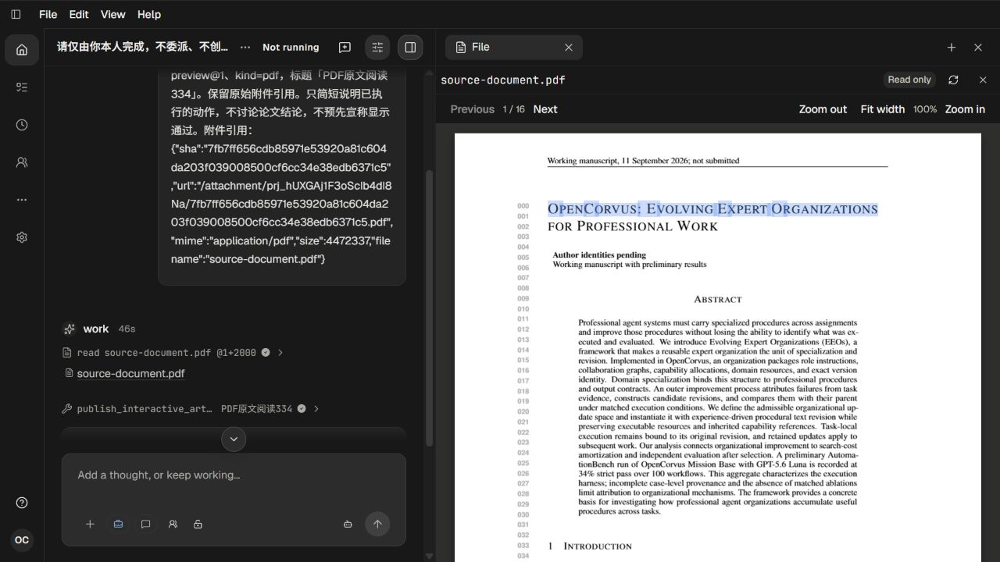

# 334 PDF 原文选择与复制

[Recall、修改准入与逐轮调查](../pdf-selection-plan-334.md)；[月度记录](../../../records/2026-10/2026-10-12-pdf-selection-334.md)。2026-10-12，单agent实现与真实页面人工复核。

原PDF来源只能观看canvas，实际拖选标题得到空选区。共享PdfPreview现在使用同一PDF页的PDF.js TextLayer呈现可选原文，文件来源与独立Artifact入口共用。显示viewport独立于画布设备像素倍率，页/宽度/缩放变化时两项渲染一起取消并清除旧文字，两者完成后再恢复阅读位置。

初次实现允许从文字层空白容器开始选择，导致浏览器按PDF内容节点顺序带入行号。补齐官方层叠样式没有解决该问题，失败结果仍保留。真实命中诊断显示699,268为DIV空白、704,268才是字母O，坏选区起点是DIV/offset13。最终只允许实际文字节点选择，空白容器不可选；原文顺序、字节和复制结果没有后处理或替代路径。

## 实际运行与证据

| 运行 | 目的 | 端口 | 实际Sol流式请求（含预检） | 原启动句柄 |
| --- | --- | --- | --- | --- |
| live-01 | 无文字层基线 | 18308 | 6，全部200/EOF | 85007，exit0 |
| live-02 | 初次文字层、定位选区边界异常 | 18309 | 6，全部200/EOF | 57514，exit0 |
| live-03 | 层叠对照及最终空白容器修复 | 18310 | 6，全部200/EOF | 16516，exit0 |

每轮成对复制已授权auth和完整models，独立预检usable/projected/实际gpt-6.1-sol streaming。正常Work/Chat实际read并publish_interactive_artifact，不直接写消息或数据库。输入是仓库既有16页、4472337字节PDF；当前项目实际上传返回canonical引用，03实际HTTP读取200且字节与原件一致。01/02模型选择读canonical附件URL，03读项目根文件；持久化Source路径分别真实保留，checker比较各物理文件原字节，未依模型自述混同路径。

03中最终改动仅CSS，构建后刷新自己的117页面，由同一个服务提供新bundle并从历史重开原对话，没有重启后端或延长固定边界。所有Native/Host、输出/请求、端口及复制凭据/模型目录成对清理均完成；115/116/117页面均关闭。

## 人工视觉结果

16张截图均实际呈现并查看，包含原始和中间失败，数量不代表全部通过：01为canvas拖选失败；02/03/05/10/11保留容器起点导致多选的现象；04/06/07为初次实现的正确标题、125%摘要和第二页范围；08/09证明深阅读关闭重开top336保持。最终12显示标题准确选择并完成原生复制，13显示125%实际部分字符选区，14显示快速Next/Next/Previous后第二页正确选择，15显示按字体run双击，16显示跨字体run拖选完整PROFESSIONAL。

最终同样从699,268空白开始得到空选区，从704,267文字开始得到完整标题，见selection-whitespace-fixed.json；native-copy-final.json保存真实Ctrl+C结果，操作后恢复原浏览器剪贴板。第二页RELATED WORK范围和Artifact跨run完整单词都由实际鼠标操作得到，不是程序构造Selection。几何/选区JSON仅为辅助观察，没有DOM或截图自动断言。

## 检查与边界

typecheck原20947 exit0；构建9385、79980、56038均exit0。最终49.26秒构建的真实服务入口为main-BHcN3tvx.js，入口HTML及检查日志完整压缩保留在checks。docs:check、真实Provider/发布请求结果所有者/canonical引用/原件字节/物理终态正向checker与凭据扫描结果见checks；没有UI自动化测试。

当前验收是桌面16页英文PDF，未覆盖全部字体、旋转页、加密文件、扫描件或OCR。原生双击按PDF字体run取词，例如小型大写拆分时只得到ROFESSIONAL；跨run拖选能得到完整PROFESSIONAL，没有新增自定义分词。拖选终点以实际文字范围为准，125%记录ABSTRAC就是当次选择的部分字符，未包装为完整单词。02读位验证适用于共同的渲染/恢复逻辑，最后两轮CSS仅改变层叠与选择范围。

另一个尚未解决的问题已明确保留：canonical附件的文件来源显示内部摘要文件名和存储路径，原始上传名未显示。01/02有实际截图及来源事实，03使用项目根路径不能证明该问题已修复；下一轮应优先调查这项Sources显示问题。
