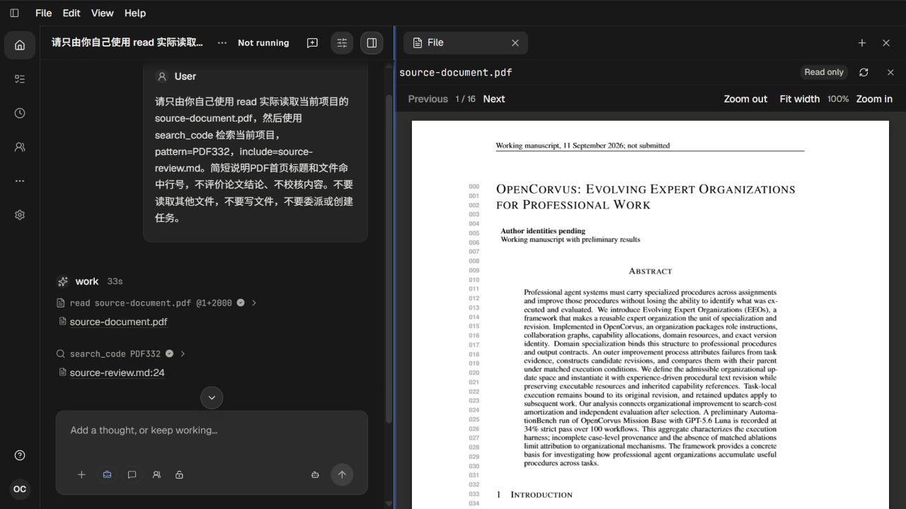

# 332 PDF 来源预览与阅读位置

[Recall、影响分析及修改准入](../pdf-source-plan-332.md)；[月度记录](../../../records/2026-10/2026-10-12-pdf-source-332.md)。2026-10-12，root 单 agent 开发与人工页面验收。

普通 Chat 实际 read PDF 生成文件来源；原 File API 返回空 binary 内容，点击后只有不可编辑占位。现在两种文件读取范围都通过既有 FileContent 返回原始 PDF 的 base64 和 MIME 类型，并保持只读。文件侧栏与 Artifact 使用同一个 PdfPreview，支持翻页、缩放及适宽。没有新增来源协议、API 或第二套阅读器。

首轮真实页面复核又发现关闭侧栏丢失阅读位置。隐藏时 canvas 尺寸保持，但滚动容器尺寸及 scrollTop 归零。修复在当前文档/页保存可见稳定位置，重新显示后等待当前宽度绘制和布局完成再恢复；源或页变化时重置。CodeEditor 与 PDF 共用原有有限祖先动画判断。

## 实际证据

| 运行 | 目的 | 服务端口 | 实际 Sol 流式请求 | 真实来源 | 原生退出 |
| --- | --- | --- | --- | --- | --- |
| live-01 | 原始失败基线 | 18303 | 5，全部 HTTP 200 / EOF | 1 个 PDF | 0 |
| live-02 | 首轮 PDF 阅读及发现读位缺陷 | 18304 | 5，全部 HTTP 200 / EOF | 1 个 PDF | 0 |
| live-03 | 读位修复、错误恢复与文本定位 | 18305 | 6，全部 HTTP 200 / EOF | PDF 与第 24 行文本 | 0 |

每轮使用独立开发模式 `/ui`，均先验证成对复制的 Provider 凭据可用、完整模型目录已投影，实际请求为 gpt-6.1-sol。固定原生出生起 600000ms、累计 12 请求的边界，未续期；Native/Host、输出、请求、端口与复制的 auth/models 均已完成收敛。仅操作本轮自有页面，110/111/112 已关闭。`live-*/` 保留原生完成事实、配对清理、会话和工具来源；日志及周期观测为可解压的完整脱敏档案。

PDF 使用仓库既有 16 页原文，4472337 字节；`input-page-1.png` 是 Poppler 对原文首页的渲染，已人工查看。`pdf-content-before.json` 与 `pdf-content-after.json` 记录真实 API 响应变化和解码原字节一致性。故意损坏的隔离副本已保留在私有 quarantine，原件已恢复；`input-preserved.json`、`input-restored.json` 记录原输入保全。没有用源码摘要充当验收。

16 张应用截图均由 root 实际查看：01 为原始占位；02–04 为首次 PDF 阅读/翻页/缩放；05–07 为关闭重开丢位；08–11 为修复后的首页、深阅读、位置恢复及第三页适宽；12–14 为真实 InvalidPDFException、重新加载原件及恢复后的窄布局；15 为文本来源第 24 行；16 为最终宽侧栏。`pdf-position-after-fix.json` 辅助记录同一页 200% 缩放时关闭前后 top=252、left=153.3333282470703；几何记录没有充当 UI 自动化断言。

## 验证与边界

后端聚焦验收先以原代码得到 3 pass / 1 fail，再以修复代码得到 5 pass / 24 assertions（原句柄 31525，exit 0）。测试实际 PDF/PNG 输入、两种真实文件读取范围、正确 MIME/编码及原字节一致性。前后端类型检查通过，最终前端构建原句柄 82210 exit 0，实际页面使用 main-DRlPTkRX.js。文档检查、凭据扫描及原始检查日志见 `checks/`。

`checks/actual-backend.json` 对实际 Provider、持久化来源、文件响应、原件恢复与物理完成事实进行正向校验；不对截图、组件或 DOM 作自动化测试。原 launch 41845/6763 的返回已记录 exit 0。03 的 65995 最后一次 join 后遇到上下文恢复，再查询已为 Unknown process id，因此不将该查询写成 exit 0 证据；03 的 Native exit 0、完整输出/请求收敛和物理清理均由生产完成事实直接证明。

本轮覆盖桌面 16 页 4.47MB PDF；未验收加密文档、表单、注释、所有 PDF 编码或超大文件性能。原 Artifact 入口复用唯一实现并通过类型/构建检查，本轮视觉证据来自真实文件 Sources 入口。没有宣称所有产品体验问题已经解决。
