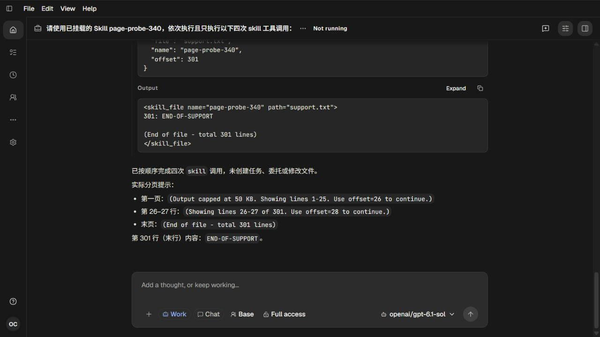

# 341 Skill loader 常驻投影与340真实分页闭环

[Recall、共享根因与改动准入](../skill-loader-plan-341.md)。2026-10-12，Root单agent；持续产品goal保持active。

已授权的Skill-family工具现在随角色常驻提供，移除@skill标记准入包装；Skill正文仍由模型真实工具调用读取。基础定义和实际执行共用专门初始化，名字范围来自执行轮次冻结的Harness/descriptor。配置Skill不再被空reveal集合覆盖；后续安装的无关Skill也不能扩大已绑定轮次的权限。原生Mission在唯一角色声明中只持有mission_skill，普通skill不会成为关闭该工具后的别名。无目录owner的原生角色保留明确空范围。两份当前架构文档同步该契约。

## 正向检查

70756原测试17失败/3通过。25185首次修复后Work和Task检查通过，Mission旧工具集合及一个真实开关错误失败；91496缩小到同一Mission角色继承两个loader的证据。临时诊断代码已删除，日志保留。最后95057实际exit0：task-routine-tools19/42、skill-reveal1/13、native-skill-base3/9、native-mission-transport-base21/51、core-artifact-owner-execution8/98，总计52 tests/213 assertions。34638后端typecheck和docs检查通过。

这些检查覆盖Chat/Work/编码角色首次加载与恢复、任务角色授权集合、Task scheduler的projected/registry Core实际工具执行、Mission首次调用/发现/取消发现/权限与switch收紧，以及真实跨进程恢复和旧轮次退休。模型是局部契约输入，不冒充真实Provider或Mission网页验收。全部为后端测试，没有添加或运行UI自动化。

## 真实页面、模型与生命周期

localhost:18318/ui实际提交与340相同的普通分页请求，没有@skill或host路由旁路。目录刷新和/config配置一次成功。首次模型错误地调用name="page-probe-340 gen"，工具明确拒绝；随后Provider返回server_is_overloaded，完整JSON错误出现在页面并持久化。截图01与[实际后端证据](checks/actual-backend.json)保留这段失败，不把HTTP200/流EOF当模型成功。

Root在同一会话发出可见重试，仍用原12请求预算和600000ms硬上限。重试四次实际skill调用完成：加载Skill、第一页1–25/total301、offset26 limit2、offset301末页END-OF-SUPPORT。实际Provider带工具的请求均包含skill声明；总共11次真实gpt-6.1-sol流请求200/reader EOF。Source文件精确301行，分页metadata/正文说明与磁盘事实一致，严格后端checker exit0。因此340先前未完成的真实分页路径已由本轮补齐，340原失败记录保持原样。

原启动17850实际join exit0，Native75924/Host76240、输出、请求和端口完整回收，已授权auth/models成对投影预检并成对清除；页面125关闭。服务从06:58:21.421Z到07:03:50.580Z，共329.159秒：由于首次失败后的同实例重试，超过计划的第5分钟收尾目标29.159秒，但没有延长或触及600000ms硬上限。该执行偏差明确保留。前端未改，使用338已验收main-HB6Ez6mO.js，未声称新构建。

三张真实截图均由Root人工查看：01失败态，02直接加载后的展开结果，03末页raw Input、实际Output与分页报告。02不证明第一页完整长正文已在一屏展示；三页计数由真实后端结果核对，03视觉证明末页301及标记呈现。原始脱敏日志/Provider/HTTP证据无损压缩；37份文本扫描零凭据命中，私有原件保留。

## 继续事项

首次Provider过载暴露了后续体验问题：结构化错误被当作UnknownError并直接显示整段JSON。下一轮追查错误标准化和主提示/原始详情的职责，保留可审计原始诊断，当前未声称这项改进已完成。本轮不发布版本或创建Release。
