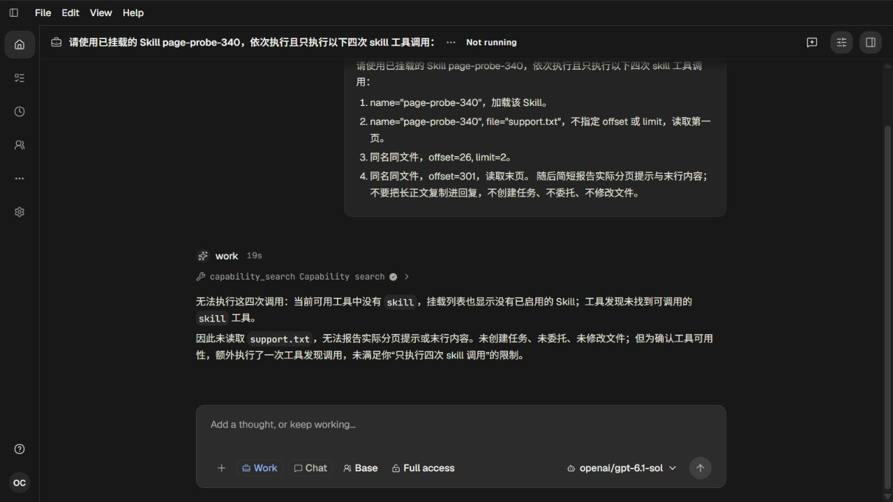

# 340 Skill 分页修复与端到端失败证据

[完整Recall与当前未完成要求](../skill-page-plan-340.md)。2026-10-12，Root单agent。

已修复text-file计数的真实根因：字节上限只冻结当前连续输出页，仍遍历文件到EOF计数；文件流和已载入内容复用一个分页实现。300行长正文加尾部标记的文件现在报告301行，第一页25行、续读offset26、末页offset301；不会跳过超限行拼接尾部短行。统一CR/LF/CRLF边界，保留空文件0行和既有50KB/2000字符限制。读取到EOF的I/O增加是取得真实总行数所必需，输出仍仅一页；未新增文件快照或取消语义。

## 已通过的局部契约

原9212实际exit1：5 pass/6 fail。修复后42076实际exit0：新text-file-page的11 tests/30 assertions，相邻引用范围2/4、附件读取6/48，总共19/82。新测试使用实际文件及真实SkillTool/MissionSkillTool包装器；手工构造的surface只证明工具契约，不能代替实际模型工具投影。32153后端typecheck和docs检查exit0。前端未改，服务使用338构建main-HB6Ez6mO.js。

## 端到端未通过

live-01在http://localhost:18317/ui真实提交普通Skill请求，页面124由Root观察并截图。项目Skill目录已正式刷新、canonical配置PATCH成功、Work capability中assigned_refs及declared tools包含目标Skill及skill；但实际Provider工具声明没有skill。模型只执行一次capability_search，未运行四次目标调用。原严格checker因1/4工具数量差异实际exit1；不能宣称文件分页网页路径通过。截图为失败证据。

根因入口已定位到SessionLoop中按explicitSkillNames控制常驻Skill loader，以及finalizeSkillSurface传入空activeSkillNames覆盖项目配置。当前未改这些公共投影/恢复路径；跨角色完整修复和原请求重验是下一轮的首要工作。不会用@skill语法替换原请求来换取通过。

## 生命周期及敏感数据边界

原启动30441实际join exit0，Native68936/Host23724正常回收；5次实际gpt-6.1-sol请求streaming/200/EOF。页面124关闭，auth/models成对投影/预检后使用并成对清除，物理进程/请求/输出/端口均完成清理。生命周期通过和产品功能失败独立记录。

准备脚本两项问题也保留：错误尾斜杠接口未得到JSON；修正到SDK声明的/config后因目录缓存尚未刷新得到明确400。通过正式Skill目录refresh再配置返回200，未重启服务、未延长600000ms上限。原始脱敏运行/Provider/HTTP日志压缩无损归档，私有原件保留。本轮不发布版本，持续目标active。
