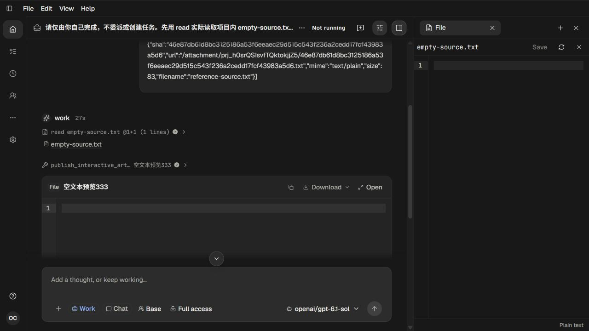

# 333 空文本预览

[Recall及修改前分析](../text-preview-empty-plan-333.md)；[月度记录](../../../records/2026-10/2026-10-12-text-preview-empty-333.md)。2026-10-12，单agent调查、实现和真实页面人工复核。

合法0字节文本附件在原预览中持续显示Loading text；同一轮的普通正文和Sources空文件编辑器正常。根因是TextPreview用正文真值判断加载完成，成功返回的空字符串仍落入加载分支。现在按既有Solid resource的ready状态呈现原始内容，空文本与非空文本均使用同一只读CodeEditor。没有修改附件、API、持久化、工具或权限契约。

## 实际链路

两轮均启动独立开发模式 `/ui`。root通过当前项目的真实附件上传接口保存0字节 empty-source.txt 和83字节中文/英文 reference-source.txt，并将实际返回引用输入正常Work/Chat。实际 gpt-6.1-sol先read空文件、再两次publish_interactive_artifact；所有消息、来源和预览记录均由正常参与者产生。附件内容见input-empty.txt/input-reference.txt，请求见request-01.txt/request-02.txt。

| 运行 | 目的 | 端口 | 实际流式请求（含预检） | 发布预览 | 原启动句柄 |
| --- | --- | --- | --- | --- | --- |
| live-01 | 原始显示失败与正文对照 | 18306 | 7，全部200/EOF | 2 | 31983，exit0 |
| live-02 | 修复、只读、展开、下载和刷新复核 | 18307 | 7，全部200/EOF | 2 | 64183，exit0 |

两轮均先验证凭据usable、完整模型目录projected、实际模型gpt-6.1-sol且streaming=true。固定600000ms/12请求成本边界内结束，Native/Host、输出/请求、端口及复制auth/models配对清理事实完整保留。113/114自有页面已关闭；未修改用户进程或窗口。

## 视觉与功能结果

6张应用截图均实际呈现并由root逐张查看。01展示Sources空文件正常、内嵌预览仍加载；02是展开后仍加载；03为正常正文对照。04展示修复后的空编辑器，按键后保持原空内容；05展示普通正文和只读行为。06是刷新页面、从持久化历史重新选择该对话后，再打开Sources空文件的最终画面。空预览重新加载成功，正文内容保留。

实际点击空预览Download并选择empty-source.txt，浏览器返回下载路径；落盘文件确为0字节，见actual-empty-download.json。两种附件实际HTTP读取均200且原字节一致，文件API也返回成功的空text内容，见live-02/actual-input-contracts.json。空预览的DOM只读属性仅作辅助观测，见empty-preview-readonly-observation.json，不构成自动化断言。

## 检查与限制

前端typecheck原68579 exit0，构建原88319 exit0，50.85秒；实际服务HTML引用main-GO3xt7j4.js。docs:check与检查日志见checks。后端事实checker逐项核对真实发布请求/完成结果/Artifact所有者与原上传引用、0/83字节输入、Provider流、文件来源及物理完成；没有新增UI自动化或以DOM、截图像素、源码文案作验收断言。

本轮修改仅涉及UI加载状态，未改变非UI契约，所以没有新增镜像实现的单元测试或重复全量测试。既有加载失败分支保持原样，本轮未另造网络失败场景；结果不扩展为所有附件格式或网络错误已验收。最初上传探针尾斜杠错误得到404，修正为声明的/attachment后完成；该探针错误不计作产品缺陷。下载空文件保留在工具返回的Downloads路径。
