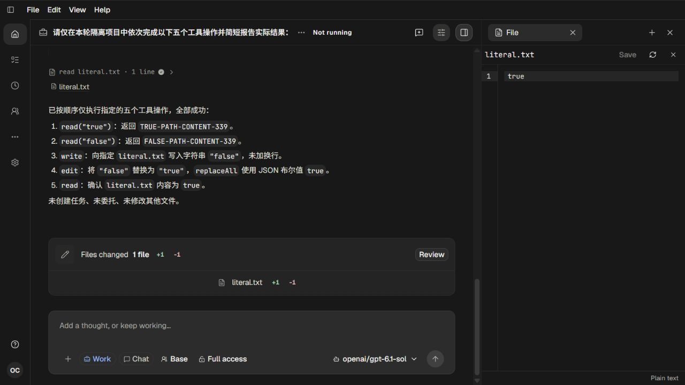

# 339 字符串工具参数与真实 Sources 验收

[Recall、影响分析和截止调查](../tool-literal-plan-339.md)。2026-10-12，Root单agent执行；用户持续迭代目标仍active。

Tool.define原先在schema校验前把所有顶层字符串true/false强制转成boolean，破坏合法文件名、文件内容、Edit匹配文本和union分支。删除这一唯一通用转换，让工具声明的schema决定类型、默认值和显式转换。权限、Tool请求、输出物化和执行生命周期未改。架构事实同步到04-extensions。

## 检查证据

- 原checker38129实际exit1，8个失败；修复后13531实际exit0，三个文件17 tests/74 assertions。新测试实际调用Read/Write/Edit、验证文件精确字节及类型错误契约；两个相邻工具/附件契约同时通过。
- 后端typecheck24073实际exit0。前端源码未改，真实服务复用338已验收的main-HB6Ez6mO.js；没有把旧构建说成本轮构建。
- 共享终态调查新增运行现有foreground-process-facade真实测试：自然退出、活动输出截止以及并行peer正常完成，2 tests/6 assertions，实际exit0。没有运行UI自动化测试。
- [live-01结果](live-01/validation.json)明确failed，原启动49246实际exit1；[terminal-audit](live-01/terminal-audit.json)保留截止与关闭准入时间、各Session/Tool完成事实和Provider EOF。模型在05:56:25.675Z完成，但人工关闭晚于06:04:38.186Z硬截止；监督器如约回收。该轮仅提供局部功能与视觉证据，不能当作完整通过。
- [live-02结果](live-02/validation.json)passed，原启动16909实际join exit0，Native73192/Host77828自然结束。仍为12请求预算和600000ms固定上限；本次约2分钟内关闭。9次实际gpt-6.1-sol流式请求均200且reader EOF；5个真实工具输入、完成结果、source身份、编辑前后字节及最终磁盘内容全部通过[实际后端checker](live-02/actual-backend.json)。
- 两轮auth和完整models目录先成对投影与预检，再使用实际目标模型；物理链、输出、请求和端口回收后成对清除。脱敏扫描包含压缩后的原始证据，63份文本0凭据命中；原私有文件保留在本轮私有目录。自建页面122/123已关闭，未操作用户窗口或进程。

## 人工视觉复核

11张真实页面截图均已由Root查看。01是整体结果，02显示raw Input的filePath仍为字符串true；03点击false Source后展示原文件内容；04/05分别展示oldString/newString仍为字符串、replaceAll为boolean以及实际false→true差异；06最终文件true；07切换真实历史会话再返回后Source仍打开原true文件。01初次动作未留下展开详情，不用该截图证明展开成功；之后重新依据页面状态操作并单独截图。

第二轮08再次展示原始字符串参数与读取结果，09在生成中点击false来源并显示正确文件，10展示编辑原始参数与真实diff，11完成态显示literal.txt的Source与右侧文件true。Source使用具体文件名而非重复空泛计数，点击能落到对应内容；本轮没有新增Sources布局代码，也不把两轮静态截图写成侧栏反复Rendering闪烁的完整验证。

## 边界与继续事项

共享机制横向检查覆盖ProcessFacade/ProcessSupervisor各生产引用、Host/Task命令入口、Task取消屏障、runtime关闭、Windows orphan/restart身份及Session事实。两轮是NativeService/Work Chat，不是Task/Mission重试或重启恢复实验；本轮持久化Session属于两个独立project，真实工具只发生于隔离项目。Task/Mission路径是代码审计，不能声称本輪真实运行了这些路径。原截止失败来自Root验收节奏，保持原限制和失败记录；没有改动共享运行时来掩盖它。

后续仍需调查Skill异步大文件读取在50KB停止时的totalLines含义。没有发布版本、创建tag或Release；持续产品目标保持active。
