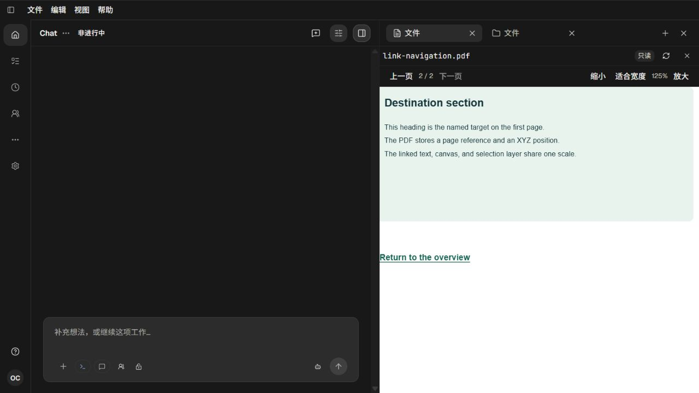
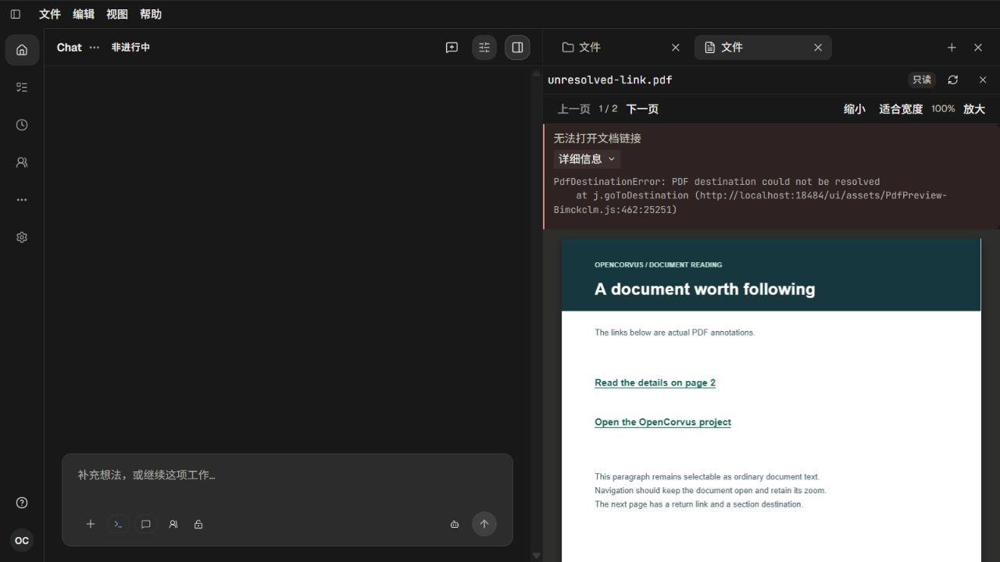
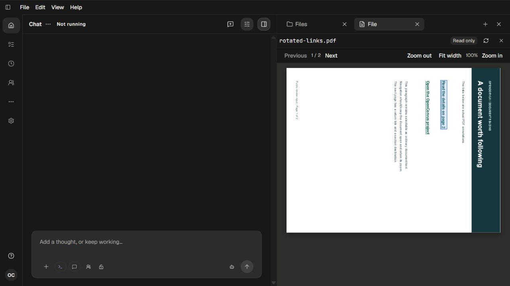

# PDF 文档链接验收

[调查与验收记录](../../records/2026-10/2026-10-13-pdf-links-381.md)记录唯一阅读器、目的地映射、异步归属与实际返工。

- `inputs/link-navigation.pdf` 是公开的两页真实文档；`inputs/annotations.json` 记录原始注解。旋转与缺失目标派生文档分别为 `rotated-links.pdf`、`unresolved-link.pdf`。输入创建脚本随证据归档。
- 现有真实参考为 [案例简报](../2026-09-08-founder-case-brief/opencorvus-case-brief-en-zh.pdf)，未修改原文件。
- `evidence.zip` 保留实际命令、退出码、前后服务收尾及所有桌面截图；没有 UI 自动化、浏览器 fixture、凭据或模拟聊天消息。
- 下图均由主 agent 在 `localhost:18484/ui` 的独立生产开发入口实际操作并人工查看。仅空会话、无模型请求；本批无需 Provider。

最终英文错误摘要、中文错误摘要及详情均清晰可见；首次后态错误被两行网格遮挡的截图保留在归档中，修复后重新构建并截图确认。实际检查覆盖原案例外链、键盘 Enter、XYZ/Fit、125% 倍率、90 度旋转点击、文件切换、正文选择和面板重开读位。纯目的地映射测试 24 项、48 断言通过；构建、类型与语言检查分别记录真实结果。

边界：本批支持链接注解；表单、脚本、附件动作和文档历史不在范围内。250% 与 50% 边界由数据合同核对，未冒称人工遍历每一种 PDF、缩放值或旋转角。
