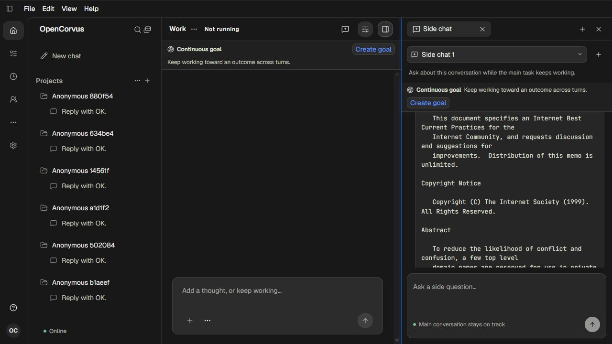

# Sources与侧栏阅读位置：实际证据

[调查与完整迭代记录](../../records/2026-10/2026-10-23-source-layout-reading.md) · [观察、模型与资源结算](evidence.json)

552全程一个开发agent，真实Source CLI /ui、内置浏览器手工操作及人工查看截图。使用真实既有成员历史和本轮真实生成的Side Chat输出；未执行UI自动化测试。

| 边界 | 修改前/中间结果 | 最终结果 |
| --- | --- | --- |
| 普通来源卡宽度变化 | [01原来源](01-source-reading.png)、[03窄栏](03-source-narrow.png)保持来源锚点 | 原有正确路径保留 |
| 阅读工具输出、隐藏后改宽 | [07输出](07-output-reading.png)→[08跳回旧消息](08-output-return-narrow.png) | [30最终侧聊返回](30-final-asset-side-hidden-return.png)保留同一原文 |
| 持续可见时改宽 | [11中间版本仍漂移](11-fixed-output-visible-widen.png)；[16手工改读后返回](16-final-new-reading-return.png) | [32宽](32-final-asset-member-wide.png)→[33窄](33-final-asset-member-narrow.png)→[34宽](34-final-asset-member-return.png)，成员字符276及原位置保持 |
| Side真实网页读取 | 首次预算遗漏自然memory，[17停止待批准请求](17-side-budget-stop.png)，不作为成功 | 重新验收自然完成，[20真实来源](20-side-source-card.png)、[21完整输出](21-side-output-reading.png) |
| Side尺寸通知 | [22窄栏偏移](22-side-output-narrow.png)；实际直接子为display:contents、宽高0 | 同一个Observer补观察viewport；[23](23-verified-side-reading.png)→[24](24-verified-side-narrow.png)证明恢复通知 |
| 最终字符目标往返 | 页182实际仍用冻结旧资产，明确排除最终资格 | 新服务页183：[27宽](27-final-asset-side-wide.png)→[28窄](28-final-asset-side-narrow.png)→[29宽](29-final-asset-side-wide-return.png)，原字符323保持，859→1013→859 |

最终页面实际入口为main-i1jR4B4Z.js，与新服务启动捕获的UI资产一致；这只证明加载身份，实际结果由图27—34证明。之前服务的main-qim-clqU.js冻结字节符合生产合同，重建磁盘文件不能更新运行中的服务。两份[入口观察](loaded-asset-182.json)、[最终入口观察](loaded-asset-183.json)均保留。

成员35段正文/11来源在可见尺寸变化中保留原owner；Side两段正文在可见改宽中保留owner，显式工具页切换会正常卸载并重建Side的正文owner，原工具披露、8008字符结果、Source及阅读位置仍正确恢复。未将Side显式切页说成owner全程不变。

六个scope实际请求依次2/2/4/5/2/2，共17次gpt-6.1-sol流式200/原reader EOF。成功Side请求包含自然memory、工具前chat、真实Allow Once后webfetch以及工具后chat；网页只实际读取一次。首次Side在许可尚待批准时安全停止，不能算成功读取。六服务公开shutdown200、原exec1249/47957/50214/34401/87464/67156、native/launcher均退出0，输出/request完整闭合；24份复制auth/catalog文件退休，原App选定条目及完整目录字节/mtime保持。

前四scope来源90表165802原行，后两scope来源为刚闭合成功Side的90表166963原行；所有源字段/时间/字节/mtime/canonical保持，schema3与实际对象/integrity保持。只读体验目标原行只变更两条运行租约；发起真实Side的两个scope额外更新其Session摘要/时间与两条自然memory。真实用户数据库未操作，版本/schema未改。

最终类型检查通过，最终Node构建58.62秒；中间一次类型自引用错误已修正重跑。全部UI依据实图，未以类型、构建或日志替代视觉验收。独立Main/Mission、专用code/diff输出及JSON格式切换未由本组图片证明。

额外发现的停止收敛问题保留在[原持久化事实](stopped-permission-observation.json)：真实Stop后Message和Tool已aborted，但Permission ledger仍只有requested且decision_slot为空。已开始共享取消链审计，未在本次布局提交中修改许可生命周期；不能宣称所有停止/恢复问题已解决。

