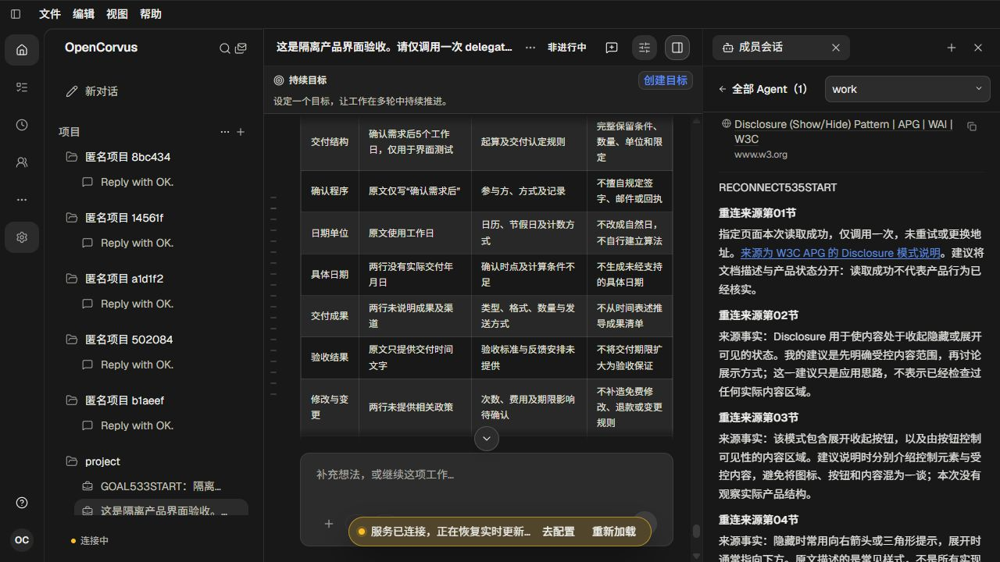

# 持续实时流重试：实页证据

[方案与调查](../../records/2026-10/2026-10-23-stream-retry-status.md) · [原观察与结算](evidence.json)

551仅一个开发agent。真实Source CLI /ui、完整既有成员历史；私有转发器只物理中断选中Session的events连接，健康检查继续实际返回200。全部图片均已实际呈现并人工查看，观察数据仅为辅助证据，未执行UI自动化测试。

| 实际阶段 | 图片 | 观察 |
| --- | --- | --- |
| 修改前在线 | [01](01-before-online.png) | 原35段正文/11来源，成员阅读位置64017 |
| 修改前持续重试 | [02](02-before-sustained-retry.png) | 14.083秒断流中经历4个重试实例；截图为Connecting但提示为空 |
| 修改前恢复 | [03](03-before-restored.png) | 原页恢复Online，原内容与位置保持 |
| 修改后在线 | [04](04-after-online.png) | 同完整历史，原35段正文/11来源 |
| 修改后英语重试 | [05](05-after-sustained-retry.png) | 黄色Connecting和实时更新恢复提示一致 |
| 修改后中文及Sources | [06](06-after-chinese-source-retry.png) | 实际设置切换中文、手工上滚两页，来源卡与重连说明可读 |
| 修改后恢复 | [07](07-after-restored.png) | 原事件流实际打开，状态在线，提示关闭，62577阅读位置保持 |

修改后中断49.066秒，16个实际重试实例、5次健康200。原状态观察持续reconnecting，语言变更更新文字，真实onOpen后connected；修改前每次重试发布idle再reconnecting，从而清除原宽限计时。不是通过延长UI计时或伪造健康状态解决。

两个页面分别保留各自原35正文/11来源绑定。没有提交新的业务消息、成员、Task、Mission或Goal；4次gpt-6.1-sol为当前OpenCorvus认证与完整catalog的实际流式preflight，均200/原reader EOF。原exec48894/96542正常退出0，公开shutdown200，native/launcher/输出/request闭合；两relay原exec69533/40831退出0，全部socket/pending/request=0，输出排空。两个转发器分别108/110次原样转发、11/10个物理上游socket，每次注册close listener总数3，原exec结算没有新告警输出。

8份复制auth/catalog成员已退休，App原始条目与目录字节/mtime保持。两scope各从已闭合549历史复制90表165802原行，原库所有字段/时间/字节/mtime和canonical保持；目标schema3/对象/integrity相同，原行仅两条运行容量租约变化。没有使用或升级真实用户数据库。

7项纯传输服务测试通过，覆盖Task、普通Session、Mission连续重试和显式停止；overlay类型检查、Node正式诊断构建59.15秒、345接口文档与20篇架构检查通过。上述检查不替代实图。独立Task/Mission页面的本批持续断流未复验，已有真实历史页与三种服务合同只能证明各自范围；不宣称所有Rendering问题已经解决。

