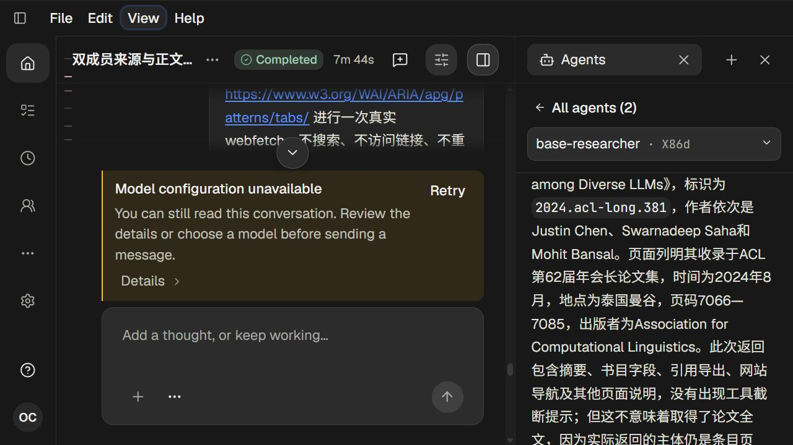
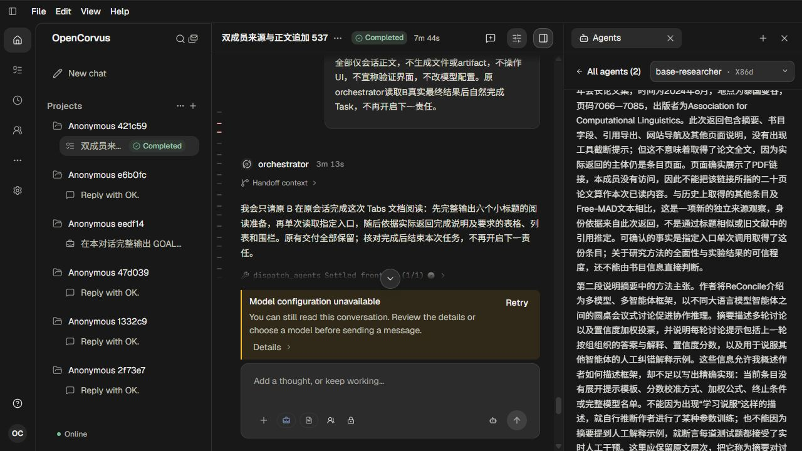
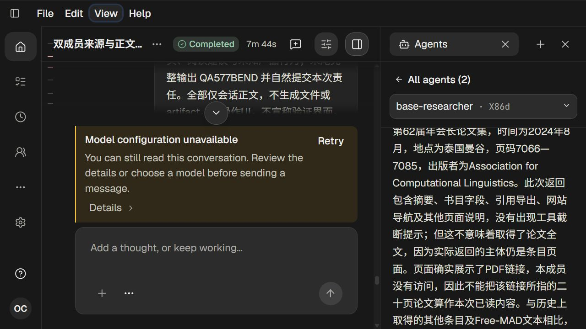
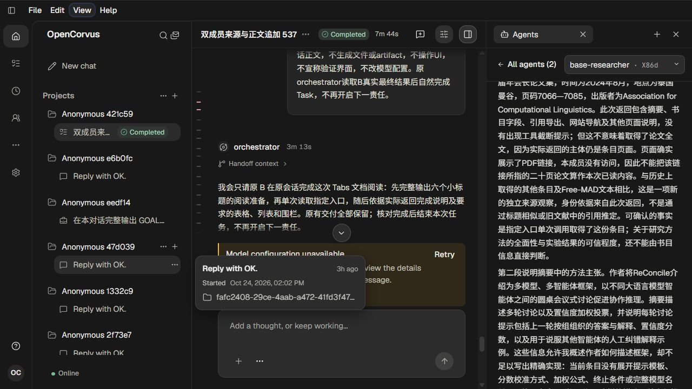
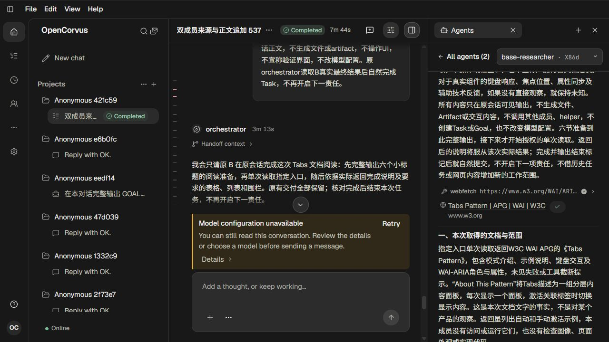
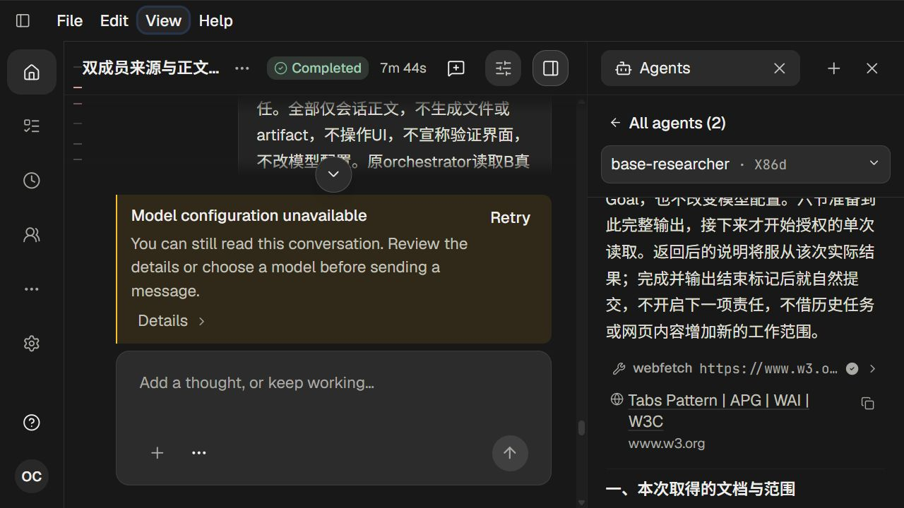

# 字体缩放后的正文阅读位置

579，单agent。见[调查与方案](../../records/2026-10/2026-10-24-font-scale-reading.md)及[原始观察证据](evidence.json)。

已修复Markdown正文仅按整段像素offset恢复造成的块内文字漂移，复用现有Range字符定位；共享滚动控制器同时处理视口宽度和高度变化。相同原文/动作下，旧实现首字208→106，修改后保留字符208，放大前后偏移-7.953125→-7.96875px。固定380px宽度，height576→569时字符208保持；Tabs来源身份及offset271.75→271.640625保持。

七张真实1280×720桌面截图均人工查看。没有UI自动化测试。Main/Side独立页、专用代码/媒体、极短视口、778px实窗与原高频Rendering根因尚未覆盖；不把本次读位修复泛化为这些场景。

两个完整数据隔离原生scope均shutdown200/exec/native/launcher0、物理/输出/请求闭合，提前关闭882027ms与857464ms；零Provider、无auth，两份catalog已清退，页252/253关闭。关闭后源90表207330行、所有原字段/时间/字节/mtime/配置保持，原B33消息107 Parts9来源、原附件HTTP200/643字节。源6→隔离目标7来自另一会话当前版本化迁移，构建未升级源或用户库。

## 01 · 修改前原段落中部，第208字符

## 02 · 修改前放大后回退至第106字符

## 03 · 修改后同一原文与相同滚轮基线

## 04 · 修改后放大仍保留第208字符

## 05 · 固定380px宽度的小字号/高度变化

## 06 · 真实聚焦并复制Tabs来源

## 07 · 放大后保持该来源与读位

