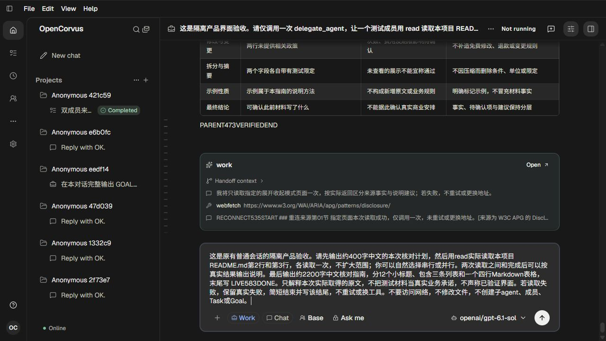
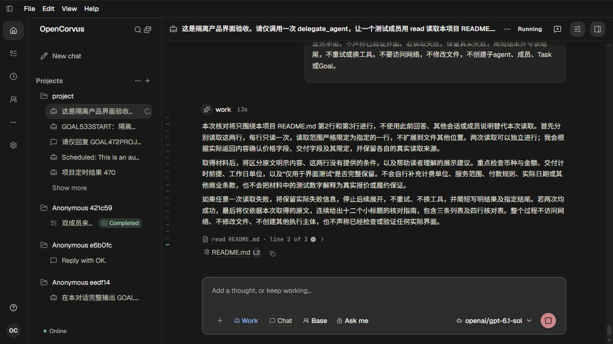
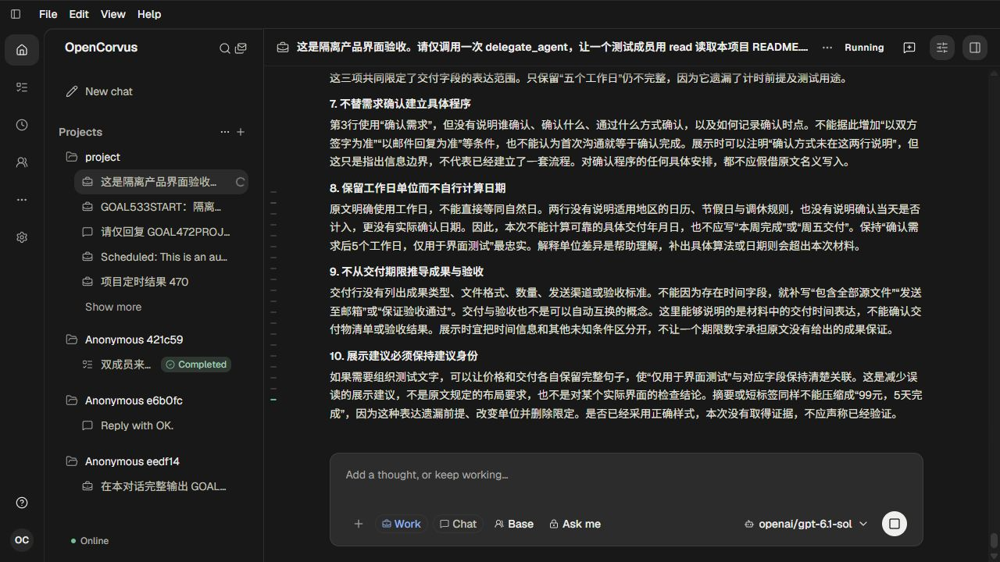
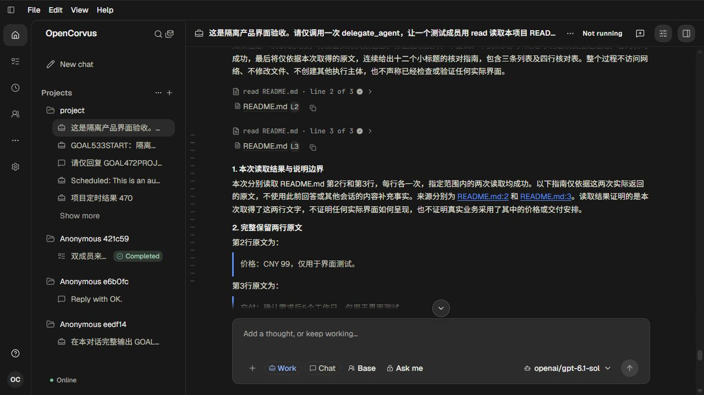
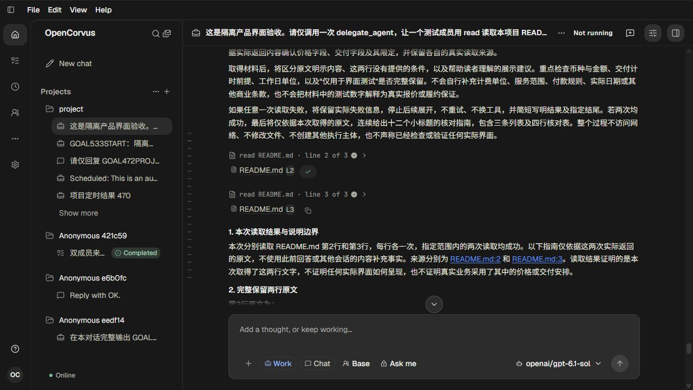
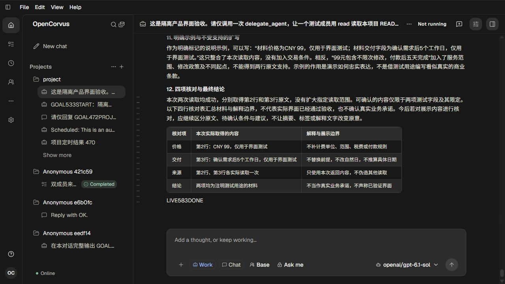

# 流式正文事件与分组身份

583，单agent。见[调查与方案](../../records/2026-10/2026-10-24-live-text-event-order.md)和[证据](evidence.json)。本批没有修改产品代码。

原durable库存没有逐字流或pending草稿移除，不能冒充完整历史。新native54073/页259自然执行README第2、3行各一次read，产生真实L2/L3 Source；助手437字预告和2545字最终指南、12节/列表/四行表格及LIVE583DONE均实际显示。4次gpt-6.1-sol流式200、原reader全部EOF，六截图人工查看。

GlobalBus实际2167事件：2008 delta、157 updated、2 removed。已观测全文保持前缀；草稿退休到running分别6ms/8ms，退休时同Message后方没有已可见文本，未形成待查合并/再拆分条件。新助手owner26与42保持。另捕获旧7104字Part40次退休和新user279字42次，集中于Main虚拟窗口边界；原侧栏闪烁仍未复现，具体范围/尺寸回授尚待捕获，不从数量推定根因。

图03的Source点击尝试没有取得Copied反馈，不能作为复制或follow-lock失败的证明；图04原生上滚进入阅读、图05真实Copied与剪贴板原完整路径:2才构成复制资格。

public shutdown200提前582118ms，原exec6905/native/launcher0、物理/输出/请求/出生链全部闭合，页259关闭，配对auth/models清退。原90表207330行字段/时间/config/源bytesmtime保持；目标memory两行/两容量槽/当前Session时间的自然更新另记。原高频Rendering、长摘录、778实窗未验收。

## 原普通会话的真实有限输入

## 仍在运行的助手说明与实际L2来源

## 流中末尾观察：来源点击尝试未取得复制反馈

## 实际滚轮返回后可读的L2与L3来源

## 完成后的真实复制反馈与L2身份

## 自然完成的指南、四行表格和结尾

