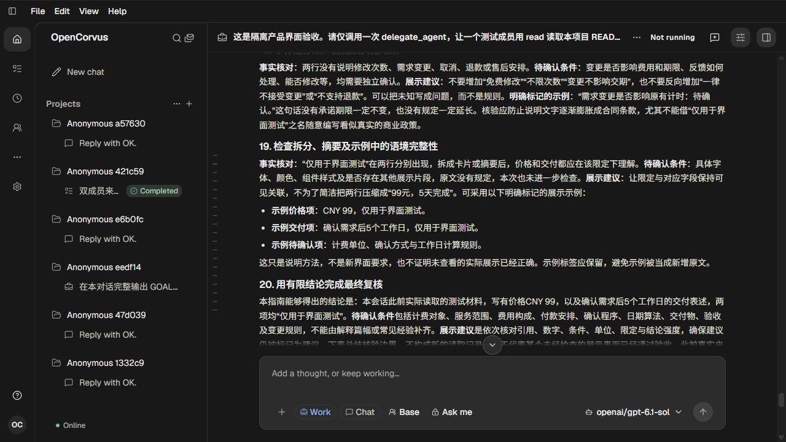
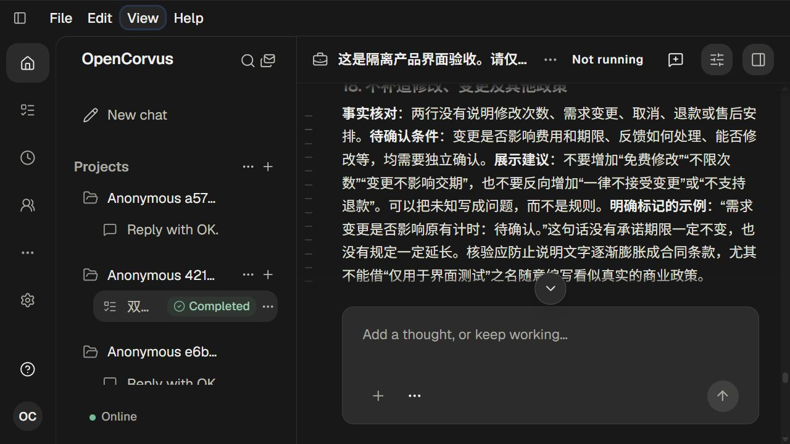
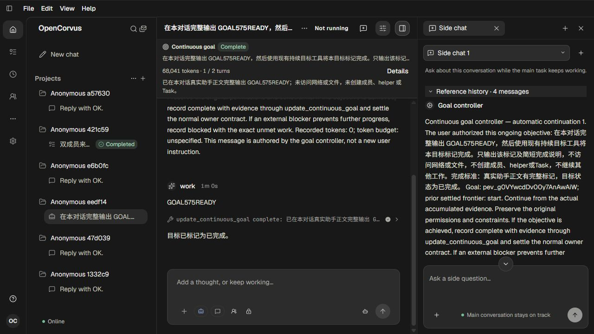
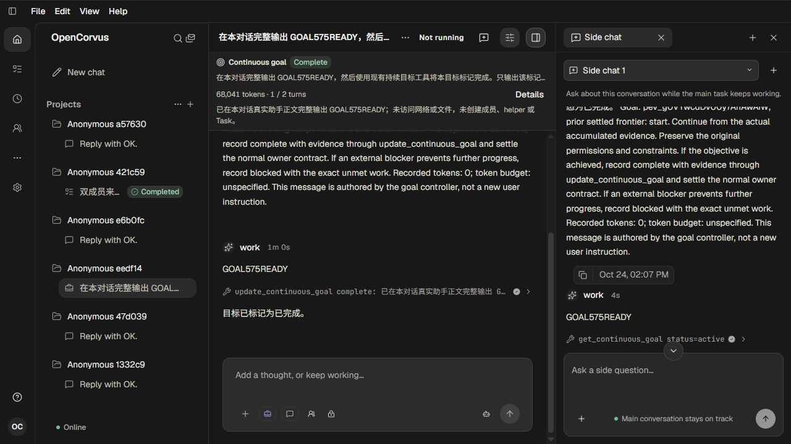
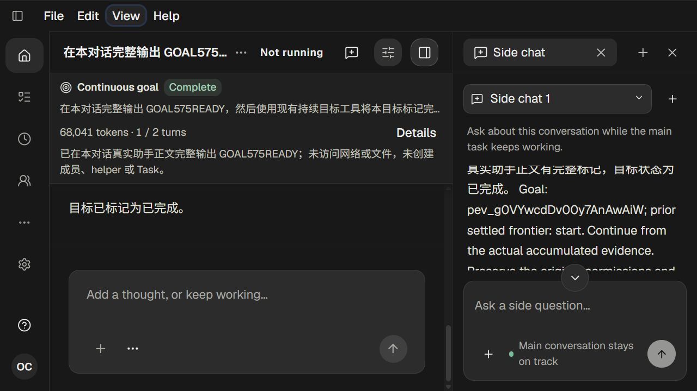
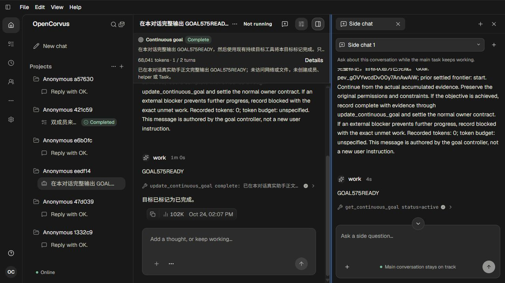
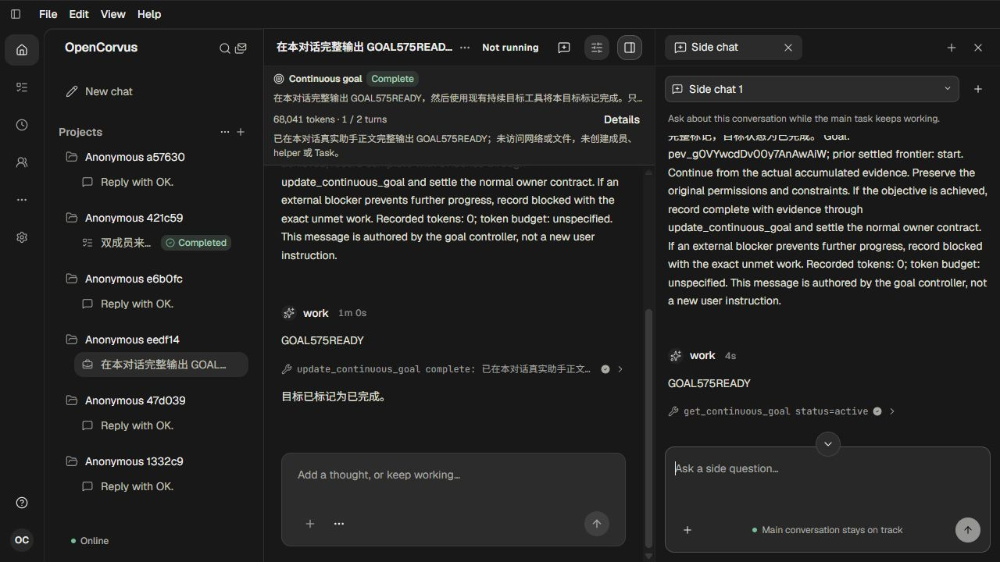

# 主对话与侧聊的共享阅读恢复

581，单agent。见[调查与方案](../../records/2026-10/2026-10-24-main-side-reading.md)及[证据](evidence.json)。本批没有新增产品补丁，补齐579/580共享实现的独立Main/Side实际页面复核。

Main为真实7104字assistant消息，100%→160%同一block45字符0偏移-13.703125→-14.1875px。Side为原有4条继承消息，最长723字属于真实Goal controller输入，不能称作模型回答；字符211在100%→160%→100%后返回原top230，宽度变化及关闭重开后仍保持同字符/top206。7张1280×720截图均人工查看，未运行UI自动化。

OpenAI授权预检：实际chat及memory共2次gpt-6.1-sol流式200，原reader均自然EOF，产品保存助手OK。公开shutdown200提前658461ms，原exec34330/native/launcher0、physical/output/request及出生链闭合，页256/257关闭，配对auth与完整models已清退；源认证元数据及目录内容保持。完整源90表207330原行/字段/时间/字节mtime/config保持；目标仅两条原容量槽字段因真实预检更新，schema6→7为隔离运行期迁移。

原高频Rendering、Side长助手正文/Sources、超高Excerpt、文件/文档来源和778实窗仍未独立验收。

## 主对话原阅读段落

## 主对话放大160%后同一段落

## 已有侧聊的真实参考历史

## 侧聊滚动后的字符位置

## 侧聊放大160%后同一字符

## 改变侧聊宽度后保持字符

## 关闭再打开侧聊恢复原位

