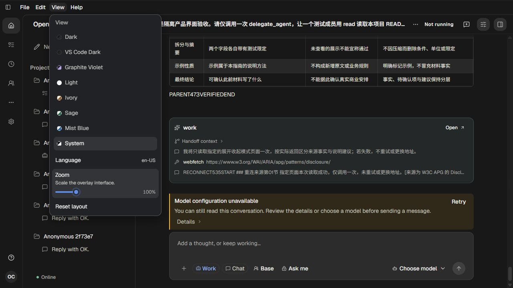
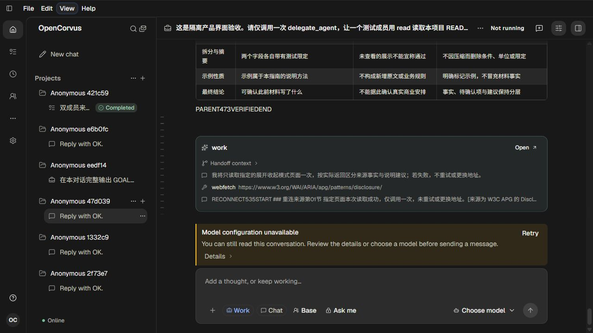
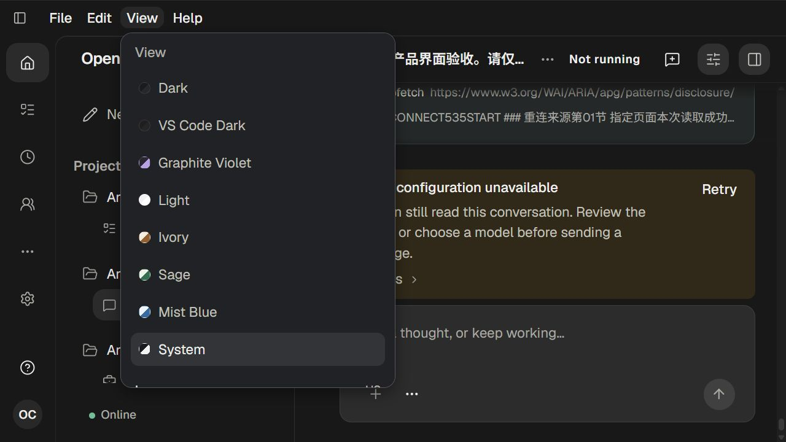
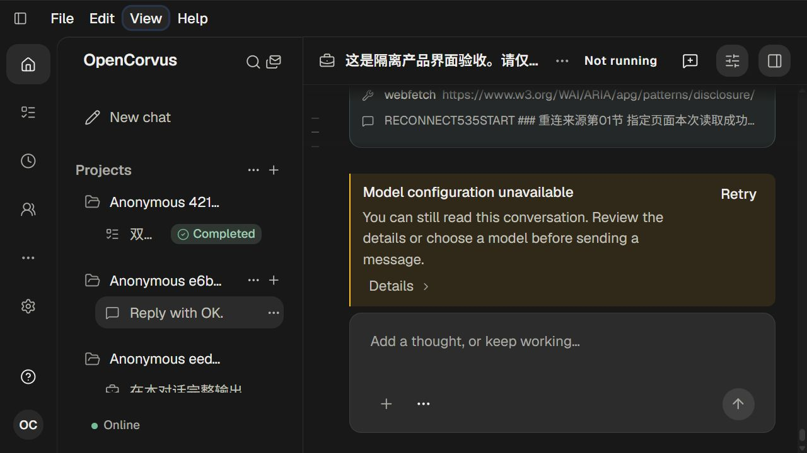
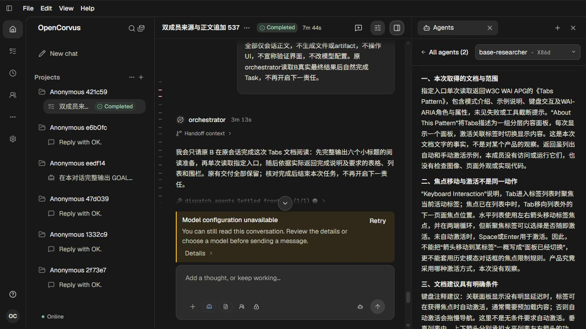
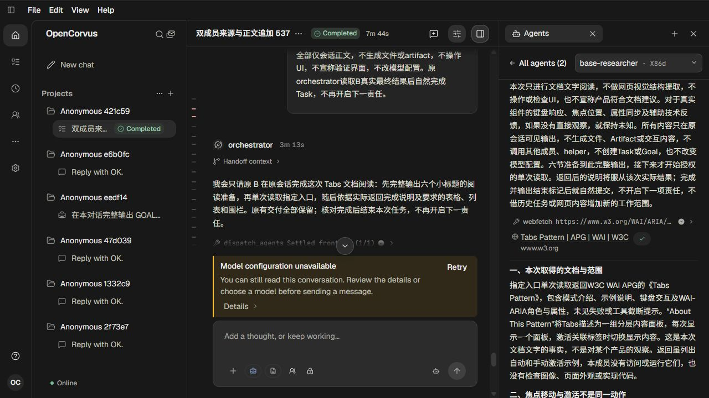
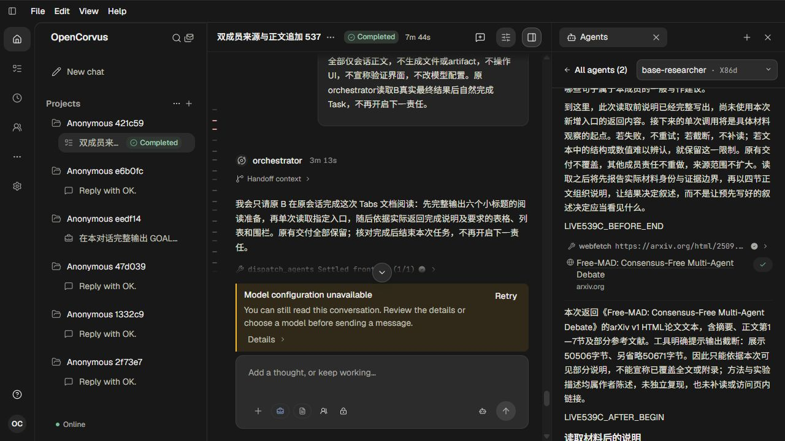

# 成员正文与来源的时序归属

585单agent；见[方案/已知边界](../../records/2026-10/2026-10-24-member-source-order.md)与[证据元数据](evidence.json)。

60条Source规范存储时序未发现较早来源晚于后续正文插入的样本；不能由此证明浏览器事件从未乱序。实际原B33消息/107Parts/9来源，经真实HTTP200、production parser与完整原SQLite核对Source身份和completed Tool绑定。没有据候选替换Index，也没有给规范可用的菜单Escape加旁路处理。

0 Provider调用、未复制auth；隔离native54076/页262已完整闭合，源原行/字段/时间、bytes/mtime与canonical保持，目标8/integrity ok，模型目录副本清退。截图里的模型配置不可用提示来自刻意不复制凭据的隔离范围，不代表用户热认证失效。原侧栏高频Rendering仍未复现，本批只排除错误补丁方向。

## 01-slider-focused.png

100%：原View菜单与真实聚焦Zoom控件。

## 02-slider-escape.png

100%：控件Escape实际关闭菜单并归还View焦点。

## 03-zoom160-menu.png

160%：设置后的原菜单，页面重排后当前焦点为menu。

## 04-zoom160-closed.png

160%：聚焦slider再发Escape实际关闭菜单并归还焦点。

## 05-member-history.png

原B/X86d成员历史正文；实际上滚阅读。

## 06-member-tabs-source.png

Tabs来源真实Copied图标；本次过早clipboard读尚保留旧值，单凭本图不证明剪贴板完成。

## 07-member-paper-source.png

原Free-MAD网页来源，完整标题/域名/复制反馈和对应正文。

## 08-member-tabs-confirmed.png

重新明确观察Copied后，实际剪贴板为完整Tabs原网址。

