# 成员流式正文的瞬时呈现调查

577，单 agent。见[调查记录](../../records/2026-10/2026-10-24-member-stream-rendering.md)和[结构化证据](evidence.json)。

真实原生开发服务 `/ui`、原 Task/原 B、实际 gpt-6.1-sol 流式请求。任务完成，读取前正文1517字、读取后1775字，两段各六标题，最终含五行数据表、三项列表及文本围栏；实际 assistant 正文与持久化文本一致。新增一个真实 Tabs Source，原成员来源8→9。14次 HTTP 200 流的原始读取器全部自然 EOF，记忆最终 idle/revision27/coverage33，原29项覆盖顺序保留。

**本批未完全达标：**公开关闭预留276754ms，要求300000ms，差23246ms。原检查器失败保持，全部原始流与原生进程闭合后单独安全清退凭据和模型目录；未降低标准或以取消冒充 EOF。

未复现原高频 Rendering。手动观察原20正文、8来源的实例归属保持；被动属性记录不能替代逐帧证据。778×884桌面内置浏览器中，双侧栏把主正文挤到约155px；这是后续独立修复线索。本批没有产品代码修改。

原源库90表203799行及所有原字段、时间、结构、字节与mtime保持；隔离目标新增真实运行记录，7条原行按授权更新记忆、容量槽或 Session 时间。用户18571服务与数据库未操作。

## 01 · 原始 Sources 与双侧栏挤压正文

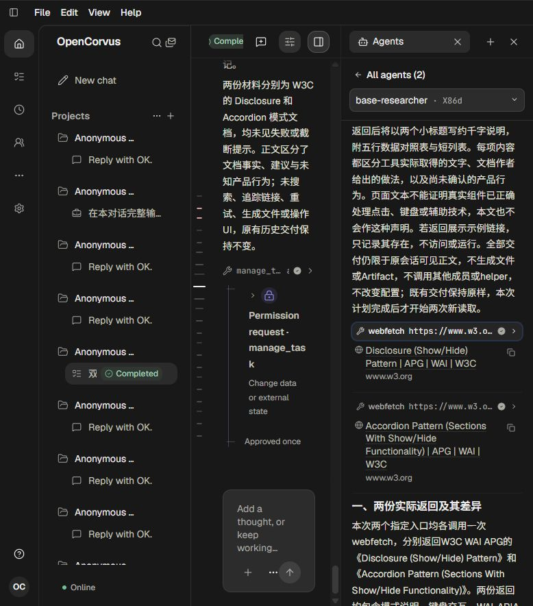

## 02 · 原 Task 提交有限责任

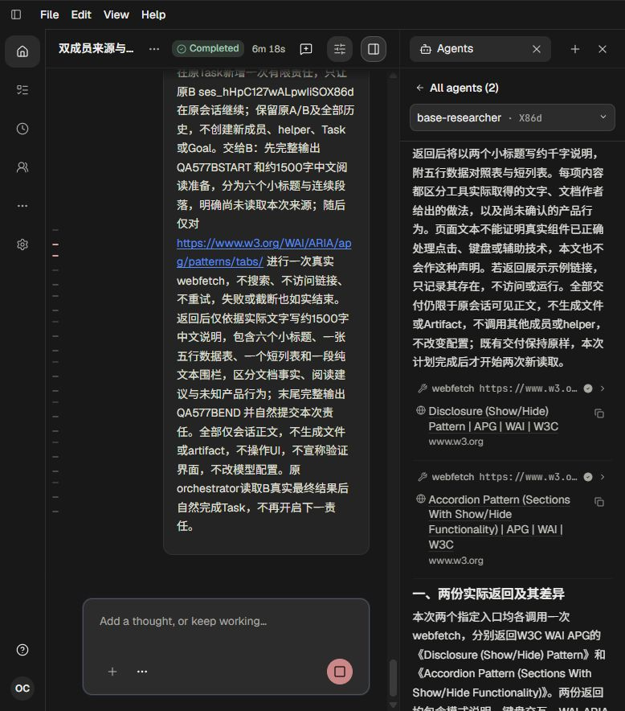

## 03 · 原 B 继续责任的真实权限请求

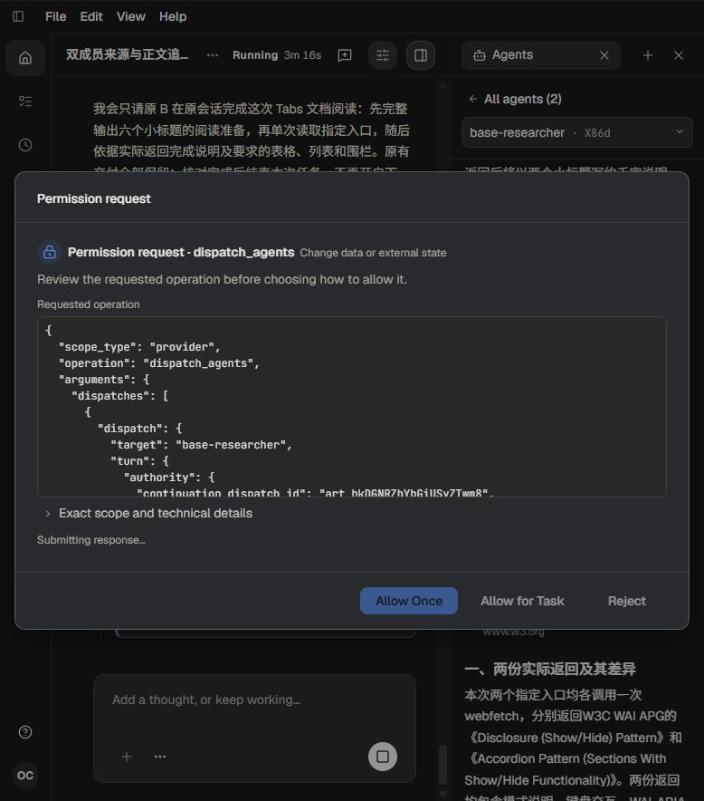

## 04 · 单次 Tabs webfetch 权限请求

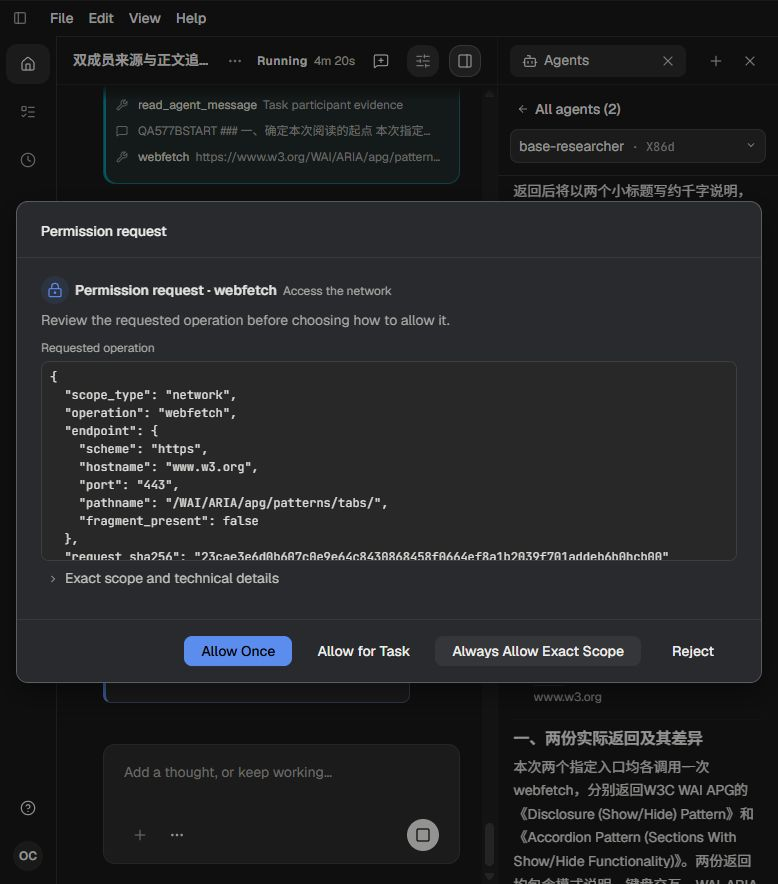

## 05 · 该权限请求的输入详情

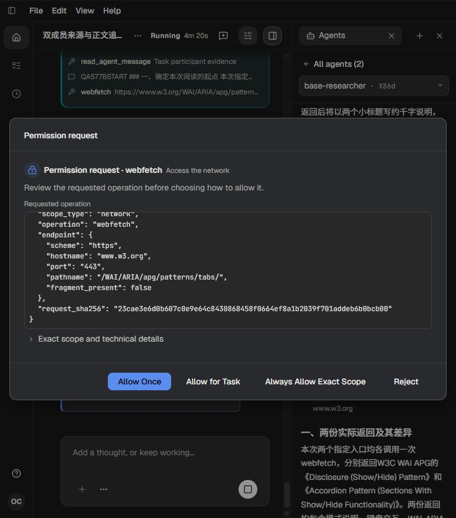

## 06 · 新增 Tabs 来源及随后正文

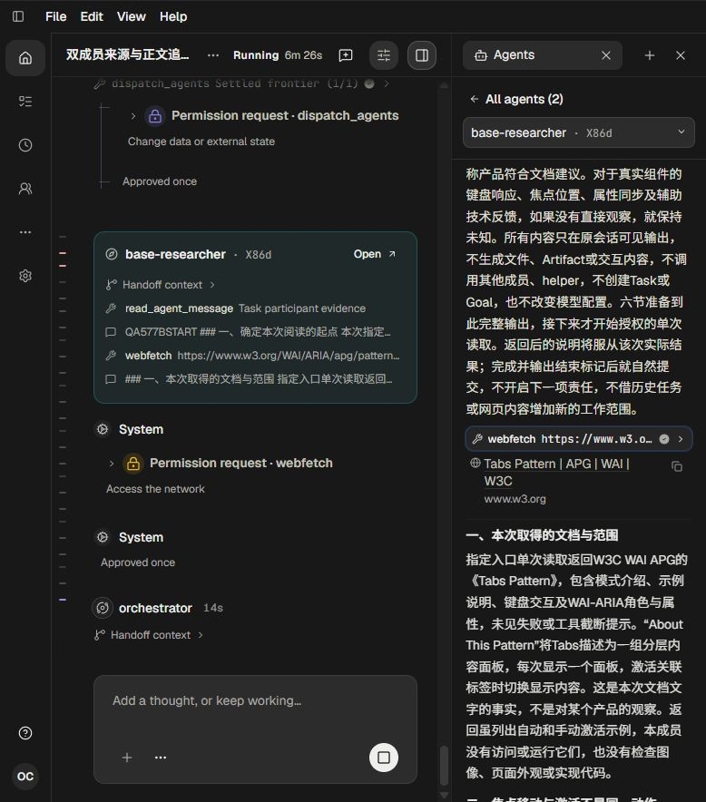

## 07 · 任务自然完成与最终正文末尾

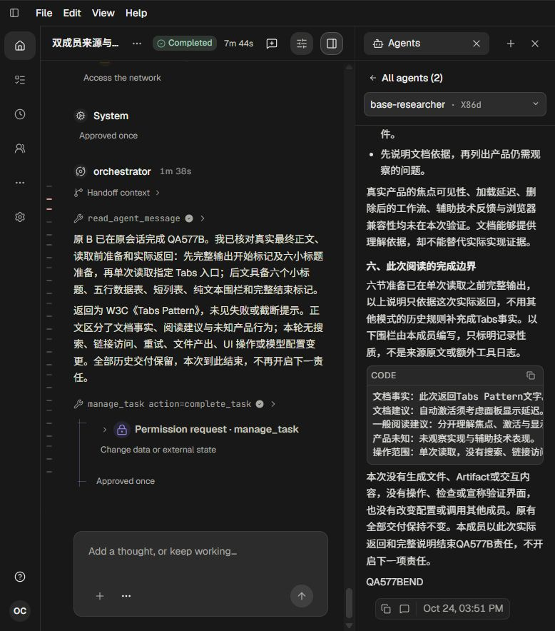

## 08 · 旧正文与本轮正文边界

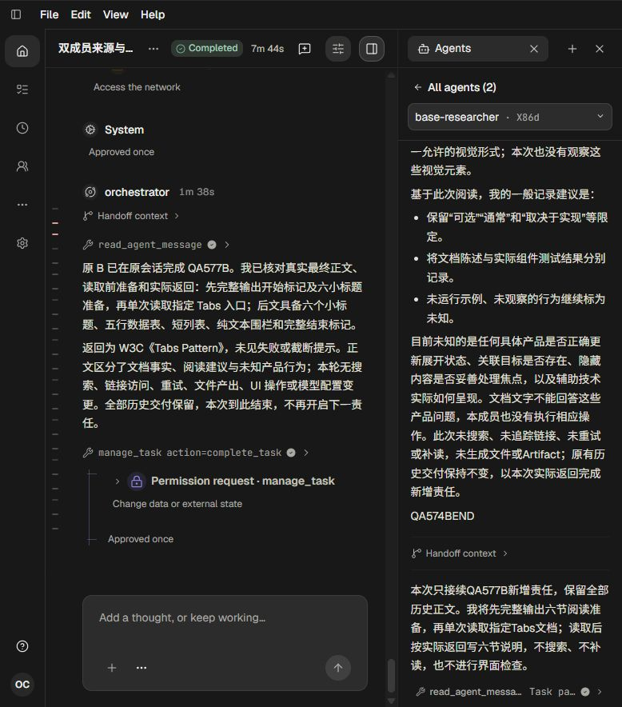

## 09 · 实际读取前准备正文

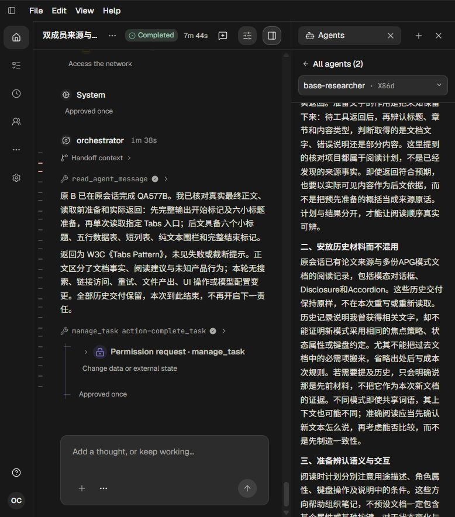

## 10 · 实际最终正文结构

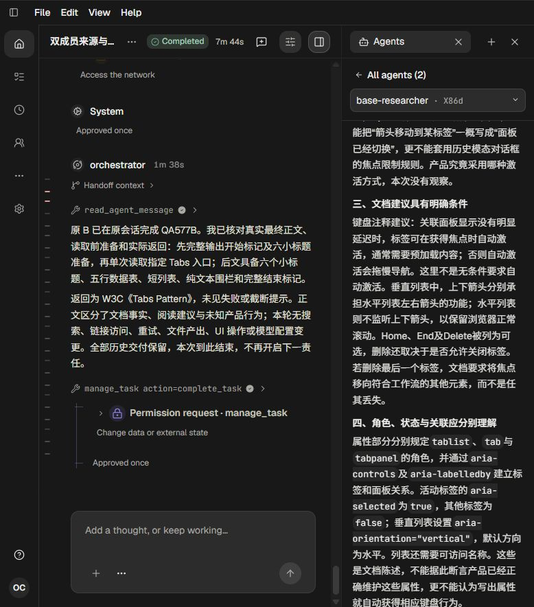

## 11 · 实际五行数据表与短列表

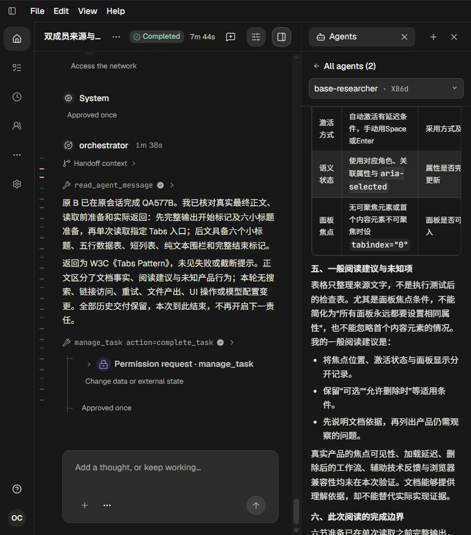
