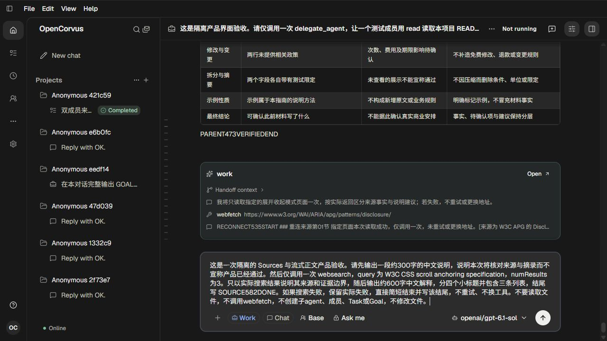
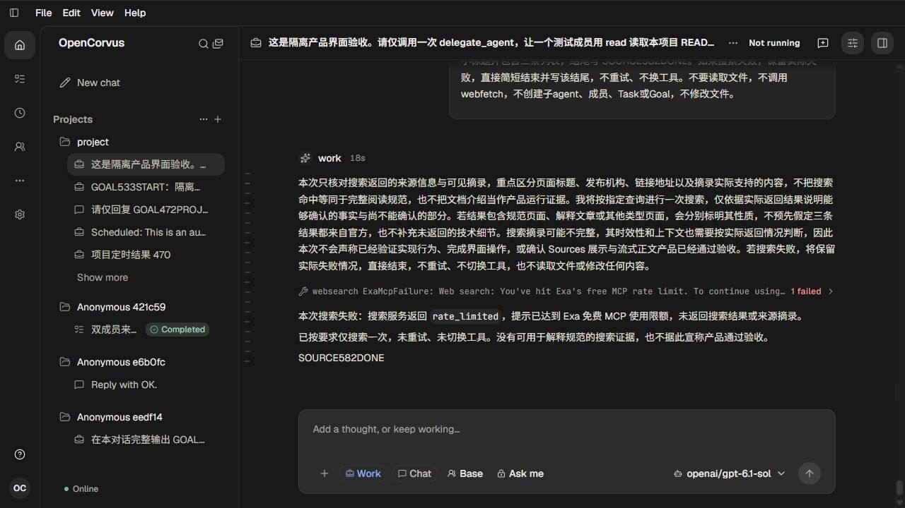
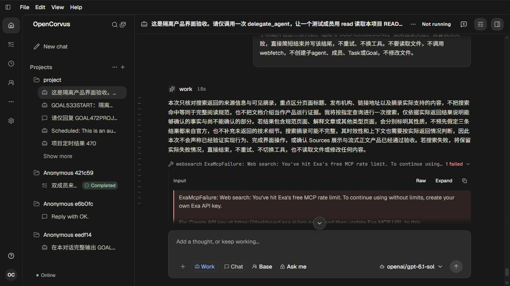

# 来源摘录内部阅读位置

582，单agent。见[方案与结果](../../records/2026-10/2026-10-24-source-excerpt-reading.md)和[证据](evidence.json)。本批没有修改产品代码。

原完整数据库29网页来源全部无snippet，31文件来源仅3短片段（最长27字符）。通过隔离页面对已有Main Work Session发送一次有限请求，产品自然调用一次websearch/3结果；Exa真实返回rate_limited及ai.exa/rateLimited=true，没有产生来源或摘录。助手保留失败、未重试或换服务，311字说明+129字失败回复自然完成；不能宣称长摘录验收通过。

实际3次gpt-6.1-sol流式200，memory/两次work，所有原始reader自然EOF。公开shutdown200提前1001207ms、原exec58695/native/launcher0、physical/output/request/出生链全部闭合，页258关闭，配对auth与完整models清退。源90表207330行所有原字段/时间/字节mtime/config保持；目标原memory_chunk、memory_file、两容量槽与该Session时间随真实请求更新，差异在证据中。3图均实际显示人工查看；无UI自动化。

长摘录与原高频Rendering仍未通过；当前外部来源条件不支持该验收，不以替代工具或虚构Source补齐。继续其他独立问题调查。

## 真实有限搜索请求的提交前截图

## 实际搜索限额失败及自然完成的助手回复

## 展开工具后原始失败详情

