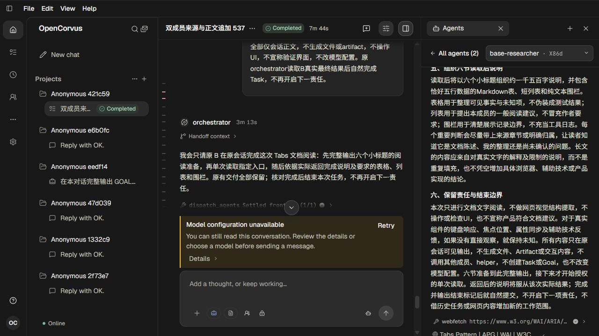
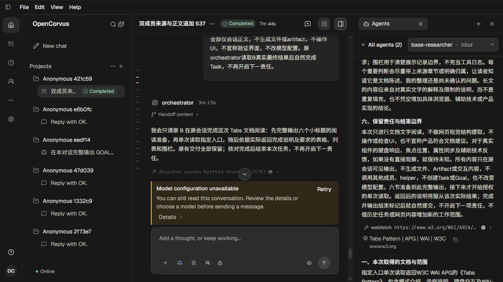
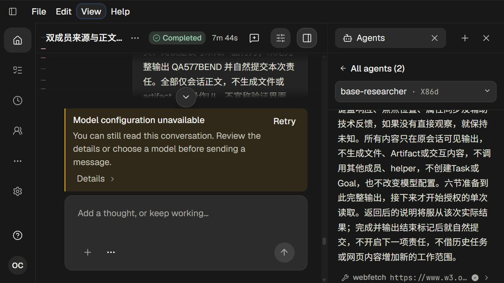
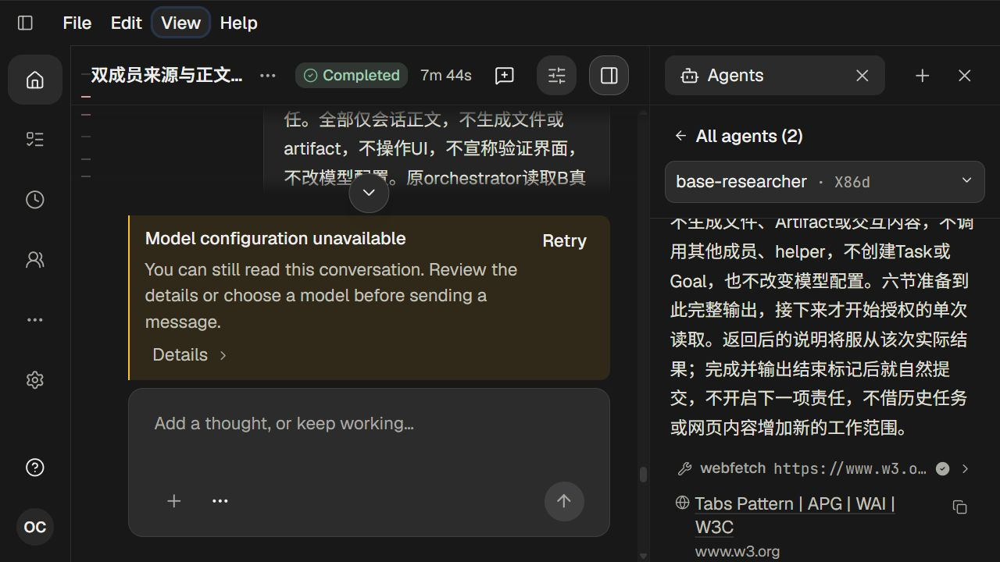
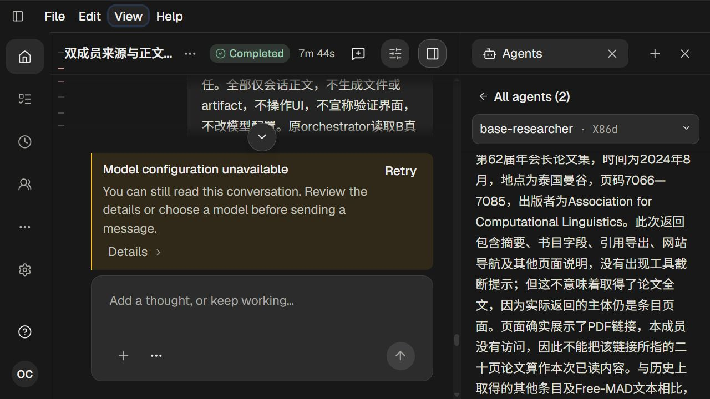

# 来源在视口边缘的尺寸恢复

580，单agent。见[调查与方案](../../records/2026-10/2026-10-24-source-viewport-edge.md)和[原始观察证据](evidence.json)。

已修复窗口变矮或来源重新换行后，旧像素offset把已选Source恢复到屏外的问题。原Tabs来源在380×576内offset455.671875时完整可见，放大到160%后旧实现将其top恢复到735.984375，超过viewport bottom720；修改后同条件top629.984375/bottom719.5625，标题、网址与复制控件留在视口内，锚点保持Source。

可行偏移349.671875→349.640625保持，正文字符208在-7.953125→-7.96875px保持。七张真实1280×720截图均实际查看，没有UI自动化。Main/Side独立页、超高Excerpt、文件/文档卡、极短视口、778px实窗和原高频Rendering尚未独立验收。

两原生scope均shutdown200、原exec/native/launcher0、physical/output/request/出生链闭合，关闭余量938043ms/796549ms，零Provider、无auth，两份catalog已清退，页254/255关闭。关闭后原90表207330行及原字段时间/源字节mtime/配置保持，原B33消息107 Parts9来源、PNG HTTP200/643字节。当前隔离6→7是另一会话迁移的正常运行，不属于UI build或本批数据库改动。

## 01 · 初次上滚后仅部分可见的来源

## 02 · 调整后原来源在旧视口内完整可见

## 03 · 修改前放大后来源标题在屏外

## 04 · 修改后同一来源与同一边缘基线

## 05 · 修改后来源标题/网址/复制控件完整可见

## 06 · 可行偏移继续保持原位

## 07 · 正文字符锚点回归

