# 工作区双侧栏的阅读空间分配

578，单agent。见[方案与完整结论](../../records/2026-10/2026-10-24-workspace-pane-allocation.md)及[结构化证据](evidence.json)。

已修复共享面板预算与缩放更新时序。实际1280×720桌面页面在100%→160%时自动让出项目列表，明确显示列表可关闭Dock，160%→80%→100%恢复保存偏好；左右键盘极值保留主区500px。中文默认页、+中的持续目标与表单均实际查看，未创建新业务。

源90表207330行、全部原字段/时间/字节/mtime/配置保持，原成员33消息107 Parts9来源与实际正文一致，附件HTTP200/643字节。零模型、未复制auth。三原生scope均已闭合：首轮成功；中间scope因另一会话未完成DDL/迁移而失败；最终当前迁移检查一致后在隔离副本运行6→7并成功。迁移7属于另一会话，未混入本次产品提交；UI build仅构建，源与用户库未升级。

**限制：**未获得778像素的修改后视口；未覆盖原高频Rendering根因、逐帧稳定、字体缩放后的精确阅读锚点和独立Mission/Side/native host。End后菜单切换仍需追查是否由布局后hover引起，未未经分析补事件拦截。图03失败保留；图05为菜单关闭过渡，图10为干净的最终Source实图。

## 01 · 首轮100%宽桌面三栏

## 02 · 可见页面仍为1280×720

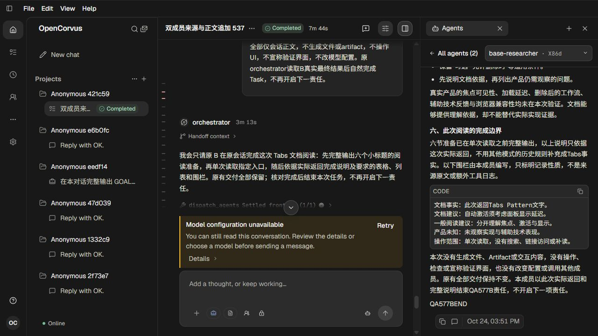

## 03 · 首轮160%未及时释放左栏的失败画面

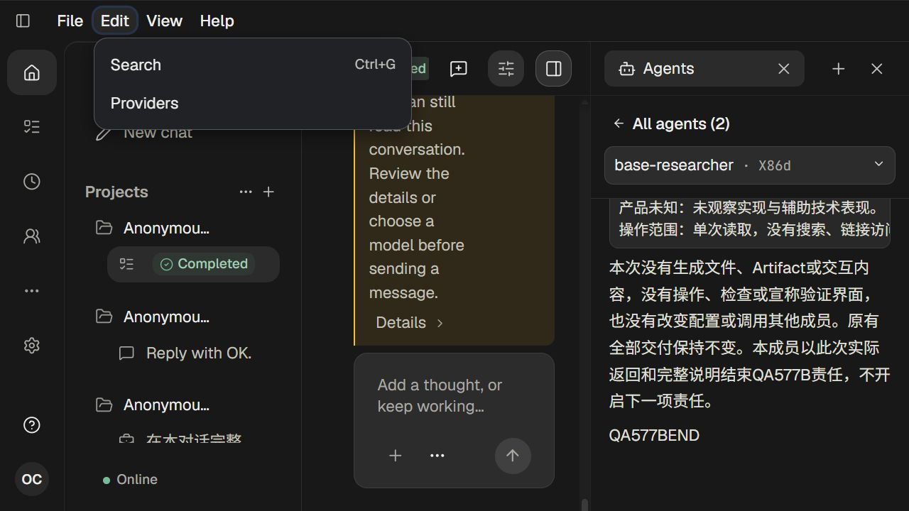

## 04 · 首轮重新打开Dock后生效

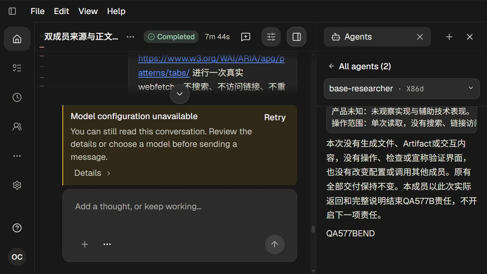

## 05 · 最终160%自动释放左栏（菜单关闭过渡帧）

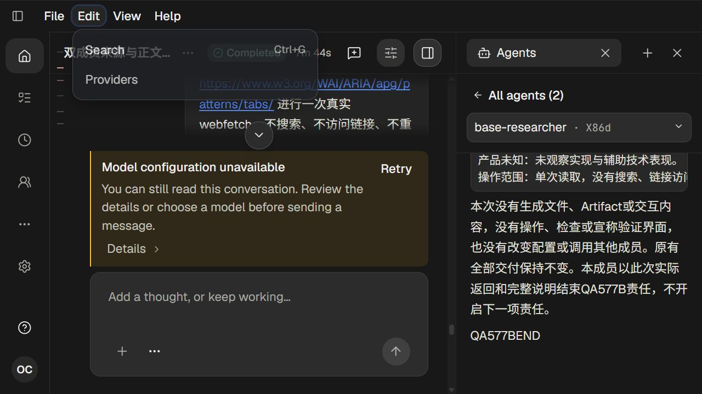

## 06 · 明确显示项目列表并关闭Dock

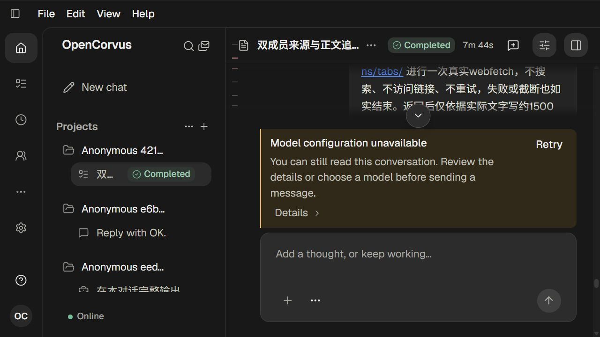

## 07 · 重新打开原成员后的实际表格

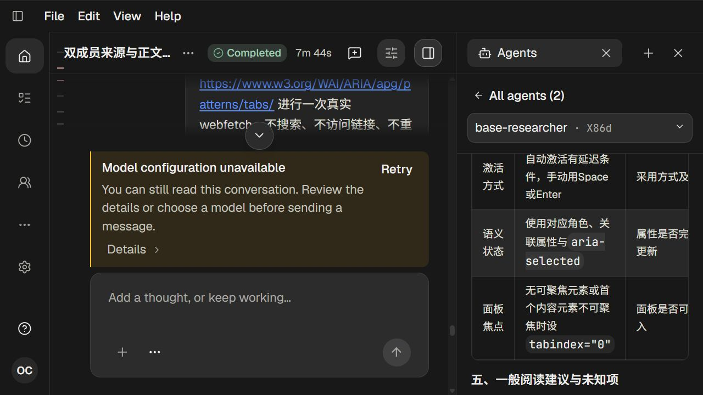

## 08 · 最终正文首节

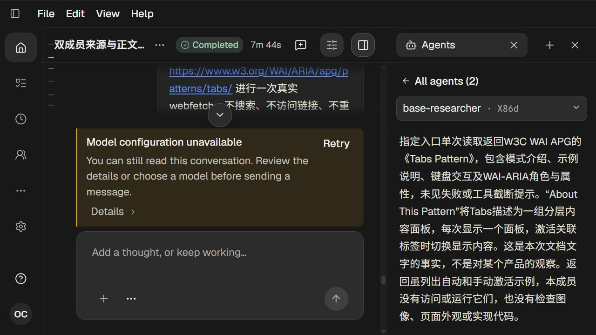

## 09 · 读取前准备末段

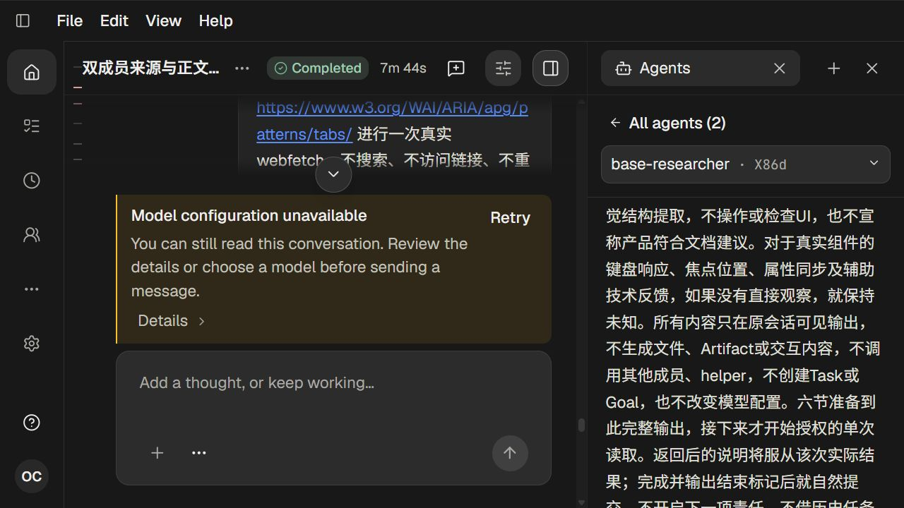

## 10 · 实际Tabs Source与正文边界

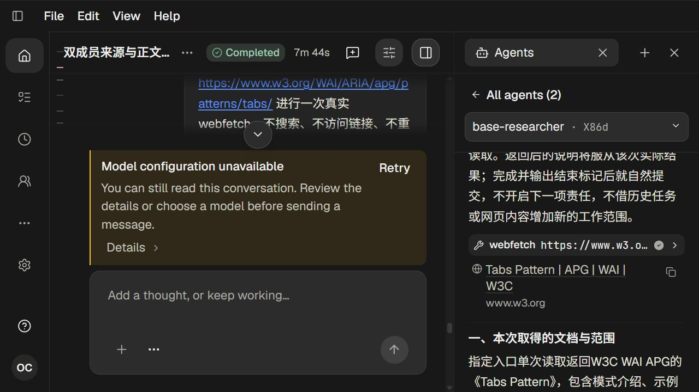

## 11 · 缩放回100%后恢复三栏

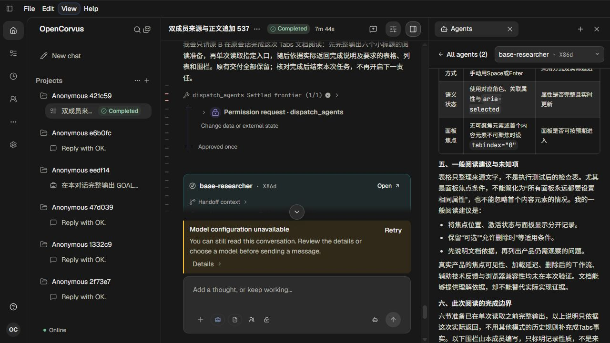

## 12 · 左栏键盘最大宽度

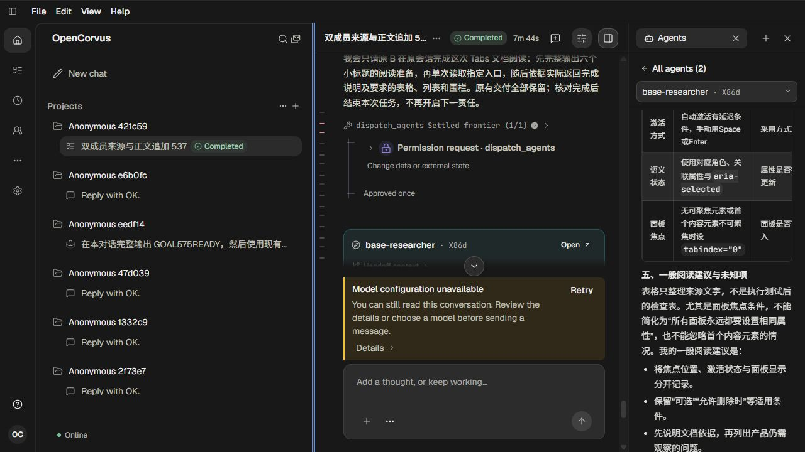

## 13 · 右栏键盘最大宽度（动画中的范围值）

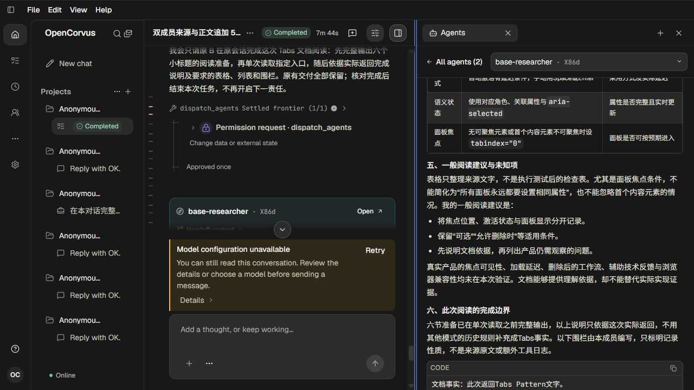

## 14 · 中文布局与实际成员正文

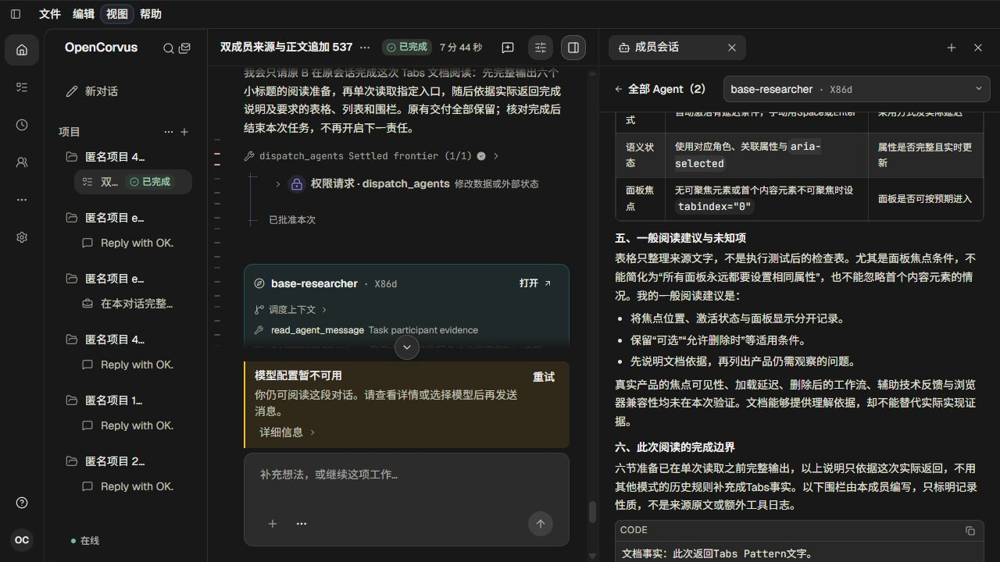

## 15 · 中文默认页

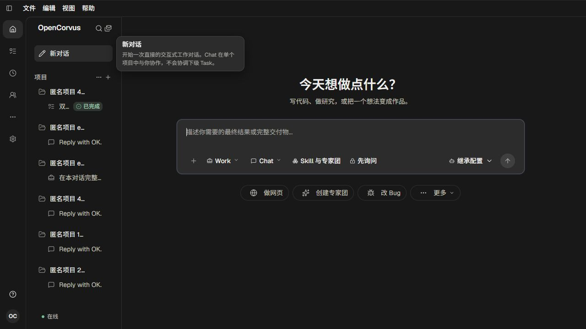

## 16 · 默认页加号中的持续目标入口

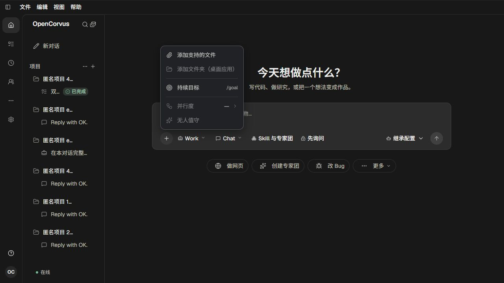

## 17 · 加号打开的持续目标表单

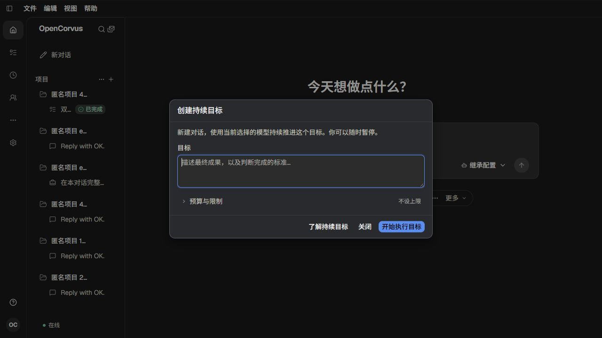
