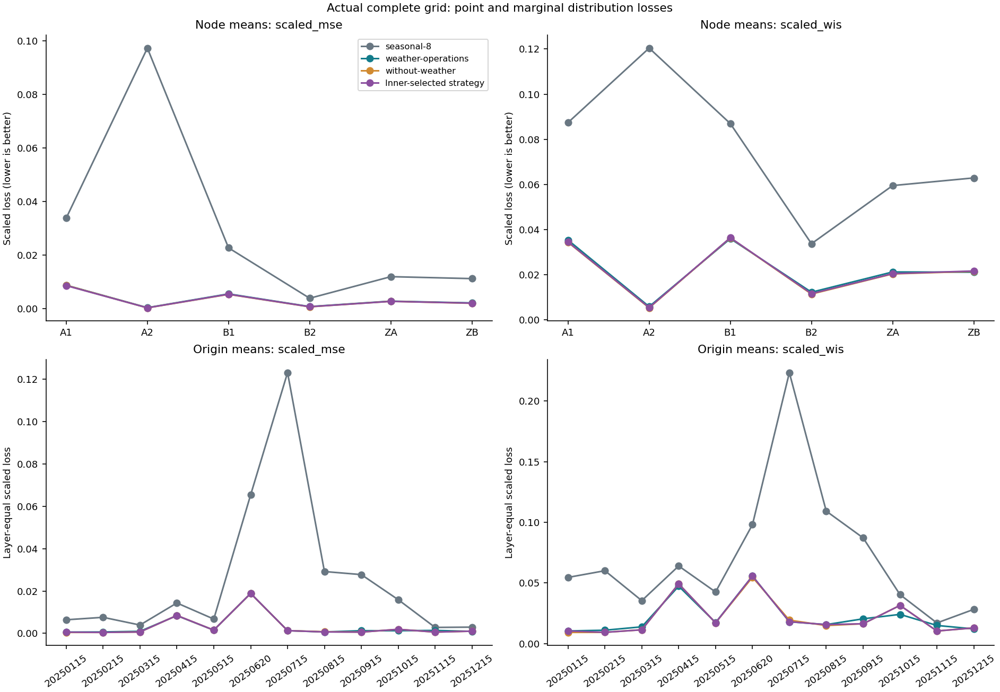
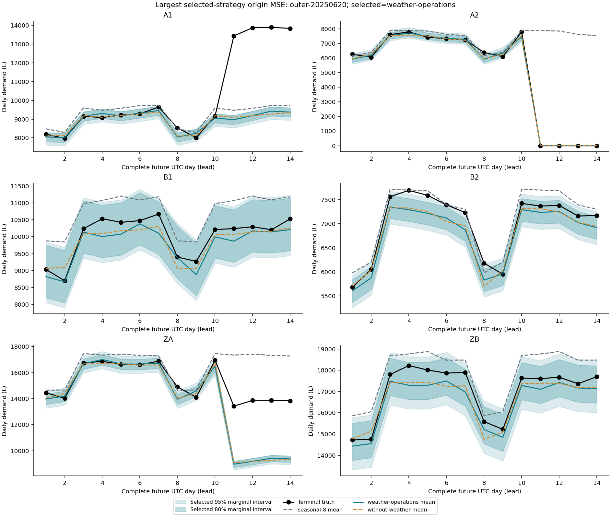
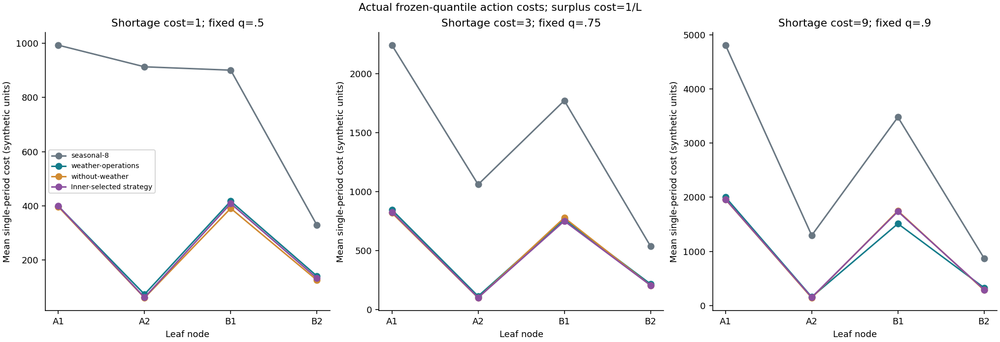

# Release-aware hierarchical daily demand research

Post-seal formal research results supplied by the evaluator; ordinary losses are reconstructed here. Completion and quality remain subject to independent checking.

This report uses 12 delivered origins, 3 frozen methods and 6 nodes ×14 full future UTC days per origin. The exact origin order is in report.json. Supplied complete_assignment=True; this is reported as an input fact, not a candidate quality certification. candidate_score remains null. Private external reference predictions and quality-floor decisions are not available to this program.

## Question, data and method

We test whether legal weather/calendar/announced states improve a recent-weekday baseline, with a full weather-removal ablation. Original synthetic data are described by the public PROVENANCE/MATERIALS and machine contracts; they do not identify a real water operator. [The complete pre-frozen specification](methods.md) gives exact equations, constants, priors, feature availability, calibration and search scope. Pool/configurations are also in the input results. We did not infer volumes from a hidden generator or private reference.

Exact decimal raw amounts are converted to integer L row by row. Every actual/pseudo-origin projects releases independently and takes highest revision INCLUDING missing before fitting. observations and observed covariates also require a completed historical interval. Missing observations are omitted as missing; calendar/operating unknowns and weather extrapolation are labeled estimates, never old-version facts. Source-index.csv points to actual diagnostics and execution-provenance.json identifies the original cells. Each diagnostics source_registry maps packet CSV line, full identity, revision, release, original units and canonical value; samples, feature refs, legal climatology refs and calibration-label refs identify actual usage. A registry row alone is not a training claim.

The extension is ridge weighted regression with calendar/weather/state features and a recent residual level adjustment. The ablation removes weather from training, target features and all pseudo-origin fits; it retains calendar and operating assumptions. All empirical distributions use paired leaf residual vectors from freshly refitted56/84/112-day pseudo-origins. Calibration features use the pseudo cutoff, but residual labels use the current origin's highest published revision. These are distinct sources, not retrospective pseudo training labels. Regression residuals are centered; the empirical nonnegative-sample expectation is the mean, consistent with squared loss. Bottom-up sample aggregation gives coherent means and separate marginal quantiles.

A2 closed exposure uses an explicit structural shutdown prior, with a learned closed-level coefficient after valid observations arrive. Transfer-in begins with coefficient0 unless data identify it. Actual operating support counts across point fits: `{"{'transfer_values': [0], 'open_values': [1]}": 264, "{'transfer_values': [0, 1], 'open_values': [0, 1]}": 120}`. Announcements reveal status, not causal volume or a previously unobserved effect size. A never-observed closure can give an overconfident zero prior; transfer magnitude is initially unknown. These are material failure boundaries, not measurements established by metadata.

Future temperatures use issued forecasts only, with a lead-specific forecast-minus-actual bias learned from legal historical issue snapshots and fit-origin actual labels (14-day zero-bias shrinkage prior). Bias-pair issue cutoffs and both source refs are retained in diagnostics. The last complete future day has no current issue in this material schedule; legal seasonal climatology plus the mean anomaly of the preceding three available target forecasts supplies an estimate. Later issues/actuals are not read for future features. Revision and unit changes are handled by the same exact parser rather than period-wide coefficients.

## Actual results and adverse evidence

| Method | scaled MSE | scaled MAE | scaled WIS |
|---|---:|---:|---:|
| seasonal-8 | 0.02551078 | 0.1016434 | 0.07161609 |
| weather-operations | 0.00316408 | 0.03088089 | 0.02166156 |
| without-weather | 0.003066812 | 0.02912623 | 0.02128652 |
| Inner-selected strategy | 0.003072004 | 0.02936334 | 0.02142329 |

These are full-grid macro means: dates/origins equally weighted, with leaf and aggregate layers each1/2. MSE and mean absolute error (MAE) are scaled by positive fixed2023 terminal means; WIS is marginal. Exact values and formulas close through aggregate-exact.json, summary.csv and node-origin-metrics.csv. Report recomputes metrics from original means/quantiles/truth and compares exact supplied metrics before publishing.

Extension minus baseline macro MSE=-0.0223467, WIS=-0.04995453. Weather ablation minus extension MSE=-9.726844e-05, WIS=-0.0003750384. These are paired descriptive contrasts, not causal weather estimates or statistically independent replications. All per-node/per-origin paired differences are in paired-differences.csv, including adverse results: outer-20250515/A2 ΔMSE=8.120551e-05; outer-20250515/ZA ΔMSE=1.428193e-05; outer-20250620/A1 ΔMSE=0.01381254; outer-20250620/B2 ΔMSE=0.0004287298; outer-20250620/ZA ΔMSE=0.009331415; outer-20251015/B1 ΔMSE=0.003187735; outer-20251015/ZB ΔMSE=0.0003501122; outer-20251115/B1 ΔMSE=0.003226474; outer-20251115/B2 ΔMSE=0.0001273452; outer-20251115/ZB ΔMSE=0.001217227

The largest selected-strategy origin macro MSE is outer-20250620 (0.01888664). The largest selected node-average MSE is A1 (0.008605171). The worst-origin figure is chosen by the declared diagnostic MSE rule, not by a favorable visual. Node/origin losses and every prediction/truth are retained in the CSV tables so local failures are visible.

Selected95% marginal coverage / mean interval width: A1: 0.8809524 / width 1867.571 L; A2: 0.9464286 / width 260.382 L; B1: 0.75 / width 1016.574 L; B2: 0.9345238 / width 629.5981 L; ZA: 0.8869048 / width 2063.688 L; ZB: 0.797619 / width 1473.444 L. Coverage uses inclusive endpoints and the complete target denominator; 50/80/95% values for every method/node/origin are in node-origin-metrics.csv. Sharper bands do not imply adequate coverage. These finite empirical quantiles have no distribution-free calibration guarantee, and an unannounced structural break or never-observed operational state can invalidate their residual assumptions. No same-day sibling nodes, overlapping windows or adjacent folds are treated as independent samples; no significance or joint-path reliability claim is made.

## Selection and operations

selection-trace.csv preserves every selected original ID, label release fact and the supplied verified three-inner exact losses. The selector minimizes complete three-inner layer-equal scaled MSE and breaks exact ties by Unicode ID order; it generates no parameters. All three original methods run on all delivered origins, including the ablation. The selected strategy is distinct from per-method aggregates; it cannot use outer truth. Development-only exceptions, if any, are stated in the scope paragraph.

Actions were fixed before truth: shortage cost1/3/9 maps to q.5/.75/.9 with surplus1/L, continuous L. actions.csv includes every method and selected-strategy leaf/date/cost action, original forecast identity, truth, shortage/surplus L, both cost components and a separate mean-action diagnostic. Each method has 2016 ledger rows; complete means use 168 dates per leaf/cost, with no discarded losses. action-summary.csv reports raw synthetic mean costs and the full mean-action comparison rather than choosing the better action post hoc. Highest selected raw mean cost occurs at A1 with shortage cost9: 1962.528, compared to mean-action diagnostic 2032.288. Higher shortage cost makes underprediction more expensive; the appropriate frozen quantile responds to this asymmetry but can increase excess volume. Local exposed nodes and failed intervals should receive specific review rather than blanket approval from an annual average.

| Leaf | Shortage cost / fixed q | Selected action cost | Baseline cost | Selected minus baseline | Mean-action diagnostic |
|---|---|---:|---:|---:|---:|
| A1 | 1 / .5 | 399.4441 | 992.5536 | -593.1095 | 320.6765 |
| A1 | 3 / .75 | 827.2559 | 2239.796 | -1412.54 | 748.5794 |
| A1 | 9 / .9 | 1962.528 | 4811.661 | -2849.132 | 2032.288 |
| A2 | 1 / .5 | 62.59714 | 912.8155 | -850.2183 | 62.86865 |
| A2 | 3 / .75 | 102.3889 | 1060.563 | -958.1739 | 131.705 |
| A2 | 9 / .9 | 150.7806 | 1295.577 | -1144.796 | 338.2139 |
| B1 | 1 / .5 | 408.8452 | 900.3936 | -491.5484 | 363.1274 |
| B1 | 3 / .75 | 751.2709 | 1770.658 | -1019.387 | 1022.202 |
| B1 | 9 / .9 | 1737.542 | 3481.301 | -1743.758 | 2999.424 |
| B2 | 1 / .5 | 133.5923 | 329.2545 | -195.6622 | 133.0225 |
| B2 | 3 / .75 | 207.2035 | 538.6972 | -331.4937 | 286.759 |
| B2 | 9 / .9 | 292.3378 | 873.2124 | -580.8746 | 747.9686 |

Selected-versus-candidate-baseline adverse leaf/cost cases: None on this delivered finite grid. These are complete average raw costs, not a private reference quality decision. For the stated9:1 shortage/surplus preference the fixed.9 quantile is the appropriate model action; do not substitute mean simply because its realized diagnostic happens to be lower. Where the complete ledger identifies a worse leaf/cost or a concentrated shortage, review that local exposure before using the model even when the macro average improves.

This is single-period synthetic demand provisioning only. It does not model inventory, capacity, interstation dispatch, temporal dependence, joint tails or an actual agency execution chain. Operational advice is limited to comparing these three continuous-quantity cost scenarios; the external reference quality floor cannot be decided from candidate baseline comparisons. A low overall loss cannot compensate for a node-specific quality failure.

## Reproducibility, diagnostics and remaining limits

forecasts.csv, node-origin-metrics.csv, node-summary.csv, origin-metrics.csv, paired-differences.csv and actions.csv contain the complete common-grid numerical evidence. fit-summary.csv records actual sample counts, training residual RMSE, features, coefficients, local offsets and operating support; calibration-summary.csv records vector counts/centers and their distinct feature/label timing. weather-bias-summary.csv contains every fit/zone/lead correction and pair count; target-feature-summary.csv identifies actual issued-weather versus extrapolated-day features and fitted locations, including the last-day behavior. source-index.csv and execution.csv connect these to actual original outputs/argv/terminal states; the numerical source diagnostics retain the raw-row identities. No fit or calibration diagnostic is inferred from filenames alone. Failed native cells, if present, retain their original terminal facts in provenance rather than being silently averaged away. This report runs only after complete numeric delivery; missing grids cause an explicit error instead of denominator reduction.

The submission README documents a fresh read-only/no-network1-CPU execution and dependencies. Frozen sources, configs and report code must be archived before the first private call. Resuming must retain original completed cell outputs and their original accepted inputs, never overwrite them with a later run. The local development runner refuses to reuse an existing output root and records each new native container's real exit state, stdout/stderr and inputs. Formal lifecycle persistence belongs to the evaluator as described in EXECUTION-CONTRACT.md; this candidate does not claim to have reproduced evaluator locks/crash recovery.

Public development is exploratory and only covers the supplied prefix. The formal12 outer/36 inner data are not a candidate-visible development interface. The report cannot retroactively tune the sealed source using the supplied outer labels. Historical forecast/actual weather mismatch is addressed empirically through pseudo-origin errors but not proved stationary. The42-vector residual tail, missing data, observation revision noise, first-ever transfer/closure and undetected changes remain limitations. Method mechanism contrasts are predictive descriptions, without identified announcement/weather causal effects. Candidate score and private quality remain unassessed by this program.

## Primary references checked

- [Gneiting, Making and Evaluating Point Forecasts](https://arxiv.org/pdf/0912.0902): Full primary PDF checked: consistent scoring targets require matching the statistical functional; this study uses mean with squared error and fixed quantiles for asymmetric piecewise-linear action costs. No statistical maturity follows from matching the target.
- [Bracher et al., Evaluating epidemic forecasts in an interval format](https://journals.plos.org/ploscompbiol/article?id=10.1371/journal.pcbi.1008618): Section2.2 distinguishes interval width, underprediction and overprediction penalties and builds WIS from median plus weighted interval scores; section2.3 supports averaging scores over targets. Here the exact three-interval weights and layer denominator are the L02 contract's.
- [Bracher et al., 2022 correction](https://journals.plos.org/ploscompbiol/article?id=10.1371/journal.pcbi.1010592): The formal correction was read along with the primary article. This candidate uses explicitly coded interval penalties and contract weights rather than inferring scoring direction from illustrative figures.
- [Hyndman and Athanasopoulos, FPP3: time series cross-validation](https://otexts.com/fpp3/toolbox.html#time-series-cross-validation): Section5.10 uses successively earlier-only training sets and permits multi-step forecast errors. This study strengthens event-time ordering to the actual release-time/revision permission rule for each pseudo-origin.
- [Hyndman and Athanasopoulos, FPP3: hierarchical forecasting](https://otexts.com/fpp3/hierarchical-forecasting.html): The hierarchy chapter defines coherent forecasts as adding up according to the aggregation structure. This study constructs aggregate samples and means bottom-up; marginal quantiles need not add.
- [NumPy quantile documentation](https://numpy.org/doc/stable/reference/generated/numpy.quantile.html): The linear interpolation method uses fractional index(q*(n-1)); the code explicitly selects method=linear. The runtime NumPy version is independently recorded by the development execution.

No cited paper certifies this synthetic application. The formula and permission authority are the frozen public L02 contracts.
