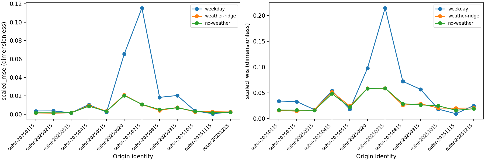
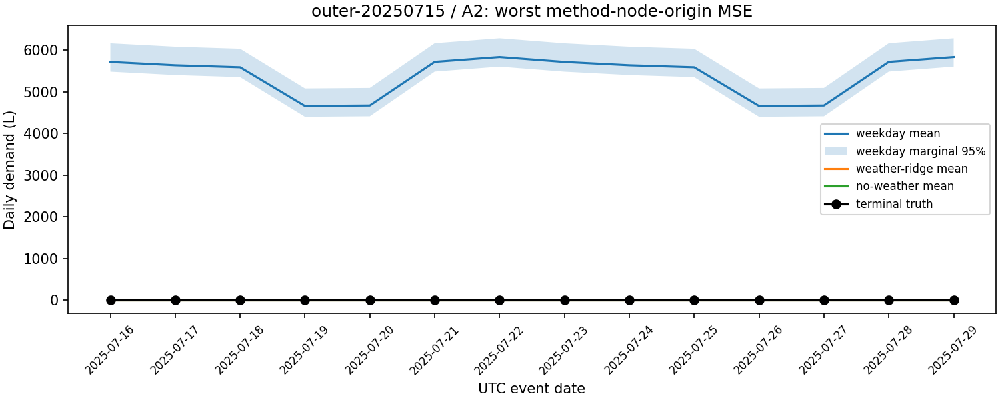
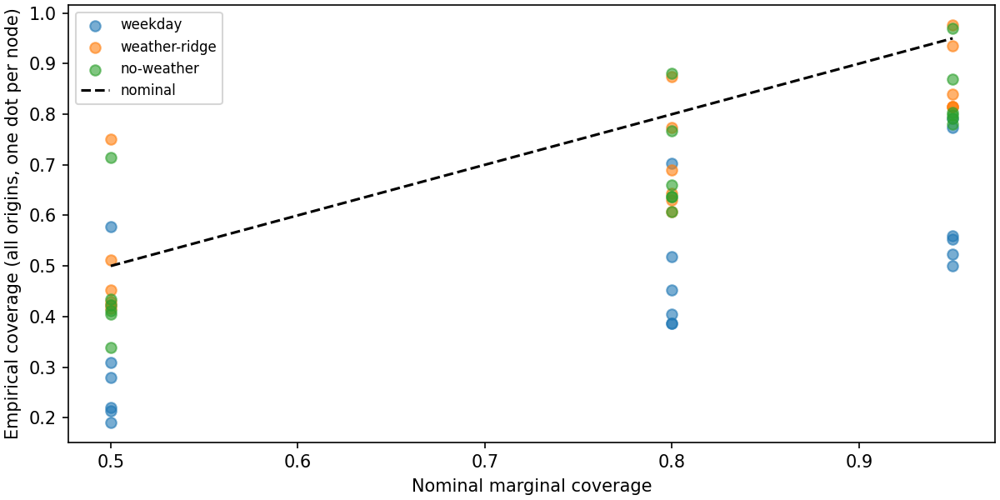

# L02 发布时间层级需求研究与运营交接

## 范围与结论
本报告直接处理 12 个输入切点，身份保持原序：['outer-20250115', 'outer-20250215', 'outer-20250315', 'outer-20250415', 'outer-20250515', 'outer-20250620', 'outer-20250715', 'outer-20250815', 'outer-20250915', 'outer-20251015', 'outer-20251115', 'outer-20251215']。
complete_assignment 原值为 True；不是质量认证。来源范围：original numeric program outputs and narrow native execution facts; file existence is not proof of training or scientific correctness。
公开2023开发运行不是盲评；开发尺度是2023终审均值的后验研究诊断，不曾提供给预测进程。私有12外层/36内层仅在其原结果真正提供后由本冻结程序处理，不能由本次开发结果替代。

|方法/策略|scaled MSE|scaled MAE|scaled WIS|
|---|---:|---:|---:|
|weekday|0.020668341|0.080839315|0.054384521|
|weather-ridge|0.0056914286|0.049358362|0.029846735|
|selection-policy|0.014632399|0.065914751|0.044409658|
|no-weather|0.0056252511|0.049135335|0.029478574|

扩展相对基线的宏MSE差值为 -0.014976913；扩展相对去天气消融的差值为 6.6177475e-05（负为改善）。
这些是固定相同格上的描述性差异，不是天气因果效应。消融在当前与全部伪origin的训练、预测和残差校准中均删除天气值及缺测指示，不参与事后挑选。
选择轨迹见 selection-trace.csv；开发试验中的三个探索性伪inner只是端到端接口测试，不冒称注册36inner。

## 误差、反证与区间
所有方法中最差节点切点是 outer-20250715 / A2 / weekday，scaled MSE=0.67265784。不能用宏平均遮蔽该局部风险。

coverage-width.csv逐格保留50/80/95区间的覆盖及L宽度；coverage-summary.csv按节点保留完整分母。边际WIS与这些区间不认证联合路径；同日站点、层级和相邻窗口有依赖，未作独立样本显著性检验。

## 固定行动损失与建议
行动在观察真值前固定：缺量成本1/3/9分别使用原q0.5/q0.75/q0.9，余量成本恒1。actions.csv保留全部方法和所选身份、四leaf逐日逐成本，另列mean-diagnostic，不将较优mean格混入正式策略。
|方法/策略|leaf|缺量成本|分位行动平均损失|mean诊断平均损失|
|---|---|---:|---:|---:|
|no-weather|A1|1|543.694|629.554|
|no-weather|A1|3|1219.4|1354.95|
|no-weather|A1|9|2792.83|3531.14|
|no-weather|A2|1|101.06|110.09|
|no-weather|A2|3|137.21|236.569|
|no-weather|A2|9|174.893|616.005|
|no-weather|B1|1|528.086|501.339|
|no-weather|B1|3|848.089|1106.67|
|no-weather|B1|9|1622.39|2922.67|
|no-weather|B2|1|212.688|221.39|
|no-weather|B2|3|299.202|453.41|
|no-weather|B2|9|384.115|1149.47|
|selection-policy|A1|1|713.001|767.643|
|selection-policy|A1|3|1616.12|1772.11|
|selection-policy|A1|9|3961.6|4785.52|
|selection-policy|A2|1|574.985|569.13|
|selection-policy|A2|3|639.246|721.229|
|selection-policy|A2|9|711.657|1177.53|
|selection-policy|B1|1|612.786|565.72|
|selection-policy|B1|3|953.393|1221.27|
|selection-policy|B1|9|1715.91|3187.92|
|selection-policy|B2|1|238.134|245.612|
|selection-policy|B2|3|348.176|502.045|
|selection-policy|B2|9|479.685|1271.34|
|weather-ridge|A1|1|570.264|636.907|
|weather-ridge|A1|3|1247.12|1369.58|
|weather-ridge|A1|9|2887.62|3567.58|
|weather-ridge|A2|1|105.91|112.439|
|weather-ridge|A2|3|138.419|240.422|
|weather-ridge|A2|9|166.08|624.371|
|weather-ridge|B1|1|540.011|491.519|
|weather-ridge|B1|3|826.74|1079.04|
|weather-ridge|B1|9|1516.2|2841.62|
|weather-ridge|B2|1|220.765|227.693|
|weather-ridge|B2|3|321.039|465.941|
|weather-ridge|B2|9|446.435|1180.69|
|weekday|A1|1|761.442|905.696|
|weekday|A1|3|2028.64|1885.11|
|weekday|A1|9|4315.08|4823.34|
|weekday|A2|1|843.464|801.247|
|weekday|A2|3|941.396|959.597|
|weekday|A2|9|1048.33|1434.65|
|weekday|B1|1|728.485|701.536|
|weekday|B1|3|1236.51|1424.3|
|weekday|B1|9|2095.8|3592.6|
|weekday|B2|1|251.961|245.688|
|weekday|B2|3|397.664|497.781|
|weekday|B2|9|552.505|1254.06|
所选策略最重单格暴露：outer-20250620 / A1 / tick 30744，缺量成本9，损失41785.9。
建议分别按站点与成本审视缺余量分量，不能从平均改善断言所有时段可靠。此处仅为单期连续L合成决策，没有库存、容量、跨站调拨、联合尾风险或真实机构调度验证。分段线性行动损失和WIS有共同分位成分，不是独立的重复证据。

## 方法、来源与信息可得性
### 研究问题与预封存池

研究问题：在真实发布时间与修订规则下，加入可发布天气、日历和运营计划的回归能否改善同星期经验模型？天气机制是否确实改变误差与不确定性？这是原创合成数据上的描述性方法比较，非因果识别。没有根据私有结果调参。

weekday基线：各leaf在前365天中最近至多8个有效同weekday量的算术平均。weather-ridge扩展：前365天有效历史，以正则化线性条件均值拟合；截距、星期0..5指示、年周期sin/cos、以拟合origin为中心的年趋势、holiday、A2.open（仅A2）、A1.transfer_in（仅A1）、zone温度预报中心化值和缺测指示。温度单位十分之一°C，先精确解码后转°C；空缺采用15°C中心值且缺测指示=1，不用后issue和实测。岭惩罚10，截距不惩罚；所有数值参数见原submission池，未做额外超参数搜索。

no-weather是真实天气机制消融：训练设计矩阵、目标特征及每个校准伪origin全部移除天气和天气缺测列；其余回归与关闭处理不变，不是无效flag或ID改名。基线不使用协变量。消融不在选择池，但全部外层必跑。运营公告的量效不预填：A1的transfer系数仅由合法历史学习；无变化时该列无识别。A2已发布open=0时扩展与消融采用结构零，未宣布变化不设规则。

### 每个拟合与不确定性的数据流

每个fit均重新在其origin按release<=origin投影，观测须event_end<origin；先选最高revision包括missing。missing仅显式排除于训练，不能回取旧valid。用Fraction先解析每行原十进制，乘该行单位系数，确认整数L后才进入浮点线性代数。参数、训练标签原行、使用时间与特征原行见fit-audit.json。

训练协变量不是当前origin下的事后最新值：每个训练日期以该日之前一天09UTC（target_end-39小时）重新查询其当时发布的未来变量；拟合标签采用fit origin已发布的最高版本。未来14日特征用本次origin查询。静态星期与日序可由日期计算，holiday/open/transfer须从合法发布版本查询，缺测取中性0/1并由原行/缺失记录说明。known_future仍受release限制；observed天气完全不进入模型。

在当前origin前28/56/84天的三个伪origin重新拟合同一配置并预测其14完整未来日。选择较近窗口以允许公开开发的更早选择测试拥有足够历史，区别于外部参照的56/84/112天，并非私有调参。伪origin训练标签和目标天气都按伪origin可得性；校准真值另取当前origin已发布最高revision，明确不是伪origin当时已知label。四leaf同日全部有效才成组保留，至少14组，否则报错。拟合不足28回归日期或同weekday无历史也报错，不引入预填答案。

未来每个leaf样本=基础预测+成组经验残差，负值截0；公告关闭的A2扩展样本置0。每组leaf样本先相加形成aggregate。输出mean为这些非负预测分布样本的算术均值，而非中位数；七边际分位数按有序样本线性插值。经验分布定义模型所估条件分布，不宣称是真实条件分布或有分布无关覆盖保证。样本内相加保证mean层级闭合，边际分位不要求相加，也不宣称联合路径认证。

### 评价与选择

所有方法固定完整6节点×14日。每节点点损失((mean-truth)/scale)^2，绝对误差|mean-truth|/scale。WIS（Weighted Interval Score，加权区间评分）=(0.5|truth-median|+Σ[alpha/2*(hi-lo)+max(lo-truth,0)+max(truth-hi,0)])/3.5/scale；alpha为.5/.2/.05。leaf与aggregate各半，层内节点/目标等权，origin等权。三个inner以Fraction精确计算完整宏scaled MSE均值，最小者胜，精确同分按Unicode码点字典序返回既有ID，不产生新配置。

公开开发尺度取2023年完整终审日均值，仅为后验诊断且不进入预测进程；正式尺度由独立评估提供。公开试验使用额外开发伪inner验证选择链，与正式36inner不同。mean行动仅诊断，正式行动固定q.5/.75/.9对应缺量成本1/3/9，不依真值择优。报告不作私有质量或总分自评。

报告已消费 108 份原拟合诊断，检查 1289522 次原行使用时点；fit-diagnostics.csv列出校准完整组及排除数。
provenance.csv保留原执行状态、退出码、时间、源码及argv投影；original-outputs/逐字节保留原产物，original-results.json及original-provenance.json保留本次输入。原预测直接与结果包匹配，指标与宏结果逐项有理数重算。不用摘要或文件存在代替拟合真实性证明；最高revision与源完整性还需原packet审计，来源包自报行不能单独证明没有漏行。
预测逐行见predictions.csv；逐节点/切点见node-origin-metrics.csv；完整配对差值见paired-differences.csv；完整行动分量见actions.csv；精确宏均值见recomputed-aggregate.json。

## 负结果与限制
回归系数是正则化相关性，不代表运营公告的因果量效；未宣布的变化不能预知。已知关闭被结构置零，但转移量只能由已有合法样本估计，历史缺乏变化时不可识别。末日天气没有当前issue覆盖，实际采用15°C中心值和缺测指示（消融完全不用天气）；这不是14天均有天气预报。
最高missing保留未知，不回取旧值；有效label才进入拟合，校准全leaf成组剔除但不删除任何评分目标。L/m3按每个版本精确转换。短历史、校准不足、坏输入非零退出而不产生成功forecast；正式单元失败不得被平均时删除。
经验残差样本量有限且可能随季节漂移，没有覆盖率保证。去天气可能改善，扩展可能退化；是否出现及其方向以本次完整配对表和局部图为准。私有固定参照不在此输入中，不能宣布达到质量底线或终审分数。

## 封存、复建与文献
submission.json指定字面argv与每程序完整文件闭包。依赖见交接USAGE.md；预测、选择、报告和静态引用在首私有预测前一起冻结。后续report只解释原结果，不更新源码、池或预测。
references/claims.json给原文定位、短摘录与主张映射；Gneiting第7/18/21页支持mean与平方损失、quantile与非对称损失匹配；Bracher等第2节支持区间宽度/欠覆惩罚及WIS。实现的精确权重以公开study合同为准。公开原创合成数据来源为本项目16项输入；不涉及真实供水机构。

## 本次数据的具体比较与运营敏感性
weather-ridge相对weekday的MSE在4/12个切点更差，8个改善，0个同分。更差切点：outer-20250315（差值0.000110059）；outer-20250515（差值0.00118135）；outer-20251115（差值0.00216009）；outer-20251215（差值8.53826e-05）。本次输入存在退化切点，不支持所有切点均改善。不能看外层结果后切换选择池；差异不识别因果效应。
weather-ridge相对no-weather的MSE在7/12个切点更差，5个改善，0个同分。更差切点：outer-20250315（差值5.99554e-05）；outer-20250415（差值0.000611385）；outer-20250515（差值0.000269302）；outer-20250620（差值0.000449546）；outer-20250915（差值0.000395694）；outer-20251115（差值0.000952951）；outer-20251215（差值0.000133602）。本次输入存在退化切点，不支持所有切点均改善。不能看外层结果后切换选择池；差异不识别因果效应。

|方法|节点|完整origin均值scaled MSE|完整origin均值scaled WIS|
|---|---|---:|---:|
|weekday|A1|0.02801933|0.07297065|
|weekday|A2|0.09003804|0.1066555|
|weekday|B1|0.0137317|0.0575804|
|weekday|B2|0.002238501|0.02209887|
|weekday|ZA|0.009204755|0.04709135|
|weekday|ZB|0.006454825|0.04079401|
weekday6节点95%区间实际覆盖率范围为0.500至0.792（每节点分母168）；低于名义0.95的节点6个，高于0个，等于0个。低于名义值是本次欠覆盖现象，需检查校准漂移等可能原因，不能仅凭覆盖率确定原因。有限样本边际覆盖不是可承诺的服务可靠性。
|weather-ridge|A1|0.01655719|0.05166652|
|weather-ridge|A2|0.0009003958|0.008610963|
|weather-ridge|B1|0.00774211|0.0413915|
|weather-ridge|B2|0.002158365|0.01990184|
|weather-ridge|ZA|0.005494011|0.0316774|
|weather-ridge|ZB|0.003592673|0.02692413|
weather-ridge6节点95%区间实际覆盖率范围为0.815至0.976（每节点分母168）；低于名义0.95的节点5个，高于1个，等于0个。低于名义值是本次欠覆盖现象，需检查校准漂移等可能原因，不能仅凭覆盖率确定原因。高于名义值是本次过覆盖现象，应结合区间宽度判断保守性，不能仅凭覆盖率确定原因。有限样本边际覆盖不是可承诺的服务可靠性。
|no-weather|A1|0.01635089|0.0504775|
|no-weather|A2|0.0008785807|0.008493993|
|no-weather|B1|0.007883058|0.0416871|
|no-weather|B2|0.001989871|0.01890393|
|no-weather|ZA|0.005397477|0.03084945|
|no-weather|ZB|0.003552327|0.02728358|
no-weather6节点95%区间实际覆盖率范围为0.780至0.970（每节点分母168）；低于名义0.95的节点5个，高于1个，等于0个。低于名义值是本次欠覆盖现象，需检查校准漂移等可能原因，不能仅凭覆盖率确定原因。高于名义值是本次过覆盖现象，应结合区间宽度判断保守性，不能仅凭覆盖率确定原因。有限样本边际覆盖不是可承诺的服务可靠性。
所选分位行动相对mean诊断的节点/成本平均损失：高于2组，低于10组，同分0组。高于mean诊断的组：A2/成本1、B1/成本1。这些组显示本次分位行动的有限样本劣势，但不独自确定模型失配的原因。低于mean诊断的组：A1/成本1、A1/成本3、A1/成本9、A2/成本3、A2/成本9、B1/成本3、B1/成本9、B2/成本1、B2/成本3、B2/成本9。仍保持原固定分位策略，不在报告阶段替换行动；不能外推为真实运营保障。
校准完整组数范围41至42；累计排除38组最高missing或缺失label。来源检查不把这些估计量误称为已知原事实。