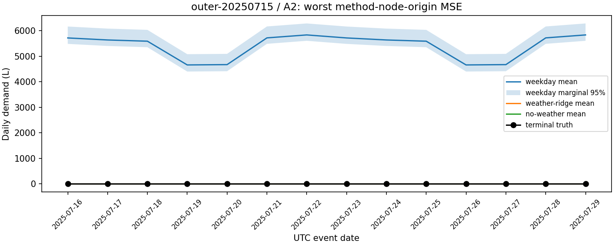
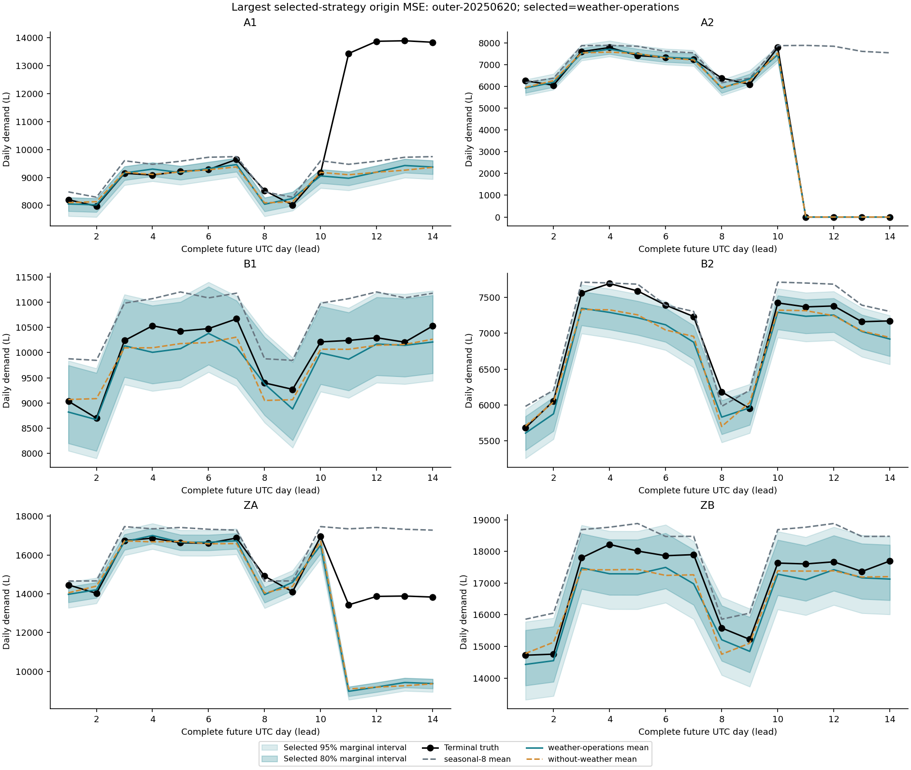

# L02真实预测质量：双100掩盖了损失差异

这里比较原L02/0.2.0两份已封存候选的实际选择策略，不是作者参考，也不是新候选或新成绩。两个原100、`quality_success=true`与原冻结规则保持不变。

| 同一原12切点、同一原始资料 | Codex | OpenCorvus | Codex相对OC |
| --- | ---: | ---: | ---: |
| 宏尺度化均方误差（Mean Squared Error，MSE） | 0.00307200380249 | 0.0146323987961 | 低79.0055% |
| 宏尺度化加权区间分数（Weighted Interval Score，WIS） | 0.0214232929179 | 0.0444096579591 | 低51.7598% |

两指标越低越好。固定2023终审均值作尺度，节点内14目标日等权、12切点等权；leaf/aggregate两层各1/2，沿用原合同。精确Fraction、原选择cell/accepted路径、所有节点与单期损失在[audit.json](audit.json)；[完整12切点配对](descriptive-contrasts.json)、[原预测/选择字节ZIP](original-selected-outputs.zip)、[2016点预测与原真值](actual-selected-points.csv)可追到实际产物。

两原grade使用的[同一固定参考](reference-floor.json)宏MSE为0.0255107818978、WIS为0.0716160898681。两者都比它低，正确越过旧质量门槛；这并不抹掉彼此的连续损失差距。

## 不能把它说成所有业务指标占优

原独立单期行动按缺量成本1/3/9分别使用原q0.5/q0.75/q0.9，余量成本1，未事后换行动。以缺量成本9为例，原平均损失为：

| leaf | Codex | OpenCorvus |
| --- | ---: | ---: |
| A1 | 1962.528181 | 3961.595733 |
| A2 | 150.780552 | 711.656669 |
| B1 | 1737.542478 | **1715.905189** |
| B2 | 292.337775 | 479.685471 |

OC在B1该情形更低；点误差或WIS更低不保证每个非对称决策损失都更低。这里是原合成L数量乘单位成本的单期损失，不是真实现金、跨期库存或联合尾风险。其余两成本比完整保留在audit中，不合成一个事后总分。

## 大差距发生在哪里

July切点的宏MSE为Codex 0.00131344、OC 0.11548950。按原12切点等权均值的差分分解，这一切点贡献总MSE差的82.3040%；这是描述性算术，不是因果贡献估计。

原selector在July实际选择：Codex `weather-operations`，OC `weekday`。A2原14日真值均0，Codex均值0且80%区间覆盖14/14；OC均值5401.57398 L、覆盖0/14。下图是OC原报告的最差方法/节点/切点；根审查另从原selector确认它也确实被July最终策略选中，不是挑一个未提交的坏实验冒成绩。

OC报告中单独`weather-ridge`宏MSE约0.00569143，明显低于它实际选择策略的0.01463240；不能替它改用更好方法重报成绩。Codex原选择4次weather、8次without-weather，OC原选择10次weather-ridge、2次weekday；允许的选择池与方法配置组合不同，不能把差距孤立归因于某个天气特征或底层模型。

Codex也有真实失败：其最差所选切点June/A1，14日真实均值10233.2857 L、预测8912.6386 L，80%边际覆盖9/14；OC同格8901.0580 L、覆盖7/14。两份报告都诚实写了局部退化、未知状态/结构变化和统计限制，没有据此伪造共同满分能力。

[原Codex报告](codex/original-report/report.md)与[原OC报告](opencorvus/original-report/report.md)、六份原PNG已实际阅读/view。原图有的画全部方法、有的画所选策略，标题范围不同，不能只凭外观直接排名。本次比较只用原选择策略的实际数值。

## 评价方法的问题与边界

- 原质量规则是相对固定外部参考的通过判定。两者越过共同参考后都满分，抹平了连续损失距离；原100可以是正确的旧验收结果，却不能表示预测质量并列。
- 宏/节点年均值会稀释局部大失败。必须同时呈现完整逐切点损失和当时实际选择，不能从报告中挑更佳方法替交付策略。
- `quality_success`不等于概率校准或运营保证。例如所选策略B1名义80%区间实际覆盖为Codex109/168、OC95/168；这是描述性边际频率，不能把“低于80%”事后设为新判负线，也不能当168个独立样本。WIS仍按原权重评价锐度与失覆代价。
- 预测损失、区间质量、各成本比行动和真实交付应分列。本轮没有通过新权重让某方稳赢，没有修改旧分或禁用合法成熟方法。

12个时间相关切点、两个系统且Codex实际底层model/usage未知，只支持这轮固定任务的产品事实，不支持总体能力、同模型费用/速度因果排名、职业真人/统计成熟或候选有效小时。原私料已执行并被本调查读取，不再当未来未知输入。

## 本轮怎样核对

从两原`formal-run/registration.zip`读同一原资料/合同，SQLite以只读immutable方式读原selector及实际outer cell；读取24份所选原forecast，使用同一封存evaluator-source的纯`score`与`decision_metrics`消费原始labels。一次4.3104秒只读核算与原grade精确连续损失逐项相同，没有运行candidate、原矩阵、prepare、grade、独审或旧API/Docker。

完整pair仍在`D:/opencorvus-benchmark-runs/L02-paired-20261030-cb3a704d`，本轮原件在`D:/opencorvus-benchmark-runs/l02-real-product-quality-audit-20261101`。[scope.json](scope.json)仅声明这里的科学投影；全部原workspace/内层与未选cell/数据库/依赖/引用/旧38独评和grade留在原根。当前没有新版本、冻结、候选或重型资格。
