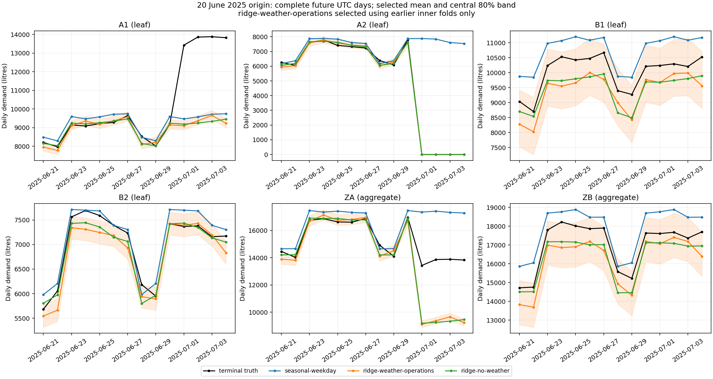

# L02 每日研究作者参考：完整数值矩阵与已知失败边界

本记录是作者可执行参考，**不是候选成绩、完整L02冻结或数小时资格**。质量底线仍null，整套仍只有L06旧合同冻结1/10。所有数字来自实际原材料、隔离程序和当前唯一metric，而不是预填预测或模型自报研究结论。

## 问题与资料

原创合成1096日、4站点/2汇总区，单位L，UTC（Coordinated Universal Time，协调世界时）自然日。完整观测13152个版本、协变量37632个版本；公开开发截止2024Aug1（6823/21934），2023探索不当盲评。36个内层均晚于开发截止；12个2025外层按注册日程含June20，预测14个完整未来日。最高已发布revision含missing先确定，再按valid使用；future-known变量也须已发布。所有预测worker只收到唯一project选中的原始CSV和公开manifest，完整canonical、真值和尺度留评估侧。

## 事前方法与实际执行

选择池在首个预测前固定为seasonal-weekday和ridge-weather-operations；outer另必跑ridge-no-weather消融。基线取过去365日内up-to8同weekday有效量。ridge以同合法窗口/alpha1、weekday/年季节/天气与运营状态拟合，采用NumPy增广最小二乘，无显式逆；去天气版本真正移除该有效输入。历史56/84/112日伪origin各14日点预测来自当时合法训练/天气，当前origin已发布的最高有效版本作残差标签，共同leaf日期成组。本次各forecast实际42组残差，原始样本/系数和出处均可审；这不等于独立样本量或有限样本覆盖保证。

未来每个leaf用非负残差样本估计均值/分位点，运营关闭作用于整组样本；aggregate对相同样本的leaf相加，均值严格一致，分位点不强求相加。合法天气预测最后一天缺测，用当时合法实测月气候均值估计；不能读下一次issue。参考仅要求当前2024+inner/2025outer，不声称2023探索也已实际通过。

每outer的3inner×2方法、独立selector、3outer方法全部为必交，新目录顺序1CPU/netnone真实运行。Jan代表49.250秒，独立June20冷复建49.775秒，其余10outer481.212秒；独立冷跑计入同一注册矩阵，不重复计算。总共108个forecast和12个selector、每forecast84格，数字只描述范围，**不是难度或候选工作时长**。原件保存实际create/start/终态/CID、只读mount、输出、代码/配置和先封存再精确cleanup；无GPU/Provider/LLM候选。实际NumPy2.4.6，图形Matplotlib3.10.3。

selector仅拿该outer前已发布的三个inner终审、完整预测和固定2023尺度，以完整平均scaled_mse最小/同分ID排序选原ID；host再独立重算。全部12/12次合法选择为weather版本。全部outer结束前没有改变池、参数或方法。去天气消融不能看外层更好后再偷偷加入选择池。

## 完整固定分母结果

尺度s为2023终审日量均值，actual publish均在2024Feb1前，仅评分侧/2024+selector可读。逐节点MSE（Mean Squared Error，均方误差）=((mean-y)/s)^2，MAE（Mean Absolute Error，平均绝对误差）=|mean-y|/s，WIS（Weighted Interval Score，加权区间评分）/s；leaf/aggregate各半，层内节点/日期等权，12outer等权。原始精确有理数在[机器结果](assessment.json)，可读逐outer表在[CSV](outer-metrics.csv)。

| 方法 | scaled MSE | scaled MAE | scaled WIS |
| --- | ---: | ---: | ---: |
| seasonal-weekday | 0.025510782 | 0.101643445 | 0.071616090 |
| ridge-weather-operations | 0.004904487 | 0.043249305 | 0.026886002 |
| ridge-no-weather | 0.004436605 | 0.038673044 | 0.025160071 |
| selected | 0.004904487 | 0.043249305 | 0.026886002 |

本固定矩阵中，合法selected相对季节基线平均MSE下降80.775%，WIS下降62.458%。但去天气消融的MSE和WIS都更低，不能声称天气特征必然提升。本研究没有把切点/同日站点当独立样本，也没有显著性/真实机构外推结论。selected与weather结果相同是实际内层选择轨迹，不是用outer挑最好的模型。

## 跨运营变化的实际失败

主方已实际打开这张新PNG，六面板的日期/单位/图例可读。所选ridge知道A2关闭并使7月1日起4天的均值/全部分位点为0；但是此前没有足够可观测的转移量效，A1的transfer特征在训练期未识别出新台阶。图上A1与ZA明显低估，区间过窄；不能仅因全矩阵较小MSE就宣称运营风险已解决。

| July1–4节点 | 真值日均L | selected日均L | 中央80%区间命中日数 |
| --- | ---: | ---: | ---: |
| A1 | 13751.75 | 9341.10 | 0/4 |
| A2 | 0.00 | 0.00 | 4/4 |
| ZA | 13751.75 | 9341.10 | 0/4 |

这些4日计数只是具体失效描述，不是覆盖率统计认证。实际公告的二元状态不提供全部定量转移系数，本参考未用私有DGP参数填空；未知变点、未来天气误差/缺测、初报偏差也会影响结果。在模拟运营中使用这些预测需要明确的信息/量效假设和压力场景，不能把窄边际区间当成多站点联合保障。本题正式质量关键项仍需独立预先校准，不按这里的误差倒填宽阈值。

## 错误对照和可复核界限

原缺预测row/inner、晚发布label和未知selected ID进入同一checker得到具名状态；另同格式合法数值控制让baseline的完整inner预测恰等已发布truth时MSE0选择baseline，两者同为0则按字典序选择。控制中的perfect预测是人工数值接口见证，绝不当真实模型可达或成绩。原自然选择没有被强迫翻转。

null inner context曾真实触发AttributeError；唯一selector类型边界及facility/候选状态已修，原反例和合法选择等价复验保留。隔离sentinel目录重入曾覆盖旧assessment；CLI取得新目录所有权前现只stdout具名拒绝，原before/after和修后新/旧目录测试保留，未碰真实历史/活跃目录。旧7点OLS入口已退役，原字节仍在历史ZIP，不保留每日fallback。

完整数值参考是建设进度，不自动认证职业研究交付、所有故障恢复、正式计分合同或整套十题。下一步是完整研究/运营决策交付、质量目标与低质量对照、原子rubric/人评锚点和单层独立冻结；之后才fresh候选实测区分度和有效时长。

方法依据：[滚动origin评估](https://otexts.com/fpp3/toolbox.html)、[WIS原论文](https://journals.plos.org/ploscompbiol/article?id=10.1371/journal.pcbi.1008618)、[层级预测](https://otexts.com/fpp3/hierarchical-forecasting.html)、[NumPy最小二乘](https://numpy.org/doc/stable/reference/generated/numpy.linalg.lstsq.html)与[分位点定义](https://numpy.org/doc/stable/reference/generated/numpy.quantile.html)。文献不替代本次实跑或独立审查。

独立图形建议已处理：区间填色现在与selected均线一致；原图/新图/同输入/两套实际终态均归档，主方和独立agent都查看新PNG。该追加只改呈现，不重跑预测或改变结果。
