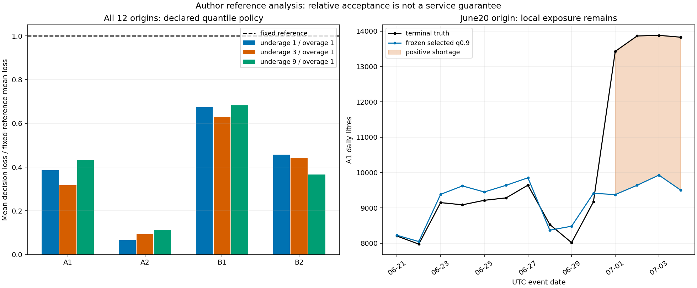

# 发布时间隔离下的层级需求预测：数值研究与运营损失分析

本报告分析已经封存的作者参考实验，不是新候选交付。完整研究清洁流水线、独立人评锚点及正式rubric冻结仍待；这里的相对参照质量通过不能称为实际供水保障。

## 研究问题与材料

问题是：在计量有修订、单位变化、未来协变量发布不齐和运营公告量效未识别时，逐origin重建的预测能否优于固定季节参照，并如实解释边界失效？材料为原创合成，四站点A1/A2/B1/B2与ZA/ZB两层，不代表真实机构。日量规范为整数L，UTC自然日，预测cutoff后14个完整未来日。公开开发截止2024-08-01T09:00Z，六个2023探索切点不称盲评。
原始完整档案有13152条观测和37632条协变量发布记录。最高已发布revision即使missing也不能回填旧版本；L/m3逐行精确换算。12个2025外层各配3个更早inner，36个inner全部晚于公开开发截止。固定2023终审日均尺度只交付评分器与已满足发布时点的选择器，不给更早预测器。

## 方法、选择与实际执行

固定参照使用过去365日合法历史中最近至多8个同weekday有效值，并用56/84/112日前的伪origin校准。扩展为alpha=1的ridge：weekday、年季节、已发布天气和运营计划；真实消融移除天气于拟合、预测和校准的全部路径。特征标准化只用当次训练样本，使用增广最小二乘而非显式求逆。
模型每个origin重新拟合。天气forecast对本任务末个目标日缺测，使用当时已发布实测的月份气候均值；未读下一issue或未来实测。校准特征回到伪origin当时重建，残差标签采用真实origin已发布的最高有效版本；每次实际形成42行leaf配对残差。未来非负样本在已知关闭计划下整组置零再相加，均值层级一致，分位点不强求相加。
选择池在首私有预测前固定为seasonal和weather，no-weather是outer必交消融。三个已发布inner的平均scaled MSE最小ID决定选型，禁止生成新参数或看outer标签改池。全部12次真实选择均为weather；并不因后见消融更好而改池。旧真实矩阵有108次预测和12次独立选择进程；该历史身份与本次秒级只读分析严格分开。

mean与MSE目标匹配、quantile与不对称分段线性损失匹配，依据[Gneiting原文](https://arxiv.org/abs/0912.0902)。边际区间用[Bracher等WIS原文](https://journals.plos.org/ploscompbiol/article?id=10.1371/journal.pcbi.1008618)；另核[2022勘误](https://journals.plos.org/ploscompbiol/article?id=10.1371/journal.pcbi.1010592)，其更正示例数值，本文不引用那些示例数字。

## 完整外层结果

| 指标 | 真实inner所选 | 固定外部参照 |
|---|---:|---:|
| scaled_mse | 0.004904487 | 0.025510782 |
| scaled_mae | 0.043249305 | 0.10164344 |
| scaled_wis | 0.026886002 | 0.07161609 |

原完整矩阵的no-weather消融MSE约0.0044366055、WIS约0.0251600710，低于所选weather。该负结果支持谨慎评价天气特征增益，不构成因果否定或事后选择许可。固定层级权重为leaf/aggregate各半；每origin和节点都有完整分母，不删困难日。

| 节点 | 所选MSE | 参照MSE | 所选WIS | 参照WIS |
|---|---:|---:|---:|---:|
| A1 | 0.011624731 | 0.033826524 | 0.034917207 | 0.087384164 |
| A2 | 0.00029133095 | 0.097325668 | 0.0051135931 | 0.12042039 |
| B1 | 0.01109328 | 0.022710095 | 0.056626765 | 0.086931045 |
| B2 | 0.0009084473 | 0.0038858521 | 0.013116145 | 0.033649105 |
| ZA | 0.0036767176 | 0.011952055 | 0.020707084 | 0.059436545 |
| ZB | 0.0039823357 | 0.011217003 | 0.031950068 | 0.062835461 |

在检查逐节点和运营分解前固定的作者政策要求：六节点MSE/WIS均不退化、原宏MSE/WIS严格好于外部参照，四leaf三成本损失均不退化。原真实选中预测通过26个条件。这是相对参照的确定性接受关系，不是26个独立统计试验，也不证明改善幅度足以满足现实服务要求。原始loss保持主结果，不以逐格skill比值替代proper score；该限制也参照[Wheatcroft原文](https://www.lse.ac.uk/CATS/Assets/PDFs/Publications/Papers/2019/Interpreting-the-skill-score-form-of-forecast-performance-metrics.pdf)。

## 合成单期运营损失

行动为连续L，余量成本1 cost-unit/L，缺量成本1/3/9 cost-unit/L分别预先使用q.5/.75/.9。损失为缺量成本乘max(truth-action,0)加余量成本乘max(action-truth,0)。每leaf/cost有12×14=168格。报告见truth后没有换q或挑较小的mean策略。模型没有容量、库存、站间调拨或联合尾风险；损失只是可分离的合成单期练习。

| Leaf | 缺量成本 | 固定q | 所选平均损失 | 参照平均损失 | 所选mean行动诊断损失 |
|---|---:|---:|---:|---:|---:|
| A1 | 1 | 0.5 | 382.1737 | 992.55357 | 493.29227 |
| A1 | 3 | 0.75 | 711.06549 | 2239.7958 | 897.15378 |
| A1 | 9 | 0.9 | 2075.7344 | 4811.6606 | 2108.7383 |
| A2 | 1 | 0.5 | 60.986605 | 912.81548 | 61.765131 |
| A2 | 3 | 0.75 | 99.494668 | 1060.5629 | 132.3736 |
| A2 | 9 | 0.9 | 145.72904 | 1295.5766 | 344.19902 |
| B1 | 1 | 0.5 | 606.97017 | 900.3936 | 576.49257 |
| B1 | 3 | 0.75 | 1114.7476 | 1770.6581 | 1355.2419 |
| B1 | 9 | 0.9 | 2373.5968 | 3481.3007 | 3691.49 |
| B2 | 1 | 0.5 | 150.30648 | 329.25446 | 151.24804 |
| B2 | 3 | 0.75 | 238.36907 | 538.69717 | 322.28768 |
| B2 | 9 | 0.9 | 318.91151 | 873.21235 | 835.40661 |

所有损失为每leaf/day合成cost-unit均值。完整缺量/余量L及各自损失分量在operating-losses.csv中，不能把这些相通的pinball成分当独立工程成功证据。

## 负结果、可识别性与适用边界

June20 origin已知A2关闭、A1接入安排，不代表已知转移量。原实际拟合记录中未发生该状态的历史特征可为常量，对应transfer系数可以为0；公告的量效没有凭空变成事前知识。July1–4的A1/ZA终审均值约13751.75L，所选mean约9341.10L，中央80%区间0/4覆盖。年平均相对参照改善没有消除该边界；本图另展示冻结q.9的实际缺量暴露。
42个校准残差、同日leaf/aggregate、相邻inner不构成独立同分布抽样。本文不报告虚假p值、名义覆盖保证、联合路径认证或真实供水可部署证明。运营使用者应将结构变化交给独立情景/约束审查；不能仅凭本次通过即自动执行高风险安排。该建议未在本实验建立完整干预模拟，故不计工程验收。

## 复核、交接和未完成项

node-losses.csv保存逐节点精确分数，operating-losses.csv保存逐成本精确分解，june-A1-q90.csv定位每个边界目标，actual-fit-summary.csv给出原拟合样本/特征/参数和来源成员，source-bindings.csv指向不可变原ZIP。数值可通过本轮quality primitive与原registry重算；原完整source-only数值矩阵证据见[旧完整参考](../../daily-full-reference/REPORT.md)。本报告是事后作者分析，新report programme在完整generic assignment上的冻结输入/来源提供与清洁复建尚须定稿和实跑。
正式完整grader对私有原件/真实selector的绑定、完整研究参考、独立人评多质量锚点及最终冻结未完成。候选总分仍null；不能把本次26条件、代码行数、作者报告或计算秒数当十题成熟/小时级证据。
