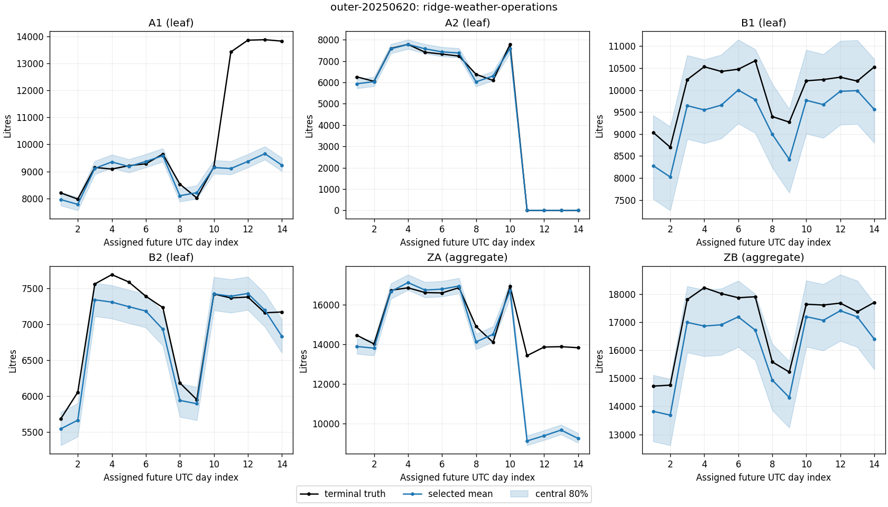

# Sealed daily forecasting study

Author reference report. This report consumes captured numerical outputs and narrow native execution facts. It does not certify the self-reported fitting diagnostics or replace independent scientific review.

Requested outer origins: outer-20250115, outer-20250215, outer-20250315, outer-20250415, outer-20250515, outer-20250620, outer-20250715, outer-20250815, outer-20250915, outer-20251015, outer-20251115, outer-20251215. Complete registered coverage: True.

## Methods and information timing

The execution contract freezes programmes and configurations before prediction. These report-side numeric records alone do not establish when this report programme was frozen relative to historical numeric cells; that requires the independent registration audit. Each worker is assigned an original CSV release-prefix; highest revision including missing is chosen before valid-value filtering. The reference uses historical seasonal weather imputation. Inner selection uses earlier published inner labels and mean scaled MSE; ties use the method ID. Outer labels reach the report only after numerical acceptance.

| Method | Role | Frozen configuration |
|---|---|---|
| seasonal-weekday | baseline | `{"algorithm": "seasonal_weekday", "weekday_repeats": 8, "train_window_days": 365, "minimum_training_rows": 56, "calibration_days_before": [56, 84, 112], "minimum_calibration_rows": 14}` |
| ridge-weather-operations | extension | `{"algorithm": "ridge", "use_weather": true, "use_operations": true, "ridge_alpha": "1", "train_window_days": 365, "minimum_training_rows": 56, "calibration_days_before": [56, 84, 112], "minimum_calibration_rows": 14}` |
| ridge-no-weather | ablation | `{"algorithm": "ridge", "use_weather": false, "use_operations": true, "ridge_alpha": "1", "train_window_days": 365, "minimum_training_rows": 56, "calibration_days_before": [56, 84, 112], "minimum_calibration_rows": 14}` |

The seasonal method averages up to eight matching weekdays. Ridge uses standardized features, an unpenalized intercept and the frozen alpha; the no-weather ablation removes weather features. Configuration and fitted coefficients are separately located in [fit-index.csv](fit-index.csv) and [fit-records.json](fit-records.json). These are empirical model parameters, not identified causal effects.

Uncertainty uses the recorded earlier pseudo-origins and complete paired leaf residual rows; current operating closures act on whole future sample vectors before hierarchical sums. Means are coherent; marginal quantiles need not sum. This empirical construction gives no finite-sample or joint-path coverage guarantee.

## Out-of-sample results

| Method | Scaled MSE | Scaled WIS |
|---|---:|---:|
| seasonal-weekday | 0.0255107819 | 0.07161608987 |
| ridge-weather-operations | 0.004904486977 | 0.02688600191 |
| ridge-no-weather | 0.004436605461 | 0.02516007102 |
| Inner-selected policy | 0.004904486977 | 0.02688600191 |

[Per-origin metrics](origin-losses.csv) and [all node losses](node-losses.csv) preserve every declared origin and method. Coverage and width are in [the complete interval table](intervals.csv). The no-weather outer ablation remains a diagnostic; seeing its outer results cannot change the frozen selection pool. A good aggregate loss does not establish local calibration or correct response to a new operating regime.

## Single-period operating decisions

The [operating ledger](operating-ledger.csv) fixes overage cost 1 and shortage costs 1, 3, 9 cost-unit/L before truth, using q=.5, .75, .9 respectively. Actions are continuous litres. Each row records action, later truth, shortage, overage and realized cost. These are separate single-period decisions, not a capacity, inventory, joint-risk or field supply simulation.

## Reproduction and evidence limitations

[Source index](source-index.csv) links actual numeric cell IDs, origin/method, narrowed argv, native start/finish/exit and delivered copies of each original output. [Execution index](execution-index.json) preserves the allowed native facts. Candidate fit statements require source and independent execution audit; a file or timestamp alone does not prove how training occurred. Exact rational tables retain evaluation precision; figure coordinates are plotting floats.

This report is a reproducible research component. Study completion, quality success and benchmark score remain unassessed until the full frozen case and independent rubric review.

## Complete interval and decision diagnostics

[All interval rows](intervals.csv) give hits/assigned days and average width in litres for every method/origin/node at central50/80/95. [Method totals](method-interval-summary.csv) and [actual selected-policy totals](policy-interval-summary.csv) sum original counts over the entire grid. Selected is connected by each original selector ID, not a reserved method name. Denominator per node is 168 assigned dates; the dates are dependent, not independent experiments. Wider bands can improve coverage while worsening sharpness and WIS.

| Selected node | Central band | Hits / assigned | Mean width L |
|---|---:|---:|---:|
| A1 | 50% | 71/168 | 374.36585 |
| A1 | 80% | 115/168 | 1345.0462 |
| A1 | 95% | 141/168 | 1959.6824 |
| A2 | 50% | 131/168 | 107.78651 |
| A2 | 80% | 149/168 | 187.40949 |
| A2 | 95% | 161/168 | 283.21524 |
| B1 | 50% | 57/168 | 546.45691 |
| B1 | 80% | 91/168 | 931.98063 |
| B1 | 95% | 114/168 | 1295.6387 |
| B2 | 50% | 90/168 | 285.81792 |
| B2 | 80% | 134/168 | 480.97722 |
| B2 | 95% | 157/168 | 678.77381 |
| ZA | 50% | 69/168 | 432.17437 |
| ZA | 80% | 119/168 | 1475.8711 |
| ZA | 95% | 139/168 | 2128.6425 |
| ZB | 50% | 55/168 | 714.53915 |
| ZB | 80% | 98/168 | 1339.7934 |
| ZB | 95% | 123/168 | 1800.0731 |

### Actual comparisons and failure boundaries

ridge-no-weather minus the actual selected policy: scaled_mse -0.00046788152, scaled_wis -0.0017259309; negative means lower loss. A better outer ablation cannot retroactively enter the frozen selection pool. This paired descriptive comparison does not identify the causal value of weather.

Earlier author development had already exposed a possible June transfer/closure failure and a stronger no-weather ablation. The fixed June20 diagnostic is therefore not a blind discovery. The following values come from this execution, not a copied older report.
A1 / outer-20250620 last four assigned days, ticks 30672,30696,30720,30744: average truth 13751.75 L, exported mean 9341.1015 L, central80 hits 0/4. These are local observations, not independent coverage trials.
ZA / outer-20250620 last four assigned days, ticks 30672,30696,30720,30744: average truth 13751.75 L, exported mean 9341.1015 L, central80 hits 0/4. These are local observations, not independent coverage trials.

Actual A1 transfer feature: centre 0.0, standardized coefficient 0.0, fit source `sources/59/result/fit.json`. A zero centre for a nonnegative binary feature means no positive training transfer in that fit; it cannot identify the magnitude of a new transfer. This diagnostic requires verification against the captured packet and source. A notice can be known while its volume effect is unlearned.

Same-day leaves/zone totals, seasonal history, overlapping training/inner windows and selection create dependence. Neither twelve origins nor thousands of table rows are randomized independent replications. No p-value, causal identification or joint-tail certification is inferred. Changes not announced at the forecast cutoff, revisions and limited residual support remain exposure even when aggregate loss improves.

### Quantile actions and exported-mean diagnostic

The operating ledger keeps the original q=.5/.75/.9 action for under-cost1/3/9 and over-cost1. For each row, shortage=max(y-a,0), surplus=max(a-y,0), their costs are c_under*shortage and surplus, and loss is their sum. The mean diagnostic uses the original exported probabilistic mean, not the ridge base point. It is never substituted after observing truth.

| Leaf | Under cost | q | Days | q loss | Mean loss | q shortage L | q surplus L | q shortage cost | q surplus cost |
|---|---:|---:|---:|---:|---:|---:|---:|---:|---:|
| A1 | 1 | 0.5 | 168 | 382.1737 | 493.29227 | 208.15325 | 174.02044 | 208.15325 | 174.02044 |
| A1 | 3 | 0.75 | 168 | 711.06549 | 897.15378 | 140.74571 | 288.82837 | 422.23713 | 288.82837 |
| A1 | 9 | 0.9 | 168 | 2075.7344 | 2108.7383 | 116.04564 | 1031.3237 | 1044.4108 | 1031.3237 |
| A2 | 1 | 0.5 | 168 | 60.986605 | 61.765131 | 34.339262 | 26.647343 | 34.339262 | 26.647343 |
| A2 | 3 | 0.75 | 168 | 99.494668 | 132.3736 | 12.409533 | 62.266068 | 37.2286 | 62.266068 |
| A2 | 9 | 0.9 | 168 | 145.72904 | 344.19902 | 6.0087453 | 91.650332 | 54.078707 | 91.650332 |
| B1 | 1 | 0.5 | 168 | 606.97017 | 576.49257 | 392.49736 | 214.4728 | 392.49736 | 214.4728 |
| B1 | 3 | 0.75 | 168 | 1114.7476 | 1355.2419 | 256.77251 | 344.43007 | 770.31754 | 344.43007 |
| B1 | 9 | 0.9 | 168 | 2373.5968 | 3691.49 | 212.54942 | 460.65203 | 1912.9448 | 460.65203 |
| B2 | 1 | 0.5 | 168 | 150.30648 | 151.24804 | 85.302112 | 65.004363 | 85.302112 | 65.004363 |
| B2 | 3 | 0.75 | 168 | 238.36907 | 322.28768 | 26.528848 | 158.78252 | 79.586543 | 158.78252 |
| B2 | 9 | 0.9 | 168 | 318.91151 | 835.40661 | 10.0504 | 228.45792 | 90.453596 | 228.45792 |

Under-cost1 uses q=0.5: across all 672 station-days, average shortage 180.073 L and surplus 120.03624 L per station-day, with realized average cost 300.10924. Read this exposure under the stated penalty, not as a guarantee that its quantile avoids shortage. Higher quantiles trade more surplus for less shortage under the same forecast; the displayed local regime failure still needs business review.

Under-cost3 uses q=0.75: across all 672 station-days, average shortage 109.11415 L and surplus 213.57676 L per station-day, with realized average cost 540.91921. Read this exposure under the stated penalty, not as a guarantee that its quantile avoids shortage. Higher quantiles trade more surplus for less shortage under the same forecast; the displayed local regime failure still needs business review.

Under-cost9 uses q=0.9: across all 672 station-days, average shortage 86.163552 L and surplus 453.02099 L per station-day, with realized average cost 1228.493. Read this exposure under the stated penalty, not as a guarantee that its quantile avoids shortage. Higher quantiles trade more surplus for less shortage under the same forecast; the displayed local regime failure still needs business review.

Values are per assigned day. [Complete operating totals](operating-summary.csv) retain both actions' shortage/surplus volumes and separate cost components. Exported mean has lower realized average loss in 1/12 leaf/cost cells: B1/under1. Quantile optimality concerns expected single-period loss under the predictive distribution, not a promised finite-sample win. The original actions remain fixed.

Read each cost scenario with its displayed shortage/surplus exposure; do not select q using these labels. Before a known closure/transfer or other regime change, review local effects and uncertainty with business evidence. That is an untested operating recommendation, not an executed mitigation. No inventory, capacity, physical stock transfer, joint-path tail risk or real supply deployment is modeled here.

## Data, methodology and reproducible handoff

[Data note](reference-data.md), [verified method sources](reference-sources.md) and [reproduction instructions](reference-reproduce.md) are declared report assets sealed with the programme. [Programme copies](reproduction/) accompany the original outputs. [Full numerical results](numerical-results.json), [method pool](method-pool.json) and [selection trace](selection-trace.json) preserve identities and exact numbers. The reporter consumes no private quality registry, weights or grading result.

Ridge uses weekday indicators with Monday reference, annual sine/cosine, optional temperature and open/transfer features. Each fit standardizes its own training features (constant scales become1); alpha penalizes standardized coefficients but not the intercept. Augmented least squares solves that declared objective. A training actual-temperature gap or unavailable future forecast is imputed from that origin's historical month mean; the final future day lacks an issued weather forecast. The no-weather ablation removes weather from fit, prediction and pseudo-origin calibration. Nonnegative base points and exported sample means are distinct.

Pseudo-origins at56/84/112 days earlier use features available then. For residual labels, first choose the highest released revision at the current origin, including missing, then use only complete valid four-leaf rows; an older valid revision cannot fill a latest missing. The42 complete four-leaf residual vectors are paired observations, not42 independent calibration experiments. Closures multiply whole sample vectors before zone sums; this empirical construction claims neither conformal nor finite-sample coverage. Mean-squared error targets conditional means, asymmetric linear loss targets the stated quantiles, and WIS includes width and missed-interval penalties. These statistical roles do not prove that the empirical distribution is calibrated.

Original registration and native facts establish actual freezing and execution; fit files alone cannot prove training. Exact rational tables retain arithmetic and figure floats are display only. The owner command/image and full original packet remain evaluator-side audit evidence; a narrow reporter projection must not invent those host facts. This is an author research product, not candidate-hour evidence or professional-human/statistical benchmark certification.
