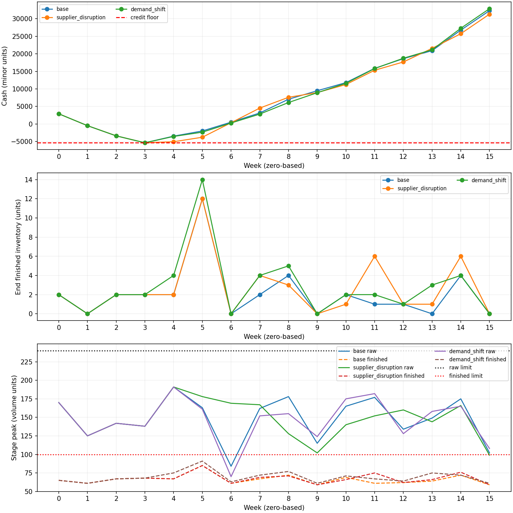
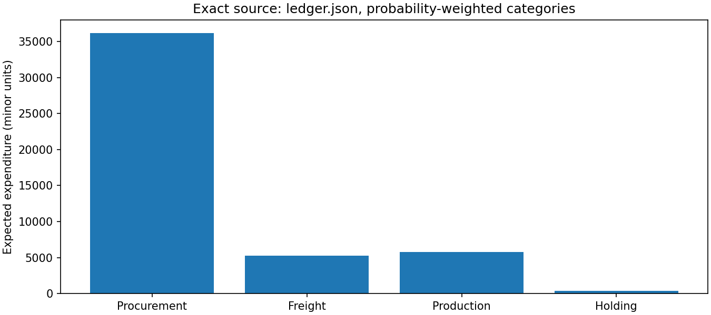

# 16周合成制造采购与生产运营方案

本报告所有金额为合成整数最小单位，不是真实采购指令。周从0开始。报告、图和CSV均由本次原始输入求解及独立逐周模拟生成。
## 执行摘要
主方案精确期望总支出 **238216/5**；替代方案 **476447/10**。
联合整数求解终态 `FEASIBLE`，本地数值下界 47375.0，目标 47643.2。
相对本地下界的差距 0.566121%（若下界为正）。非零差距不称精确最优；该数值界不是独立有理证明，也不是评估者预注册界，正式1%质量仍需独立评估。

|情景|概率|支出|最低周末现金|末周现金|末期应收|
|---|---:|---:|---:|---:|---:|
|base|1/2|47028|-5369|32322|24150|
|supplier_disruption|3/10|48022|-5369|31328|24150|
|demand_shift|1/5|48613|-5369|32897|25230|

## 操作交接与身份

原料index→ID：[(0, 'R0'), (1, 'R1'), (2, 'R2'), (3, 'R3')]；产品：[(0, 'P0'), (1, 'P1'), (2, 'P2'), (3, 'P3')]；产线：[(0, 'F0'), (1, 'F1')]；供应商：[(0, 'A'), (1, 'B'), (2, 'C')]。
完整动作在[plan.json](plan.json)的`decisions[情景ID]`：`order_lots[周][供应商index][原料index]`为整包数；乘normalized中该供应商的pack_units得件数，price_minor为每件价格。`truck_on[周][供应商index]`为装运开关；`production[周][产线index][产品index]`为生产件数。非上述动作不由本报告授权。
周0至3只执行一份共同承诺（任一情景同值），不可按未来选择前缀；周4开始前确认情景ID，之后逐周执行该情景分支。早期订单按原下单周加lead_weeks到货，情景揭示不撤销在途。没有初始在途。
每周按先到货、再生产、再交付、再计期末库存的次序操作。现金先收已到期销售款，再支付当周支出。供应共享体积、产线共享工时及两个阶段峰值不是期末库存约束的替代。

### 共同承诺（完整数值）

|周|采购包数[供应商][原料]|装运开关|生产[线][产品]|
|---:|---|---|---|
|0|[[5, 3, 3, 1], [3, 0, 2, 1], [0, 0, 0, 0]]|[1, 1, 0]|[[10, 0, 7, 0], [0, 6, 0, 4]]|
|1|[[0, 5, 0, 1], [2, 0, 1, 2], [0, 1, 0, 1]]|[1, 1, 1]|[[11, 0, 3, 0], [0, 6, 0, 4]]|
|2|[[0, 6, 0, 0], [1, 3, 0, 0], [0, 0, 0, 0]]|[1, 1, 0]|[[10, 1, 7, 0], [0, 6, 0, 4]]|
|3|[[0, 5, 0, 3], [0, 0, 0, 0], [0, 0, 0, 0]]|[1, 0, 0]|[[10, 4, 3, 0], [0, 2, 0, 7]]|

## 为什么必须提前生产

以下用原始需求与资格/工时计算当周可生产的产品上界；需求超过上界的部分，必须由此前期末成品覆盖。该上界甚至忽略其他产品竞争，因此缺口是必要条件，而非凭求解轨迹推测。

|情景|周|产品|需求|当周宽松产量上界|必须提前持有至少|实际上周期末持有|
|---|---:|---|---:|---:|---:|---:|
|base|6|P0|10|0|10|10|
|base|9|P3|4|3|1|1|
|supplier_disruption|6|P0|10|0|10|10|
|supplier_disruption|9|P3|4|3|1|2|
|demand_shift|6|P0|11|0|11|11|
|demand_shift|9|P3|5|3|2|2|

共享工时还会要求在其他周预制，实际期末成品见图及ledger.finished_inventory；上述表仅陈述可直接证明的必要缺口。

## 供应中断及情景后应对

下表逐一列出相对首情景的供应容量差异，并列实际下单体积。最低装运量高于容量时，该供应商只能关闭，绝不能把原料分别占满一份供应容量。

|情景|周|供应商|基准容量→当前容量|最低量|基准下单体积→当前体积|
|---|---:|---|---:|---:|---:|
|supplier_disruption|6|A|80→15|20|80→0|
|supplier_disruption|7|A|80→15|20|80→0|
|supplier_disruption|8|A|80→15|20|0→0|

共同期不能预知中断；揭示后通过此前/其他供应商订单的到货和库存弥补。下表给出分支中各供应商累计下单体积和成品总产量，逐周采购、到货与耗料分别可在plan和ledger对应字段直接定位。相同动作仅在容量和全部其他约束仍满足时保留，不要求人为翻转。

|情景|情景后供应商累计体积|情景后各产品产量|与首情景不同动作周|
|---|---|---|---|
|base|[625, 630, 45]|[124, 75, 60, 48]|[]|
|supplier_disruption|[625, 560, 120]|[124, 75, 60, 48]|[4, 5, 6, 7, 8, 9, 10, 11, 12, 13, 14, 15]|
|demand_shift|[665, 630, 64]|[136, 75, 48, 60]|[4, 5, 6, 7, 8, 9, 10, 11, 12, 13, 14, 15]|

## 现金瓶颈、费用与仓容

每周`cost = purchase_cost + freight_cost + production_cost + holding_cost`。采购=包数×每包件数×每件报价，运费=每供应商装运开关×固定运费。持有费=两类期末件数×单位持有费；初始库存不重复购入，没有残值冲减。
`cash[t] = cash[t-1] + receipts[t] - cost[t]`，初值7000；receipts[t]为t−4周已交付的需求×销售价，早于0则为0。应收只含已交付未到期销售，不能用于本周付款。

|情景|最低现金周|现金|剩余信用空间|该周收款|该周支出|原料峰值最大|成品峰值最大|
|---|---:|---:|---:|---:|---:|---:|---:|
|base|3|-5369|0|0|1980|191|85|
|supplier_disruption|3|-5369|0|0|1980|191|85|
|demand_shift|3|-5369|0|0|1980|191|91|

信用紧张来自先付订单与生产、销售回款滞后的时间错配；每个情景独立守住信用底线，不能用期望现金抵销某分支缺口。

|期望费用类别|精确金额|
|---|---:|
|purchase_cost|362059/10|
|freight_cost|5232|
|production_cost|29004/5|
|holding_cost|809/2|

最大期望费用项为`purchase_cost`，先比较整包原料价差与运费/库存代价，再考虑产线分配费用。分解之和严格等于期望成本。

图源：[weekly.csv](weekly.csv)，来自[ledger.json](ledger.json)；成品件数曲线不是体积，仓容图采用阶段体积。

图源：ledger四类费用乘summary的精确概率；绘图浮点显示不参与核算。

## 基线与完整可行替代

基线定义：保留主方案全部采购/装运，将生产改成逐周按净当周需求即时生产（先耗初始成品），每种产品只选允许路线中单件生产费最低者，不预制。它是明确、可执行计算的常见局部贪心基线，但不是可行承诺。完整动作见[baseline-plan.json](baseline-plan.json)，实际逐周模拟违例见[baseline-check.json](baseline-check.json)，不将非法轨迹费用冒充可行成本。
模拟共发现33项违例；首项为`{'scenario': 'base', 'week': 2, 'rule': 'line_hours:F1', 'actual': 26, 'limit': 25}`。
第6周F0容量0、P0仅F0合格，故不持成品的即时生产策略必然失败；补救是提前完成表中最低缺口，并联合安排其他产品共享工时、原料到货、仓容与现金，正是主方案所执行。
替代方案由主方案的一次有工时余量的合格路线调配产生（共同期若改则所有情景一起改），不改变采购、到货、产品数量及交付。完整策略、规范账与汇总分别见[alternative-plan.json](alternative-plan.json)、[alternative-ledger.json](alternative-ledger.json)、[alternative-summary.json](alternative-summary.json)，已重新通过独立整数模拟全部约束。
调配详情：{'scenario': 'base', 'week': 15, 'product': 'P2', 'units': 1, 'from_line': 'F0', 'to_line': 'F1', 'extra_production_cost_minor': 3}。替代期望成本比主方案变化3/2。这展示以较高生产费换取原产线工时余量的可行选择，而非假称另一全局最优方案。

## 模型、复跑、输入控制与局限

模型为联合情景的CP-SAT（Constraint Programming with Boolean Satisfiability，布尔可满足性约束规划）整数模型。共同期使用同一组动作变量，后续分支仍引用原订单的到货项。目标乘概率共同分母后为整数。库存递推、两个阶段仓容、资格、共享容量、末期成品零、每周期现金与末期现金均显式约束。独立模拟器不导入求解模型，按周重算全部业务字段并检查整数形状、身份与共同期。
normalized所有向量按目录显式index排序；source-map.json记录每张表的联合身份、数值字段和记录数，DATA.md给出列映射。缺失、重复、非法索引、未引用身份、错误数值/单位域或共同信息不一致直接拒绝，不把缺失当零。
实际参数、依赖版本、终态、耗时在[run.json](run.json)。本轮求解墙钟1800.135秒，线程8。无子代理，不读旧输出，冷启动也不需要本次策略作为热启动。
声明控制类别：仅增加单一供应商某项原料的unit_price_minor，或任意CSV物理行重排。程序始终读取输入数字，不硬编码报价/动作；自测脚本执行反向行序与仅C的R0每件报价+1，并到全新目录复跑。正式封存控制不由本报告推断，其结果仍需独立验证。
求解器浮点原生界按整数目标的概率分母缩放，仅作为成熟求解器的数值界；可行性及账目用Python精确整数/有理数，不用容差。任何限时/正gap不能被解释为精确最优。有限资源下可能只有可行解；本报告不宣称评估得分或业务成功判定。
