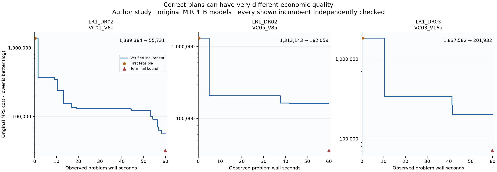
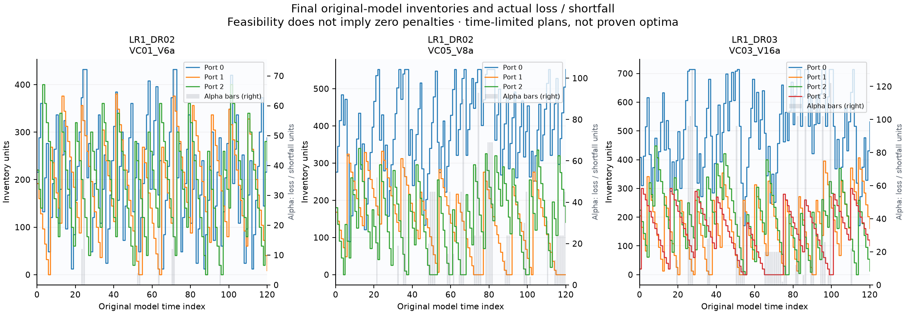

# L06实质重建研究：原海运库存路径问题

这不是0.5题包、冻结合同或重型资格通过。旧0.4题面/分数只读，新candidate和重复旧测试已停止。

实施前Recall、来源比较、影响面、首轮原实例和真实输出要求在[主记录](../../../../../../records/2026-10/2026-10-29-heavy-workbench-long.md)的“实质重建”节。当前采用MIRPLIB原问题调查路线、库存、泊位、装卸和现货的实际经济质量，不能从文献声称困难就宣称本题已获区分度。

原问题资料来自[MIRPLIB](https://mirplib.scl.gatech.edu/instances)，相关成熟评价依据为[ML4CO组织者论文](https://proceedings.mlr.press/v176/gasse22a/gasse22a.pdf)。第三方数据许可尚未核清，原始下载保外部本地缓存；这里不对原资料改许可证。

当前已有原问题实测与实际质量图，仍未完成完整新题、公平可达的质量评价、完整参考/错误programme/一次整审及fresh实测，不能计作完成题数或有效小时。

## 原问题首轮实测

第一次计算前在主记录固定三个原45期实例，单CPU线程，PySCIPOpt6.3.0，成熟算法保留，数值可行容差1e-8。每例一次60秒原MPS完整求解，11:00:10→11:03:11Z实际native0，三例均time-limit且未发现可行解；不是工具失败，也没有候选得分。没有加时或更换原实例重跑。

官方MST仅给全部整数路线，未给连续装卸和库存。随后固定原已发表整数，真实LP补全三完整原模型；合计2.0709316秒，逐一用独立标准库reader重算原约束、界、整数性和目标。它是已发表路线的可达性控制，**不是自主发现路线的参考算法**；三个`optimal`仅指固定路线后的问题，不能当原MILP最优。

| 原实例（均t45） | 原60秒运行 | 已发表路线补全后的可行目标（原MPS最小化） | 独立原约束重算 |
| --- | --- | --- | --- |
| LR1_1_DR1_3_VC1_V7a | 无可行解 | -13272.086123138663 | 7909行、8045变量，全部满足 |
| LR1_2_DR1_3_VC3_V8a | 无可行解 | -12010.195344820282 | 12325行、12745变量，全部满足 |
| LR2_22_DR2_22_VC3_V10a | 无可行解 | -24749.808525111606 | 26234行、24631变量，全部满足 |

原数值与限度在[首次原生末态](observations/native-first.terminal.json)、[完整原问题结果](observations/native-first/execution-terminal.json)和[已发表路线控制](observations/published-route-completion/execution-terminal.json)。这支持“确有可行计划，路线选择与连续补全是不同工作”；尚不能证明重型难度、候选数小时有效工作或质量区分度。L01与本CPU研究同时运行，也不能据此作绝对速度排名。

原输入/原完整模型、MST、完整解向量和所有运行输出保在`D:/opencorvus-benchmark-runs/l06-substantive-reconstruction-20261031`；仓库只保自写程序、实际参数/日志/数值验证和来源成员事实。第三方原始ZIP和数值向量未以本仓库许可证再分发。外部[原料获取收据](observations/acquisition.json)记录原URL/字节/成员；这些身份事实不替代约束和目标的功能验证。

## 从原料重新运行的方法

以下用于全新的自有研究目录，不应据此重跑已完成的首轮：

```powershell
python -m venv D:/new-own-mirplib-env
D:/new-own-mirplib-env/Scripts/python.exe -m pip install -r requirements.txt
D:/new-own-mirplib-env/Scripts/python.exe -B fetch_originals.py --group 1 --out D:/new-own-mirplib-run/original-inputs
D:/new-own-mirplib-env/Scripts/python.exe -B run_original_baseline.py --group 1 --original-inputs D:/new-own-mirplib-run/original-inputs --out D:/new-own-mirplib-run/native-first
D:/new-own-mirplib-env/Scripts/python.exe -B complete_published_routes.py --original-inputs D:/new-own-mirplib-run/original-inputs --out D:/new-own-mirplib-run/published-route-completion
```

后续仍须自主路线算法、从原运营数据到原模型的语义核对、完整研究方案/质量轨迹与实际图/报告/移交、真实错误programme/一次整题审查及合法fresh对照。原已发表路线只是控制；不能将其补全结果当新作者100，不能自动创建0.5或启动candidate。

## 首个自主方法尚未产出可行计划

[时间分解程序](run_temporal_routes.py)在首次计算前登记四个前沿15/25/35/45、每段15秒，只读原MPS，保留全45期物理约束、暂放松远期整数并拟逐步提交早期决定。没有读取官方MST或控制向量。

[真实原生运行](observations/native-temporal-first.terminal.json)11:16:33→11:17:19Z自然exit0，内部44.9243957秒。三例均在首个15前沿没有找到条件可行解，25/35/45从未执行，全部`solution_produced=false`、原可行目标null；[完整研究末态](observations/native-temporal-first/execution-terminal.json)保实际分支与计数。没有加时、调窗口重跑或加载已发表路线补成功。

这是自主方法的真实失败记录，尚不是可复现完整参考、资格通过或模型得分。提交决定、后续前沿与完整算法成功路径尚无本次执行证据；原已发表路线控制不替代它。接下来需实质算法与完整任务工作，不能循环改变窗口或换题编号冒进展。

## 成熟整数构造试验也未找到路线

[构造程序](run_constructive_routes.py)按事前登记把原连续数量暂限制为整数，以CP-SAT找首解，再拟由[原模型优化阶段](refine_constructed_plan.py)处理实际经济目标；没有读取MST/控制解。第一轮三例CP均UNKNOWN、无向量，后SCIP阶段全部未执行，原成本和分数null。[原native末态](observations/native-constructive-first.terminal.json)11:38:05→11:39:40Z实际exit0，研究内部92.1663761秒。不能拿CP无目标响应中的0作经济成本，不能将原不可行与未知混同；优化阶段没有本轮执行成功证据。

目标声明新合同有一次必要局部正向重算：[未声明/真实声明原目标](observations/nullable-claim-original-model-check.json)使用同一已闭合真实原模型和完整向量，前者一致性null，后者true。这不是重跑原LP，也不把此局部信息合同算新构造方法成功或整题资格。

## 已取得正确计划之间的真实经济质量差异

Group1侧重找到任意可行解，连续短冷启动不能建立所需质量层次。按[Group2原模型](https://mirplib.scl.gatech.edu/sites/default/files/Group2_MIP_Model.pdf)的不同结构，在首次本机结果前登记三个原120期实例：船类聚合、每区一个港、整载运输，损产/缺货以显式代价进入目标。没有把Group1数据放大或将其原失败换成新成功。

首次Group2完整源执行11:49:55→11:52:56Z原生exit0、内部180.022284秒。下表中的首解和终解都满足同一原问题，**不是一份错答案和一份对答案**；全部实际BESTSOLFOUND向量均由原MPS独立重算约束、界、整数性与原经济目标。此处没有作者100、候选成绩或新评分线。

| 原实例（t120） | 首个实际可行成本（约） | 终值原可行成本 | 求解器终态下界 |
| --- | --- | --- | --- |
| LR1_DR02_VC01_V6a | 1389364.23 | 55730.689596818054 | 32031.272148783784 |
| LR1_DR02_VC05_V8a | 1313142.66 | 162058.53609443826 | 35918.905468874844 |
| LR1_DR03_VC03_V16a | 1837581.53 | 201932.05230586205 | 71454.3854662436 |

均为time-limit，未证最优；下界是求解器报告，未冒独立精确最优证明。具体首值/事件/数值误差以[完整原质量研究](observations/native-group2-quality-first/execution-terminal.json)、原事件及[作图数据](figures/plot-data.json)为准。原问题允许有代价的损产/缺货，不能把它偷偷变成另一个“必须零缺货”的隐藏硬约束。





两图实际呈现并查看；首版和补显式Alpha图例后的原图/源/命令均保。时间是每例BESTSOLFOUND的实际观察wall时间，含读入、搜索及记录开销，原始求解器时间另外保留；终态下界只画在终态时点。不据此作速度排名/有效小时结论。真实可行质量跨度支持继续建设评价，**不等于该来源已经成为合格重型benchmark**。

复建只对新的自有目录执行；当前已完成研究不得重复求解：

```powershell
python -m pip install -r requirements.txt
python -m pip install -r plot-requirements.txt
python -B fetch_originals.py --group 2 --out D:/new-own-mirplib-run/original-group2-inputs
python -B run_original_baseline.py --group 2 --original-inputs D:/new-own-mirplib-run/original-group2-inputs --out D:/new-own-mirplib-run/group2-quality
python -B plot_quality_axis.py --run D:/new-own-mirplib-run/group2-quality --out D:/new-own-mirplib-run/figures
```

原始输入ZIP/全部原矩阵和解向量继续保外部；本目录只保自写源、原生日志/质量事件及重算/图，范围见[本轮原件清单](observations/constructive-and-quality-scope.json)。缺少的仍是完整新任务/公开质量合同、强弱正确方法锚点、全链科学研究与移交、同checker错误programme、一次集中整题独审及后来合法fresh实测；禁止机械0.5和当前启动candidate。

## 运营计划、经济账与实际移交

[完整任务与输出合同草稿](TASK.reconstruction.draft.md)已明确科学研究目标和未冻结范围。[三份实际运营交付](operational-delivery/README.md)与[真实原生命令移交](operational-delivery/HANDOFF.md)来自已闭合的原计划，没有重新求解。30条匿名路径完整分解562个原弧单位，1200行港口账闭合，最大库存残差2.842170943040401e-14；原数学行/界/整数/目标与raw船队、初始库存/容量、航时、前120期生产消费、泊位和成本来源均已实际核对。

原初始source弧要支付目的港费，原人工sink退出弧也参与本港装卸/泊位和终点调整；三例实际费用分解及匿名路径图没有把它们省略或伪造现实未来航程。同类流的一种路径分解不等于原船名的唯一未来分配。raw元数据360期与原MPS120期边界明确。

该阶段核对只支持已列字段与当时计划一致；后续本轮三个完整原模型的raw构造与全部允许弧/约束比较见下文，历史交付本身未因此被改写。

首导出器source费用误设0、第二例原多类航时文件误读两项设施失败及原源/全部命令保[原件范围](observations/operational/scope.json)。港费修后首例成功，单一格式解析修后仅执行第二/第三例，未重已成功首例或任何solver；两个成功源版本据实记录，不冒同一源码的全新cold或独立整审。全部运营CSV/完整原向量保外部，仓库交付报告/图/源/原检查与范围清单。

原站当前记录三例120期可行成本33809/36659/82837，远低于本轮原计划55730.69/162058.54/201932.05；[来源记录](observations/operational/group2-published-table-operational-context.json)与[原表数值](observations/operational/group2-published-scalar-context-rows.json)明确它们是舍入网页事实，未将其冒本机独立最优证书或新通过线。现有合法解仍有明显改进空间，文件齐全不代表经济质量高。

当前仍缺更强研究方法/有依据的质量锚点、正式质量标尺和整题正错程序/一次集中独审与fresh测量；本轮运营交付不计作合格重型题数或有效候选小时。

## 整类时间网流的实际方法对照

[首次成对研究报告与实际曲线](method-study/README.md)已完整执行。同一原可行起点、同一预登记120秒名义方法wall，两例分别将全模型热搜索和一次整类对串行pass比较；单线程/seed0/原模型/成熟算法保留。原单类例没有再跑一个结构重复的“类对对照”。

| 原实例 | 全模型热搜索成本 / 实际秒 | 整类对成本 / 实际秒 |
| --- | --- | --- |
| LR1_DR02_VC05_V8a | 114048.99020035022 / 120.2398 | 41950.612252912506 / 90.4147 |
| LR1_DR03_VC03_V16a | 182399.0062253472 / 119.7144 | 159303.84020757372 / 120.7171 |

五类的10段条件最优后自然提前结束，三类的3段均time-limit；条件最优和条件界不能冒原模型全局最优/界。46个实际原生改进事件与四终值均核原约束/整数/目标，四份新运营计划/账也真实导出；完整向量/16CSV保外部，[原件范围](observations/class-pair-study-first/scope.json)列每项。没有重复旧冷基线或组件资格，没有按结果换预算/排序或新建候选。

这证明此轮方法对照有实际经济作用；两个公开实例、单次受控研究还不能证明未知输入泛化、无污染、统计区分度或有效小时。正式质量标尺/完整新题正错programme和一次整审仍待，不能按这些数值倒填新的100分线。

当前运营导出CLI已改为显式原MPS、完整向量、真实目标声明和计算作用域，不再要求作者baseline目录/文件名。历史交付中旧命令只对应其已封源码版本，不保当前fallback。当前命令为：

```powershell
python -B export_operational_plan.py --original-mps <original.mps> --values <actual-values.json> --reported-objective <genuine-native-quote> --computation-status <actual-status> --computation-scope original_model --raw-archive <Group2_data_format_only_files.zip> --instance <original-name> --out <new-output>
```

类对pass使用`--computation-scope conditional_pass`且不传原全局界；真正没有目标声明时省略该声明，一致性保持null。原数学reader仍唯一，不重算期望自比。四臂原生→原向量/真实声明→运营账→实际报告/图的本轮全链有记录，但没有冒同一源码的新cold或整题独审。


## 原料构造与新输入全链已实际执行

[新输入完整报告和实际图](constructed-input-study/README.md)将本轮结果、失败、来源与限制放在一起。[构造程序](build_group2_model.py)仅从原raw解析船队/初始可用注入、港口、航时、容量、泊位、生产消费、费用与终点调整，不读取已发表MPS或解；[数学等价检查](verify_model_construction.py)随后与三份独立发布的完整MPS比较。

| 原实例 | 替换固定变量后的自由变量 / 约束 | 比较数值数 | 最大绝对差 |
| --- | --- | --- | --- |
| LR1_DR02_VC01_V6a | 1873 / 1080 | 10595 | 4.55e-13 |
| LR1_DR02_VC05_V8a | 6465 / 2520 | 38443 | 5.12e-13 |
| LR1_DR03_VC03_V16a | 5574 / 2400 | 32799 | 4.55e-12 |

三例全部变量域/整数性、约束函数/方向/右端和目标函数/常数相等；只省原固定零source候选和零dummy，不省真实多船注入及其费用。原始初始固定变量先代入再比较，序列化行名不当数学语义。[实际构造与比较收据](observations/raw-construction-first/equivalence-commands.json)对应三份完整数学对象，未重新求解旧模型或做源码摘要验收。当前reader在同一实现中支持实际SCIP导出的MIN/单一RHS与bound集合、LO/BV/PL；原公开格式和实际新模型均进入同一数值检查。三例等价不是对所有可能Group2输入的普遍证明。

新原料在首生成前固定两个label/seed（20261031、20261032），只用已登记的8%循环需求扰动、逐期总生产=总需求；几何、船队数量、容量、价格、泊位、航时保持来源值，不扩大规模。这些是明确披露的**合成构造验证输入**，不是官网原实例、现实数据或以后可再声称未知的private测试集。没有据求解结果筛seed。

[真实source-only执行](observations/constructed-input-study-first/source-closure-native-terminal.json)13:11:21→13:16:35Z原生0。每份新raw→新MPS→一次成熟冷求解→从其实际可行计划执行原整类对方法→两份运营交付完整闭合：

| 新构造验证输入 | 冷求解正确计划成本 | 整类对续接正确计划成本 | 方法实际wall秒 |
| --- | --- | --- | --- |
| native_rate_validation_vc05 | 161747.706104694 | 51776.886727669065 | 71.2805249 |
| native_rate_validation_vc03 | 300629.6129055649 | 161633.73254488615 | 120.7743717 |

原登记冷求解60秒、后续方法名义120秒为本次研究数值投入，非候选总任务时限；五类10段条件optimal后自然提前结束，三类3段time-limit。续接有额外计算，不据此宣称同资源优于全局法；对应同资源对照已有上一轮独立成对研究，本轮不重跑。所有新实际改进向量/终值按各完整生成MPS重算，四份运营交付共48条匿名类路径、1680港期账、最大库存残差5.684341886080802e-14。类对的局部界/optimal不作全模型证书，也不拿原父实例网页成本给改变后的问题打分。

首source胶囊因CLI配置依赖在库模块顶层导入而exit1，发生在owner启动/原料生成/任何求解之前；[原错误](observations/constructed-input-study-first/native.stderr.txt)和首源保留。唯一修复将CLI专用import移入main，完整封依赖后才执行两个原登记新输入，未重复已完成计算。报告实际渲染并查看，不重求解或重画旧图。[范围清单](observations/constructed-input-study-first/scope.json)列每份当前投影/外部原件；完整rawZIP/MPS/全部中间与最终向量、固定变量映射和16运营CSV继续保外部。仓库不能宣称已包含全部第三方字节。

当前数学对象仍允许有代价的alpha松弛。可行但未最优的计划可以含不必要松弛，不能把所有alpha都解释为物理必然损失，或私加“仅满仓/空仓时才准松弛”的隐藏硬约束。报告必须区分模型允许、经济上可改进与现实可执行保证。

这补上三个原模型的完整raw构造核对和两个新数据完整执行实例；**正式质量校准、整题同checker错误programme、一次集中整题独审、后来合法fresh和有效小时证据仍缺**。当前不新建candidate、0.5、组件资格或审查；已有原矩阵/成对对照不再执行。

### 新目录的原生重现入口

下列命令是当前依赖/数据/输出合同，供以后新自有目录重现，不应再次执行本轮已闭合对象：

```powershell
python -B build_group2_model.py --raw-archive <declared-raw.zip> --instance <name> --periods 120 --out <new-model-dir>
python -B verify_model_construction.py --published <published.mps> --constructed <constructed.mps> --out <new-comparison.json>
python -B run_constructed_input_study.py --original-raw <Group2_data_format_only_files.zip> --out <new-owned-study-dir>
python -B report_constructed_input_study.py --run <closed-new-owned-study-dir> --out <new-report-dir>
```

规划/求解依赖见requirements.txt，绘图环境见plot-requirements.txt。第三方原数据从原站获取，实际两个新输入配方/seed封在首源码中。运行器本次入口只承担这两个已登记构造研究，未冒通用新候选评分接口。未知输入任务与正式质量标尺仍须完整建设。

## 真实经济界与完整数字交付检查

[经济质量合同草稿](NUMERICAL-QUALITY.draft.md)现在明确区分工程有效、经济成本与科学成果：不再把“进入1%阈值”聚合为满分。主量为原成本P，辅以独立可核[L,U]和允许低于1的参照成本比；没有新的100分裁剪、候选总分或有效工时结论。完整数字原子合同N01..N08与逐层科学锚点S01..S05已落盘，科学部分仍未独评，不拿表格数量作完成证据。

[实际完整数字交付/界报告](economic-measurement/README.md)对应两个新输入的首独立证书：

| 输入 | 精确弱对偶下界L（约） | 精确可达上界U（约） | [L,U]剩余不确定度 |
| --- | --- | --- | --- |
| native_rate_validation_vc05 | 36050.09623027005 | 51776.88672766906 | 30.3742% |
| native_rate_validation_vc03 | 70604.14079312999 | 161633.73254488615 | 56.3184% |

这是最优值所在区间，不是测得参考计划实际离最优有这些误差。GLOP各只执行一次连续放松以提议原行乘子；[唯一有理核验](verify_economic_bounds.py)对原MPS十进制/Fraction重算弱对偶和全部界，未信其声称的下界。两个native0、实际各0.873/0.800秒（含精确检查），本次dual投影0。原路线整数保留，仅另做一次有理库存/alpha补全，所有2520/2400行与6476/5594变量、整数性精确通过，独立给U；不改原native声明/P/向量，不冒新路线方法、整数最优或重旧LP控制。

[完整数字checker](assess_operating_delivery.py)首次只读检查原四份正确交付：全部完整MPS、raw运营语义、实际弧表、1680港期账、费用表、48条匿名路径及正流多重集均过；同一MPS/运营事实源，无另一个隐藏模型，也没有重新导出/优化这些对象。文件名按显式layout定位、路径ID和合法分解自由，正确计划保各自不同P，科学内容仍unreviewed/总分null。

[真实错误programme](write_wrong_operating_report.py)从同一实际闭合计划原生写两份完整数字交付：一份把alpha经济费用置零，报37872.30832949673；另一份保正确51776.886727669065但运营账省人工退出服务。两producer实际native0，同checker分别native4/目标声明错误和native4/port0期105退出服务差220；原错误表、源、命令和实际assessment全部保。前者数学P被错报，后者数学计划/目标正确但真实运营账错误，未运行的科学部分不补分。

current exporter只把既有运营计算提取为单一evaluate，原CLI仍负责写同四表；本次checker复用该计算，未再运行旧导出命令。新增Fraction数值类型只在同一MPS parser中，float原路径保持；实际两原生LP证书、精确上下见证和完整正错交付都经当前实现。报告实际渲染并view_image，不重旧科学图。

[原件投影范围](observations/economic-measurement-first/scope.json)明确完整有理证书/向量/CSV继续外部保存，repo源胶囊、原native命令日志、上下界核验事实、四正向/two错误真实assessment和新报告图可读。当前正式未知输入任务、完整参考科学移交/锚点校准、一次集中整题独审与后来fresh/有效小时仍缺；不启动新candidate、0.5或重复资格审查。
