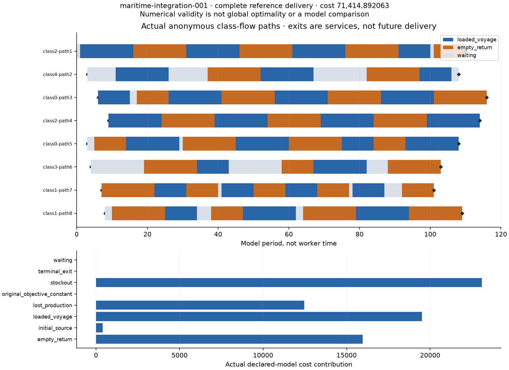

# Complete assigned-input reference delivery

Input: `maritime-integration-001`. The source-only run consumed its assigned raw and
full MPS, using the existing cold method followed by the unchanged single
class-pair pass. No development result vectors or known objectives were loaded.

Actual cold cost: 156117.4485721524.
Actual final cost: 71414.89206295804.
Exact-witness optimum-containing interval (decimal display): [35727.17075583841, 71414.89206295804].
The interval is not a measured error, and conditional optimal statuses are not
full-model optimality. The submitted numerical cost remains separate from the
exact rational feasible upper witness.

The delivered operator tables cover 8 anonymous paths
and 360 port-period rows. Every positive class-flow arc,
initial fee, terminal service, inventory balance and economic term was reconciled
to the assigned raw and MPS. Alpha is allowed priced slack, not necessarily an
unavoidable physical loss. Paths do not identify unique original named vessels.

The full original vector, native logs/accepted events, method stages, four actual
CSV tables, numeric assessment, exact witnesses and source map remain beside
this report. `delivery-layout.json` locates the actual numeric files; the checker
accepts any semantically equivalent layout and valid path decomposition.

This is the integration reference required before an actual candidate comparison.
It does not replace that comparison. Scientific research evidence also includes
the earlier explicitly dated, closed original-model paired study and failure
reports; those experiments were not repeated by this run. One concentrated
whole-case scientific review and later fresh results are still pending.
