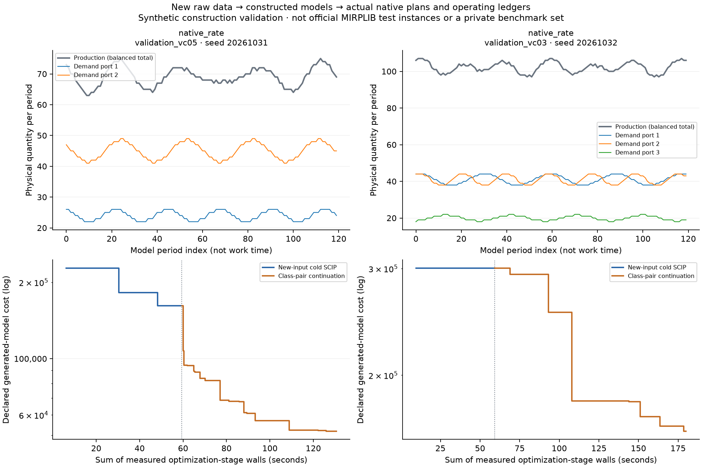

# Raw-to-model construction and new-input execution

These are synthetic construction-validation inputs, not official MIRPLIB
instances, company records, a future private heldout, model grades or heavy-task
qualification. Their recipes and seeds were registered before generation.

The independently implemented operating-data constructor was compared with all
three original published models. Full variable domains/integrality, constraint
functions and objective functions matched after substituting fixed variables.
Only redundant zero source arcs/dummy variables were omitted; actual initial
fleet injections and their port fees were retained. This was algebraic model
verification, not a source checksum and not a rerun of the original optimizers.

## Actual new-input execution

| Generated validation input | Seed | Cold plan cost | Continued class-pair plan cost | Actual dependency |
| --- | --- | --- | --- | --- |
| native_rate_validation_vc05 | 20261031 | 161747.706104694 | 51776.886727669065 | executed_from_actual_new_cold_plan |
| native_rate_validation_vc03 | 20261032 | 300629.6129055649 | 161633.73254488615 | executed_from_actual_new_cold_plan |

Demand uses the fixed cyclic recipe; total production equals aggregate demand
each period. Fleet size, geometry, capacities, berth limits, prices and travel
times retain the original operating values. The variation removes reliance on
the exact published plan but is not claimed to make a task intrinsically harder.
No seed was reselected after seeing a solve. These disclosed validation inputs
must not later be mislabeled as fresh private tests.

Every newly accepted vector and final plan was recomputed against its complete
declared generated MPS. For produced plans, actual operating ledgers checked
the raw rate arrays, fleet, capacity, berth, travel and cost semantics; missing
initial plans leave downstream dependencies explicitly unexecuted. The full original
inputs, generated MPS, vectors and operating CSVs remain in the external run root.
No published optimum or parent-instance cost was substituted as a target for
the generated problems.

The first source capsule failed on an unused top-level CLI profile import before
owner startup or any input/solve. That failure and its exact source were retained;
the source-closure revision moved the CLI-only dependency into main and sealed
the full dependencies. Both registered inputs then used that revised source.
No completed original solver, paired study, candidate or component qualification
was repeated.

## Interpreting quality and time

The cold optimizer received its registered 60-second research allowance; the
subsequent class-pair pass received a nominal 120-second method-wall allowance.
The latter starts from an actual cold plan, so an improvement is not evidence
of superiority over a contemporaneous equal-time global continuation. That
different comparison was performed in the prior original-model paired study.
Here the purpose is complete new-data execution and operational correctness.

The cost chart concatenates measured optimization-stage walls and excludes
generation, process-start, export and plotting work; model periods in the top
chart are not worker time. Native logs and real wrapper timestamps are retained.
Conditional subproblem bounds/optimal statuses are not full-model optimum
proofs. L01 remained active; there is no hardware speed, model cost or effective
candidate-hours claim.

## Reproduction and unfinished benchmark work

The current source uses one raw parser, one constructor, the current mature
original-model optimizer primitive, the unchanged class-pair method and one
numerical MPS checker. It does not select expected values from known solutions.
The pre-execution source archives, the dependency-closure revision and all real
commands identify exactly what ran. A new full independent cold rebuild/review
of this complete reconstructed task has not been performed.

Formal prospective scientific quality calibration, complete task wrong-programme
evidence, one concentrated whole-case independent review, later legitimate
fresh studies and effective-hours evidence remain pending. The old engineering
contracts/scores remain immutable; there is no new 100-point line or version loop.
