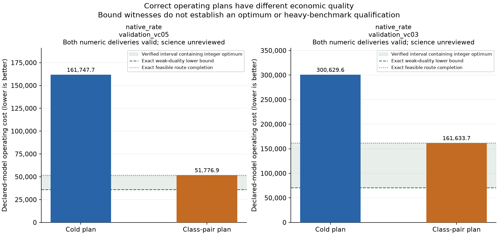

# Economic measurement and complete numeric deliveries

This work evaluates disclosed construction-validation inputs. It is not a new
frozen benchmark, model grade, independent scientific review or candidate-hours
qualification. Earlier engineering scores remain unchanged.

Four actual closed deliveries were read without rerunning their optimizers or
exports. The same checker recomputed the whole declared model, raw operational
semantics, all positive arcs, port-period ledgers, economic tables and path-flow
coverage. Both valid outputs per input retain their different economic costs.

| Input / plan | Numerical cost P | Verified lower L | Verified feasible upper U | P / U | Gap to L (remaining uncertainty included) |
| --- | --- | --- | --- | --- | --- |
| native_rate_validation_vc05 / cold | 161747.706104694 | 36050.096230270 | 51776.886727669 | 3.123936496 | 77.712144% |
| native_rate_validation_vc05 / class-pair | 51776.886727669 | 36050.096230270 | 51776.886727669 | 1.000000000 | 30.374152% |
| native_rate_validation_vc03 / cold | 300629.612905565 | 70604.140793130 | 161633.732544886 | 1.859943517 | 76.514575% |
| native_rate_validation_vc03 / class-pair | 161633.732544886 | 70604.140793130 | 161633.732544886 | 1.000000000 | 56.318437% |

L is independently verified from rational Lagrangian multipliers and all
original variable bounds. A floating LP solve only proposes the multipliers;
its reported objective is not accepted as proof. U is a separate exact rational
inventory/alpha completion of the already obtained integer route. Every row,
bound and integer domain was checked exactly. The original submitted P and
stored vectors were retained; this new completion does not rewrite history.

The interval [L,U] contains the integer optimum of the finite decimal MPS.
Its width is unresolved: it is not a measured error of the class-pair plan.
Numerically feasible submitted plans use the declared tolerances and do not
automatically inherit the exact rational upper witness. No conditional-neighborhood
bound, rounded website value or parent-instance optimum was substituted.

The raw objective remains primary. P/U is a descriptive ratio to an explicitly
feasible reference, with values below 1 permitted for better submissions. A
reference ratio of 1 is not 100 points, an optimality certificate or a quality
threshold. The bounded relative-gap convention follows the optimization
literature; no timing integral or worker-hours conclusion is computed here.

## Real error programmes through the same checker

Two native operating-report programmes consumed the same actual closed plan
and wrote complete new numeric deliveries. One booked alpha loss/shortfall at
zero expense; one treated artificial terminal exits as no inventory service.
The former misreported the economic objective, while the latter retained the
right mathematical plan/objective but supplied a wrong operating ledger.

- invalid_delivery: `submitted_model_or_objective_contract`.

- invalid_delivery: `operating_delivery:delivery_numeric_cell:(0, 105):signed_vessel_service_inventory_effect:actual=6.915286121511599e-10,expected=-219.99999999930847`.

Both producer processes exited 0; the same delivery checker returned 4 with
those concrete contract errors. Unreviewed scientific material and final scores
remain null. These error controls validate the specified domain errors, not
heavy-task difficulty or the complete scientific task.

## Remaining task work

A fair future unknown-input task, full scientific quality anchors, complete
reference research/handoff and one concentrated independent whole-case review
still need completion. Later fresh studies must establish actual discrimination
and useful work; the two disclosed inputs cannot be relabeled private heldout.
No new candidate, repeated paired study, old solver run or component qualification
was started. Full rational witnesses, raw/MPS/variables/CSV and original logs
remain external with an explicit repository projection manifest.
