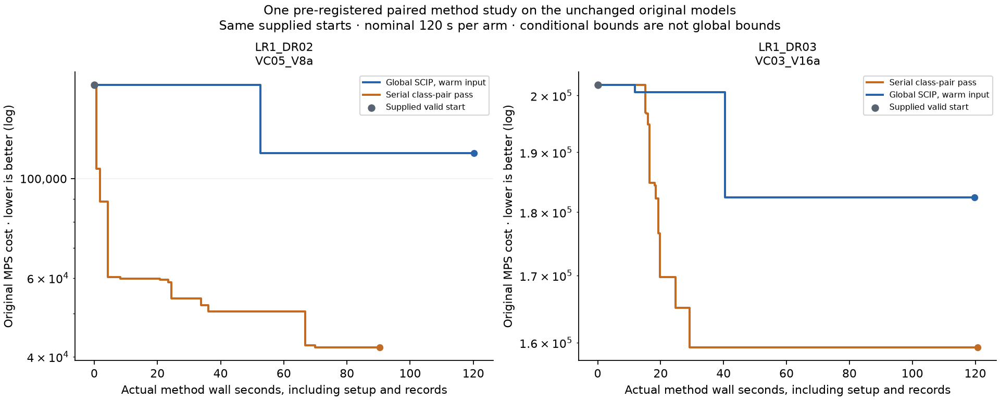

# Full-horizon class-pair method study

This is original-problem author research, not a model score or qualified heavy benchmark.
The counterbalanced study was registered before execution. Both arms used the same
actual prior feasible vector for each instance; no published route solution was supplied.
The original mature SCIP algorithms were retained in both arms.

| Instance | Strategy | Original feasible cost | Actual method wall s | Nominal overrun s | Stages |
| --- | --- | --- | --- | --- | --- |
| LR1_DR02_VC05_V8a | global | 114048.99020035 | 120.2398 | 0.2398 | 1/1 |
| LR1_DR02_VC05_V8a | class-pairs | 41950.61225291 | 90.4147 | 0.0000 | 10/10 |
| LR1_DR03_VC03_V16a | class-pairs | 159303.84020757 | 120.7171 | 0.7171 | 3/3 |
| LR1_DR03_VC03_V16a | global | 182399.00622535 | 119.7144 | 0.0000 | 1/1 |

The class-pair arm had lower final cost than the warm global arm on 2/2
registered instances. Every retained plan and actual native best-solution event
was independently checked against the original rows, bounds, integrality and
objective; fixed other-class integer arcs were also checked for each neighborhood.
The initial point in the chart is the supplied valid input, not a new discovery.

## Operating interpretation

All four new resulting plans were actually exported with the explicit original
MPS, full vector and genuine native objective claim recorded in the mathematical
check. The original raw fleet/rates/capacities/travel/cost/berth semantics and
inventory and economic ledgers were reconciled. No new optimization occurred in
that export. Full CSVs and vectors remain in the external scientific root.

| Instance | Strategy | Loaded travel | Empty return | Lost production + stockout | Source fees + terminal adjustment |
| --- | --- | --- | --- | --- | --- |
| LR1_DR02_VC05_V8a | global | 19173.64 | 14777.28 | 79703.94 | 394.13 |
| LR1_DR02_VC05_V8a | class-pairs | 20582.55 | 16486.35 | 4486.50 | 395.21 |
| LR1_DR03_VC03_V16a | class-pairs | 39750.65 | 31941.25 | 87049.30 | 562.64 |
| LR1_DR03_VC03_V16a | global | 36804.13 | 30692.40 | 114339.83 | 562.65 |

## Method and evidence limits

The method is inspired by the two-ship neighborhood and serial improvement pass
in the [authors' manuscript, sections 5.2.1 and 5.4](https://optimization-online.org/wp-content/uploads/2014/04/4319.pdf).
Here the variables describe aggregate vessel classes. Every unordered class pair
is released over the entire original horizon once; other-class integer arcs stay
at the current feasible plan, while all original continuous variables remain free.
Pairs are ordered by the predeclared initial unused capacity-time proxy. This is
an adaptation, not a reproduction of that paper's different individual-ship model.

Nominal method wall allocations include setup/check/record costs. Actual measured
wall overruns are shown above; platform solver limit granularity is not disguised
as exact equal resource use. Fast completed neighborhoods carry spare time onward;
the single pass can finish naturally before the allowance. All arms were serial,
with a counterbalanced order, seed zero and one CPU thread; L01 training remained
active. This is not a population-level, exact-hardware, speed or effective-hours claim.

Neighborhood bounds and optimal statuses apply only after fixing other classes.
They are not original-MILP global bounds. The global arm's bounds are solver
reports, not independent exact certificates. A lower objective on these public
instances does not establish unseen-input generalization, absence of contamination,
benchmark discrimination or a new 100-point quality line.

The single-class original instance was not rerun: releasing its full class flow
would duplicate the complete-model neighborhood rather than test the mechanism.
No window/budget tuning, previous cold baseline, old candidate, solver control or
independent whole-case review was repeated. The full task's stronger quality
anchors, prospective calibration, genuine wrong-programme chain and concentrated
whole-case review/future fresh evidence remain unfinished.
