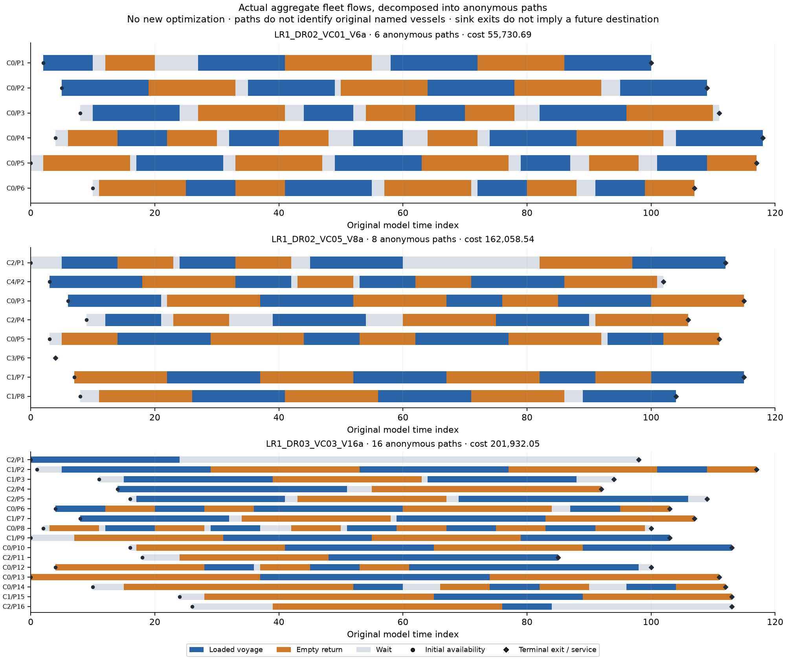

# Original maritime planning: operational study

This is an actual author research delivery, not a frozen benchmark or model score.
The three already closed original plans were exported without a new solve.

| Original instance | Paths | Port-period rows | Original cost | Published rounded feasible cost |
| --- | --- | --- | --- | --- |
| LR1_DR02_VC01_V6a | 6 | 360 | 55730.68959682 | 33809 |
| LR1_DR02_VC05_V8a | 8 | 360 | 162058.53609444 | 36659 |
| LR1_DR03_VC03_V16a | 16 | 480 | 201932.05230586 | 82837 |

The original rows, bounds, integrality and economic objective are recomputed by
the standard-library original-MPS reader. Operational ledgers then match the raw
initial fleet and inventory, class capacities, production/consumption prefix,
berths, travel-time tables, coordinate-based travel and port costs, and penalties.
The raw files describe 360 periods; the exact selected MPS models describe 120.
Only that original 120-period prefix is interpreted.

## Economic findings

Every plan is valid, while material penalties remain. The first plan pays
approximately 23,138 in lost-production/stockout costs; the other two pay
approximately 129,108 and 134,215. Those are original economic penalties, not
violations of a newly invented zero-loss condition. Their route choices therefore
still leave substantive room for better decisions.

The [published MIRPLIB table](https://mirplib.scl.gatech.edu/index.php/instances?order=field_inst_period&sort=asc)
provides the scalar context shown above. These are rounded website observations,
not independently checked solution vectors or exact optimality certificates.
The costs are not turned into a new pass threshold or a 100-point aggregate.
The local plans remain time-limited and are substantially more expensive than
the published feasible-cost context. Completion of this report does not make
their optimization quality excellent.

## Operational findings and limits

Initial source arcs pay the original destination port fee. Terminal sink arcs
also load/unload a full class cargo and use a berth at their origin; their
objective includes the original terminal adjustment. The artificial sink is not
a real next port, and its cargo is not claimed as demand delivered in the future.
Removing those arcs from the operating ledger would silently break the model.

The path plot decomposes all original positive integer class flow. Each arc is
consumed exactly its original number of times. Anonymous paths are one possible
assignment of aggregate flows, not an identified schedule for uniquely named
real vessels. Hard constraints and costs remain the original MPS facts.

The full CSVs and original vectors remain in the external research root. The
index records their actual directories and the two successful export-source
versions; it does not pretend all three ran under the later parser revision.
The initial source-fee and multi-class parsing errors are retained as facility
failures, followed only by the affected export reruns. No solver was repeated.

## Unfinished work

A stronger researched method, prospective quality calibration, complete new
task wrong-programme evidence, one concentrated whole-case independent review
and later legitimate fresh studies remain pending. Neither heavy-task
qualification, candidate discrimination nor effective hours is established.
