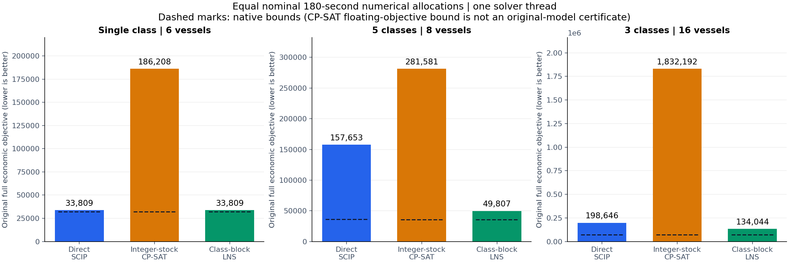
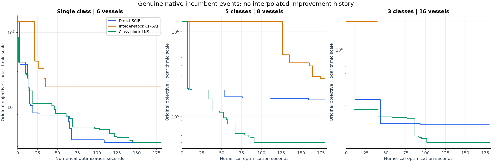
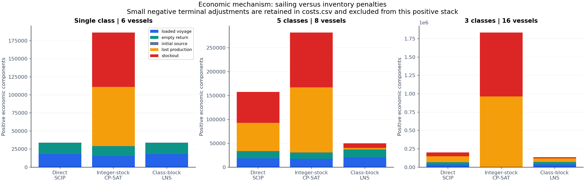
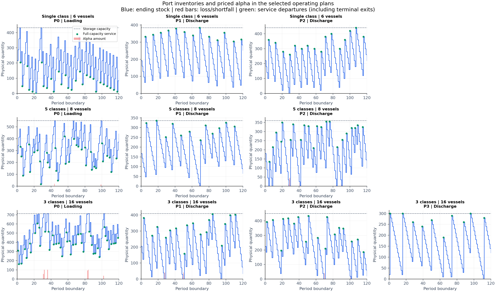
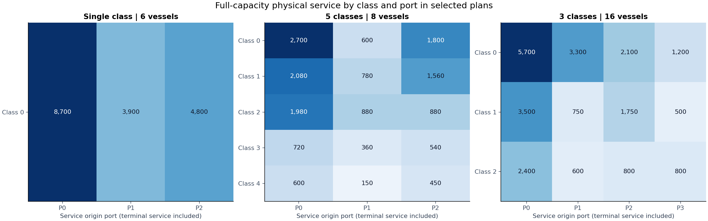
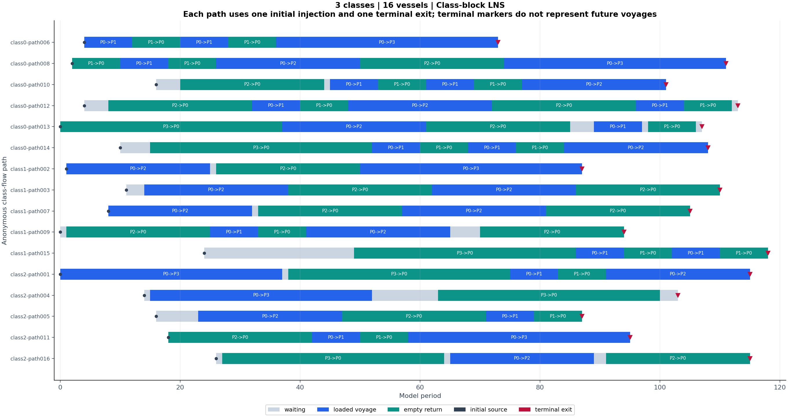

# Maritime inventory-routing: native methods and operating evidence

Class-block large-neighborhood search (LNS) reduced the five-class objective from 157,652.78 to 49,807.07 (68.41%) and the three-class objective from 198,645.51 to 134,043.71 (32.52%) at the same nominal 180-second, one-thread profile. The single-class case was 0.01 more expensive. The remaining full-model gaps are 27.88% and 46.70% for the multi-class plans; neither is proved optimal.

The deliverable computes fresh plans from the complete assigned Mathematical Programming System (MPS) model file and raw archive. The economic objective is the original finite MPS dot product, including initial port fees, discounted inventory penalties and terminal adjustments. All nine registered 180-second development results were checked against every original row and the operating tables. The observations below concern these three disclosed development instances; new-input performance has not been observed.

## Methods and controlled allocation

SCIP means Solving Constraint Integer Programs. Direct SCIP uses the complete original mixed-integer linear programme (MILP), SCIP 10.0.2 through PySCIPOpt 6.3.0, one solver thread, seed shift 0 and feasibility tolerance 1e-9. Its mature presolve, cuts, branching and heuristics remain enabled. The baseline has no author route hint. Integer-stock CP-SAT (constraint programming with Boolean satisfiability) uses OR-Tools 9.15.6755, one search worker and seed 0, with the same physical constraints and original floating objective. It receives a freshly constructed, checked terminal-only hint. The native floating objective is scaled internally; its native bound is reported as a numerical CP-SAT bound, not an exact original-MILP certificate. Engine, inventory-domain strengthening and the hint change jointly, so this comparison does not isolate their individual causal effects.

For fixed integer arc counts, every remaining stock/alpha column has one unit coefficient or two opposite unit coefficients in a separate port chain. With integral fixed cargo effects, rates, initial stocks and bounds, this incidence matrix has an integral optimum. Making the stock/alpha variables integer therefore preserves the best value for each integer flow in this supplied family. It does not make the coupled route/berth/cargo model integral. Unbounded alpha receives a safe finite upper bound derived from its original inventory equality and the finite original bounds of every other variable in that row. These derivations are saved per CP-SAT run; no heuristic cap or zero-shortage condition is added.

Class-block LNS (large-neighborhood search) constructs its own feasible terminal-only seed, then uses the original SCIP MILP throughout. With multiple classes it allocates 25% to an unrestricted full solve, 50% across cyclic adjacent class pairs over the entire 120-period horizon, and all measured remaining numerical time to another unrestricted solve. In a class-pair block, only other classes' original arc counts are fixed; stocks, alpha and the two free class flows remain jointly optimized. The one-class case is a single seeded unrestricted solve. Seed construction counts as numerical optimization. Every phase retains its native candidate and bound scope. Only unrestricted phases contribute to a global bound. Original waiting arcs and flow rows are retained; waiting-flow elimination was not implemented. This is a simple block-neighborhood design, not a reproduction of an author algorithm.

The six SCIP/CP-SAT runs were registered first and executed sequentially; the three class-block runs were registered as a development refinement and executed once per input afterward. Each nominal numerical allocation is 180 seconds and each solver has one thread. No previous experiment vector is read by the assigned-input programme. Source snapshots, exact parameters, native logs/events, complete vectors and process return codes are retained under the experiment directories. Development selection is disclosed; there are no independent unseen quality results in this report.

## Actual economic results

| Fleet | Method | Full objective P | Native lower bound | Bound scope | Lost production | Stockout |
|---|---|---:|---:|---|---:|---:|
| 1 class / 6 vessels | Direct SCIP | 33,808.95 | 32,039.95 | full original model | 0.00 | 0.00 |
| 1 class / 6 vessels | Integer-stock CP-SAT | 186,208.42 | 32,031.21 | scaled CP-SAT | 876.00 | 804.00 |
| 1 class / 6 vessels | Class-block LNS | 33,808.96 | 32,035.16 | full original model | 0.00 | 0.00 |
| 5 classes / 8 vessels | Direct SCIP | 157,652.78 | 35,938.21 | full original model | 632.00 | 697.00 |
| 5 classes / 8 vessels | Integer-stock CP-SAT | 281,581.48 | 35,921.62 | scaled CP-SAT | 1,464.00 | 1,213.00 |
| 5 classes / 8 vessels | Class-block LNS | 49,807.07 | 35,919.44 | full original model | 35.00 | 98.00 |
| 3 classes / 16 vessels | Direct SCIP | 198,645.51 | 71,456.78 | full original model | 844.00 | 551.00 |
| 3 classes / 16 vessels | Integer-stock CP-SAT | 1,832,191.89 | 70,646.01 | scaled CP-SAT | 10,284.00 | 9,349.00 |
| 3 classes / 16 vessels | Class-block LNS | 134,043.71 | 71,444.85 | full original model | 498.00 | 165.00 |

The single-class seeded SCIP case has the same loaded-voyage and empty-return cost as direct SCIP; its total is 0.01 higher because of the terminal adjustment. It is not an improvement. Tiny negative slack values within feasibility tolerance are displayed as zero here; the original full vectors and CSV values are retained unchanged. No cost is clipped or converted to an author score. The following ratio uses the disclosed feasible direct-SCIP plan on the same input; below 1 means lower cost.

| Fleet | LNS / direct SCIP | LNS cost reduction versus SCIP | LNS full-bound relative gap (P-L)/P |
|---|---:|---:|---:|
| 1 class / 6 vessels | 1.0000003 | -0.01 (-0.000030%) | 5.25% |
| 5 classes / 8 vessels | 0.3159289 | 107,845.71 (68.407111%) | 27.88% |
| 3 classes / 16 vessels | 0.6747885 | 64,601.80 (32.521146%) | 46.70% |

The CP-SAT histories are evidence of the actual tested configuration, not a claim that CP-SAT is universally inferior. The seeded short smoke plan was feasible but very expensive. In the completed single-class CP-SAT run, late incumbent changes were small while substantial alpha remained. A feasible hint alone did not solve the hard route-timing problem. Native logs show the actual search and bound evolution; no smooth or hypothetical improvement history has been added.

## What the class neighborhoods changed

| Fleet / phase | Before | Retained after | Economic decrease | Actual optimizer-call seconds | Bound scope |
|---|---:|---:|---:|---:|---|
| 1 class / 6 vessels / full | 1,388,593.53 | 33,808.96 | 1,354,784.57 | 179.671 | full model |
| 5 classes / 8 vessels / initial-full | 1,312,385.26 | 116,444.45 | 1,195,940.81 | 44.991 | full model |
| 5 classes / 8 vessels / class-pair-1 [classes 0,1] | 116,444.45 | 82,136.58 | 34,307.88 | 14.887 | local block |
| 5 classes / 8 vessels / class-pair-2 [classes 1,2] | 82,136.58 | 63,279.31 | 18,857.26 | 17.406 | local block |
| 5 classes / 8 vessels / class-pair-3 [classes 2,3] | 63,279.31 | 57,313.14 | 5,966.17 | 11.257 | local block |
| 5 classes / 8 vessels / class-pair-4 [classes 3,4] | 57,313.14 | 56,679.24 | 633.90 | 0.378 | local block |
| 5 classes / 8 vessels / class-pair-5 [classes 0,4] | 56,679.24 | 49,807.07 | 6,872.17 | 1.715 | local block |
| 5 classes / 8 vessels / final-full | 49,807.07 | 49,807.07 | 0.00 | 89.179 | full model |
| 3 classes / 16 vessels / initial-full | 1,834,572.37 | 233,229.99 | 1,601,342.38 | 44.864 | full model |
| 3 classes / 16 vessels / class-pair-1 [classes 0,1] | 233,229.99 | 229,883.70 | 3,346.28 | 29.687 | local block |
| 3 classes / 16 vessels / class-pair-2 [classes 1,2] | 229,883.70 | 134,043.71 | 95,839.99 | 29.697 | local block |
| 3 classes / 16 vessels / class-pair-3 [classes 0,2] | 134,043.71 | 134,043.71 | 0.00 | 29.655 | local block |
| 3 classes / 16 vessels / final-full | 134,043.71 | 134,043.71 | 0.00 | 46.719 | full model |

A decrease within a pair block is a concrete feasible improvement while all other class flows are held fixed. It demonstrates that the incumbent had an improvable class interaction; it does not establish global optimality. A block optimal status only certifies that restricted block numerically. The cyclic pair list does not cover every subset of classes, and final full search can still be far from a proof.

| Fleet | Change in loaded voyage cost | Change in empty return cost | Change in lost-production penalty | Change in stockout penalty |
|---|---:|---:|---:|---:|
| 1 class / 6 vessels | 0.00 | 0.00 | 0.00 | 0.00 |
| 5 classes / 8 vessels | 2,230.77 | 1,447.28 | -55,785.05 | -55,738.88 |
| 3 classes / 16 vessels | 2,385.65 | 1,285.87 | -32,203.37 | -36,069.72 |

Negative changes in this table reduce cost. Initial source fees are fixed by the assigned injections; terminal adjustments and any objective constant are fully reconciled in costs.csv. Priced alpha can be legal and avoidable: its occurrence in an incumbent does not prove a physical shortage is unavoidable.

## Operating mechanisms and delivered plans

Full vessels depart loading ports and perform their discharge service when leaving a discharge node. A waiting arc has no cargo service and consumes no service berth. Each terminal exit performs one full-capacity service at its origin and consumes a berth there. Its artificial destination time is the horizon boundary, not a future port or delivered future demand. Initial source arcs pay a port fee but perform no inventory service. These distinctions explain why total service at a loading port is not identical to in-horizon loaded-voyage cargo.

The five-class input combines capacities 300, 260, 220, 180 and 150 with a single berth at each port. All classes have the supplied same travel times (9 periods from loading port 0 to port 1 and 15 to port 2). Larger classes lower voyage cost per unit on a fixed route but need more free inventory space on discharge. For example, port 1 starts with 168 units, consumes 24 each period, and holds at most 336. Its initially loaded class-0 vessel becomes available at period 3, but a 300-unit service then would leave 372 units. With no earlier incoming voyage possible, service first fits at period 5, leaving 324. The actual initial-service table records what each delivered path does. This is a concrete inventory/arrival interaction, not a demand forecast.

The five-class change adds 580 units of loading-port service (7,500 to 8,080), while lost production falls from 632 to 35 units. Port-1 shortfall falls from 512 to 8 and port-2 shortfall from 185 to 90. The extra sailing/return cost is about 3,678, while the two inventory penalties fall by about 111,524. Smaller classes perform more loading services in the final plan (class 3: 2 to 4; class 4: 2 to 4), alongside changed larger-class routing. This supports a service-timing and capacity-mixing explanation rather than a transport-cost reduction.

The three-class input has loading-to-port-3 travel time 37 periods versus 8 to port 1. Long cycles tie up the same fleet much longer. Fixed initial loaded vessels, capacity mixing and terminal service can change which early departure should use the sole loading berth. The figures below show actual class/port service, stock trajectories, alpha and complete anonymous paths. Actual full MPS arc prices, rather than rounded displayed distances or a common invented discount rule, determine every economic comparison.

For the three-class fleet, port-3 shortfall falls from 230 to zero, port-1 from 226 to 99 and port-2 from 95 to 66, while loading loss falls from 844 to 498. One class-2 injection at port 2, available at period 18, waited until period 98 for terminal service in the direct-SCIP plan; in the delivered plan it performs service and starts its empty return at period 18. These statements can be checked in the original and final initial-service.csv and paths.csv. They describe changed feasible schedules and avoidable incumbent slack, not a proof that this single vessel alone causes the total economic gain.

| Selected class-block plan | Port / role | Service quantity | Alpha quantity | Ending stock | Berth periods used / available |
|---|---|---:|---:|---:|---:|
| 1 class / 6 vessels | P0 / Loading | 8,700.00 | 0.00 | 156.00 | 29 / 120 |
| 1 class / 6 vessels | P1 / Discharge | 3,900.00 | 0.00 | 252.00 | 13 / 120 |
| 1 class / 6 vessels | P2 / Discharge | 4,800.00 | 0.00 | 220.00 | 16 / 120 |
| 5 classes / 8 vessels | P0 / Loading | 8,080.00 | 35.00 | 441.00 | 34 / 120 |
| 5 classes / 8 vessels | P1 / Discharge | 2,770.00 | 8.00 | 66.00 | 12 / 120 |
| 5 classes / 8 vessels | P2 / Discharge | 5,230.00 | 90.00 | 100.00 | 22 / 120 |
| 3 classes / 16 vessels | P0 / Loading | 11,600.00 | 498.00 | 550.00 | 45 / 120 |
| 3 classes / 16 vessels | P1 / Discharge | 4,650.00 | 99.00 | 34.00 | 17 / 120 |
| 3 classes / 16 vessels | P2 / Discharge | 4,650.00 | 66.00 | 21.00 | 18 / 120 |
| 3 classes / 16 vessels | P3 / Discharge | 2,500.00 | 0.00 | 120.00 | 10 / 120 |

Path IDs are anonymous decompositions of class flow, not unique assignments to the named raw vessels. Every positive original arc count and initial vessel is covered. The full schedule, per-port inventory/slack and exact costs are operating outputs of this deterministic model. They are not real-company logs or guarantees against unmodelled weather, congestion, partial cargo, future demand or execution disruptions.

## Timing, validation and uncertainty

| Fleet / method | Native solver seconds | Measured optimizer-call seconds | Optimizer process CPU seconds | Input + method setup seconds | Validation/export seconds | Child process wall seconds |
|---|---:|---:|---:|---:|---:|---:|
| 1 class / 6 vessels / Direct SCIP | 180.000 | 179.510 | 175.500 | 0.145 | 0.015 | 180.270 |
| 1 class / 6 vessels / Integer-stock CP-SAT | 180.006 | 180.012 | 170.172 | 0.315 | 0.023 | 181.590 |
| 1 class / 6 vessels / Class-block LNS | 180.000 | 179.671 | 175.047 | 0.133 | 0.038 | 180.338 |
| 5 classes / 8 vessels / Direct SCIP | 180.000 | 179.112 | 168.906 | 0.359 | 0.036 | 180.568 |
| 5 classes / 8 vessels / Integer-stock CP-SAT | 180.011 | 180.025 | 175.812 | 0.526 | 0.035 | 181.601 |
| 5 classes / 8 vessels / Class-block LNS | 181.000 | 179.814 | 171.109 | 0.657 | 0.379 | 183.296 |
| 3 classes / 16 vessels / Direct SCIP | 180.000 | 179.500 | 178.438 | 0.222 | 0.034 | 180.361 |
| 3 classes / 16 vessels / Integer-stock CP-SAT | 180.012 | 180.020 | 176.984 | 0.471 | 0.028 | 181.497 |
| 3 classes / 16 vessels / Class-block LNS | 182.000 | 180.622 | 175.609 | 0.432 | 0.264 | 182.929 |

Recorded numerical-profile overruns: 1 class / 6 vessels / Integer-stock CP-SAT: 0.011862 seconds; 5 classes / 8 vessels / Integer-stock CP-SAT: 0.025014 seconds; 3 classes / 16 vessels / Integer-stock CP-SAT: 0.020177 seconds; 3 classes / 16 vessels / Class-block LNS: 0.636154 seconds. Class-block total numerical time also includes its measured seed-construction heuristic; see each native-result.json. SCIP's native Windows event clock has coarse one-second observations in these runs; high-resolution process-wall and CPU measurements are retained separately. CP-SAT seed construction was included in method setup in the original comparison implementation and not separately timed; this small implementation overhead is not represented as solver work. Model reading/conversion, validation, plotting and the whole process lifecycle are not relabelled as numerical optimization.

The separate check.py audit reads the full vector and checks every original bound, integrality restriction and row; it then checks the six output slots, original objective, all positive arcs and anonymous path counts/continuity, every inventory balance and berth row, and all cost components. It uses absolute1e-6 for domains/integrality, 1e-6+1e-9*abs(rhs) for rows (including inventory residuals), and the public ordinary reconciliation tolerance. Full model and table audits, native terminal statuses and solver errors are retained. This is numerical feasibility, not an exact rational proof.

The short unseeded CP-SAT and one-second SCIP smoke runs found no incumbent and remain failures with unavailable objectives. The seeded five-second CP-SAT smoke plan remains an expensive feasible engineering check. These are not substituted for the controlled comparison. The initial PDF console Unicode error is also disclosed in EXPOSURE.md.

These are single runs with fixed seeds on one native Windows environment, not a replicated statistical study. Wall-clock stopping, solver builds, warm starts and phase restarts can change outcomes. The class-block design was selected with access to development evidence. The two later assigned inputs are only known to retain the disclosed fleet/geometry/prices while changing rates by the registered cyclic recipe; no actual result on them is claimed. No universal method superiority, optimum, benchmark grade or mature industrial generalization follows from source engineering completion.

## Traceability and reproduction

submission.json declares the exact fresh-input argv and six-slot layout. HANDOFF.md gives native commands and dependency/setup instructions. source-map.json maps programme modules, validation, report and figures to real run artifacts. analysis-summary.json and operating-analysis.json contain the numeric sources of the tables and plots. Every development run retains its original complete vector, genuine native claim, parameters, incumbent events and terminal status; class-block stages retain those separately. No answer vector is an assigned-input dependency. Local Git provenance exists only inside this owned project and has no remote.

Method/library attribution: [PySCIPOpt Model API](https://pyscipopt.readthedocs.io/en/stable/api/model.html), [PySCIPOpt genuine event callbacks](https://pyscipopt.readthedocs.io/en/v6.2.1/tutorials/eventhandler.html), [official OR-Tools CP-SAT Python API](https://or-tools.github.io/docs/pdoc/ortools/sat/python/cp_model.html), [official OR-Tools search logging/worker documentation](https://github.com/google/or-tools/blob/stable/ortools/sat/docs/troubleshooting.md), and [SCIP timing API](https://www.scipopt.org/doc-10.0.3/html/group__PublicTimingMethods.php). Instance facts come exclusively from the supplied MPS/raw/PDF; see EXPOSURE.md for the full boundary and disclosure.
