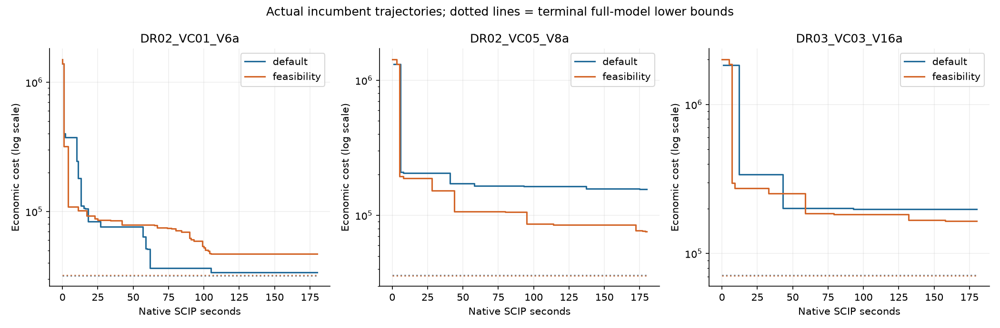
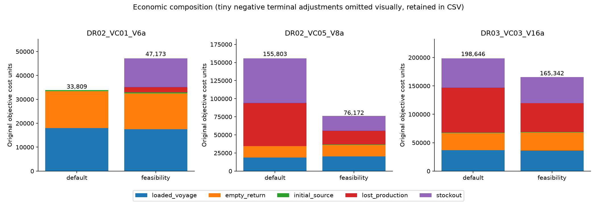
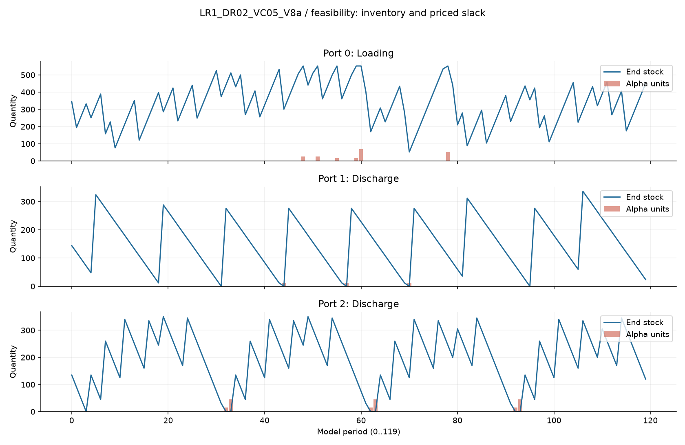
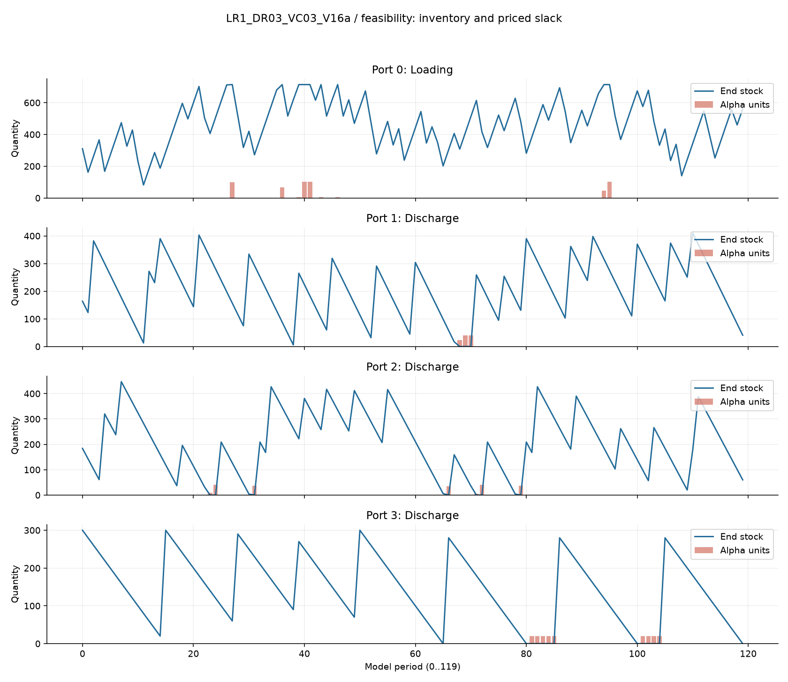
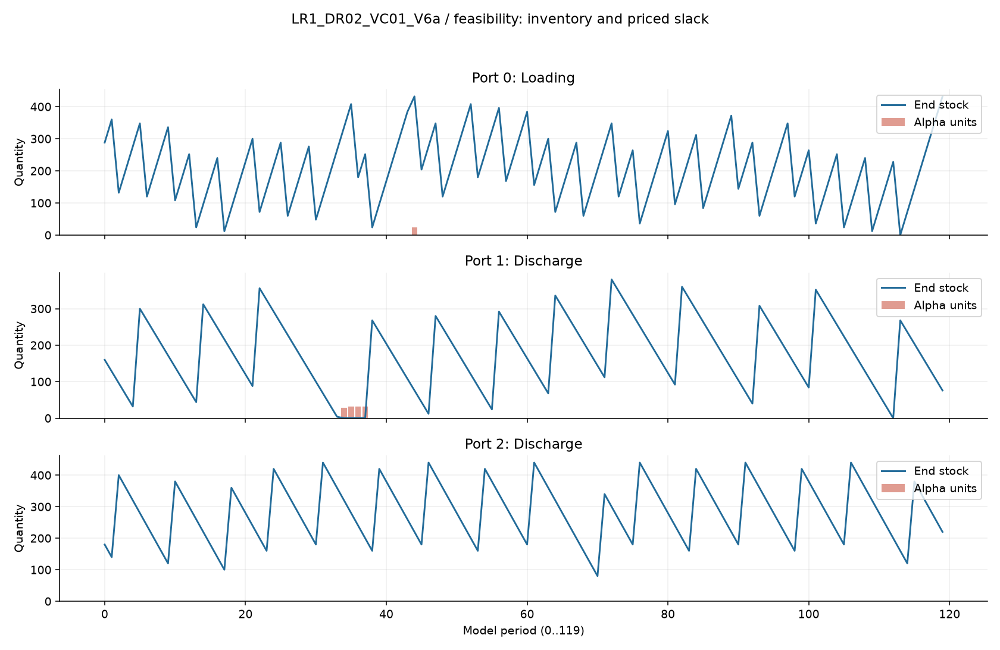
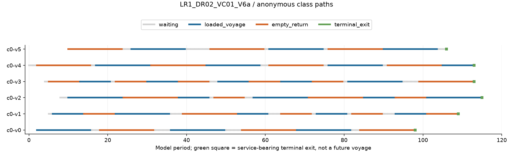
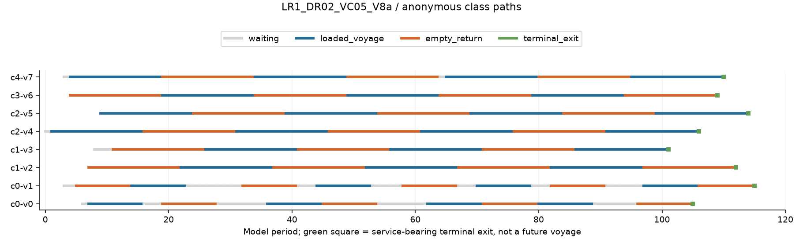
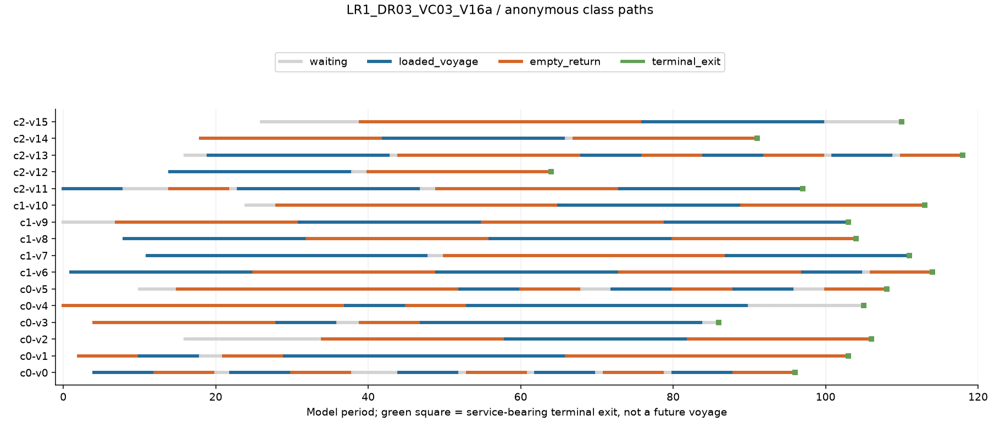

# Maritime inventory routing: a bounded native SCIP configuration study

## Result and scope

The delivered programme solves the **full original MPS**, exports its complete
variable vector and reconstructs the operating plan. It uses native SCIP 10.0.2
through PySCIPOpt 6.3.0, one solver thread, and the public nominal 180-second
optimization profile. It does not load development solutions, route caches or
incumbent files. The assigned raw ZIP and full MPS are its only instance inputs.

The proposed method is **SCIP feasibility emphasis**, not a new routing algorithm.
The control is default SCIP with identical thread, tolerance, seed and time-limit
settings. This modest mature-solver configuration intervention improved the two
multi-class development objectives by **51.11%** and **16.77%**, but made the
single-class result **39.53% more expensive**. These are observations from one run
per method and instance, not estimates of population-average performance. Both
methods timed out on every input. No global optimum is claimed.

The source-only command fixes feasibility emphasis for new assigned inputs,
which are declared to be multi-class. This development-informed choice does not
demonstrate performance on the new cyclic demand profiles. No such profile has
been solved here. The single-class regression remains in the evidence, rather
than being hidden by an instance-specific answer selector.

## Inputs, authority and knowledge boundary

All five public contract files were read. All three complete development MPSs
and every file in their raw instance directories were consumed. The supplied
three-page `Group2_MIP_Model.pdf` explains the original arc-flow formulation.
The raw 360-period demand arrays are truncated by the assigned MPS horizon:
only its 120 model periods are operated. The programme checks the signed raw
rate against every original inventory-row RHS before exporting a plan.

Only supplied instance facts were used. No published incumbent, external bound,
route vector, prior candidate, other run root, private reference or answer
service was read. Generic plotting packages were downloaded from the configured
Python package index into the owned submission directory. No external method
webpages were retrieved. General pretraining knowledge of Python, MILP and SCIP
was used; pristine pretraining or operating-system isolation is not claimed.
There was no known incidental exposure to another instance answer during this
work. The declared Python runtime was used solely as a dependency.

No agents were delegated work, no host Git repository operations were performed,
and all generated files are under `submission`. This is owner-performed
validation with a separate checking implementation, **not independent human or
agent review**.

## Model and method

SCIP reads the original MPS directly: original objective coefficients, bounds,
integer domains and constraints are not replaced by a surrogate. Anonymous class
flow includes fixed source injections, waiting, loaded voyages, empty returns
and terminal exits. Ports and classes share berth and inventory constraints, so
good routes considered individually need not form a good fleet schedule.

The feasibility configuration calls SCIP's built-in `FEASIBILITY` emphasis.
This changes a bundle of primal-search settings, including heuristics and search
priorities, while retaining mature presolve, separation and branch-and-bound.
The actual complete parameter sets are saved in each experiment. The exact
default-to-proposed changes are in `method-parameter-diff.json`; this study does
not isolate any single changed heuristic as causal. We hypothesized that more
primal-search effort could find better synchronized service schedules within a
short allocation, potentially at the cost of bound progress or late quality.

Both configurations explicitly set:

- `parallel/maxnthreads = 1` and `lp/threads = 1`;
- `randomization/randomseedshift = 0`;
- `numerics/feastol = 1e-9` (stricter solver setting than the output acceptance
  tolerance, without changing the mathematical model);
- `limits/time = 180` native seconds.

There are no deliberate delays, artificial work, disabled mature algorithms,
post-time-limit optimization steps, or accumulated multi-core allocations.
Experiments ran sequentially in instance order, default then feasibility. The
first baseline was executed directly during integration; the remaining five
were run by `experiments.py`, which refuses to repeat recorded experiments.
`study-design.json` records the design and that first-run chronology explicitly.
No run was discarded or repeated to select a favorable seed or timing outcome.

`BESTSOLFOUND` callbacks record genuine incumbent events with solver time,
objective, current dual bound and node count. Final results retain the native
best solution and full-model dual bound. The native solution-pool count is not
the number of all solutions ever discovered; the log's total may be larger.
No LP-only or neighborhood certificate is described as a full-model certificate.

## Comparable development results

All values below are original economic objective units (lower is better).
`LB` is SCIP's terminal numerical lower bound on the full original integer
problem. Native SCIP gap is `(P-LB)/min(abs(P),abs(LB))` for these positive values.

| Development instance | Method | Feasible P | Full-model LB | Native gap | Events |
|---|---|---:|---:|---:|---:|
| LR1_DR02_VC01_V6a | default | 33,808.9700 | 32,033.9401 | 5.54% | 36 |
| LR1_DR02_VC01_V6a | feasibility | 47,173.2783 | 32,066.2035 | 47.11% | 75 |
| LR1_DR02_VC05_V8a | default | 155,802.7891 | 35,938.5560 | 333.53% | 10 |
| LR1_DR02_VC05_V8a | feasibility | 76,171.6956 | 35,870.3431 | 112.35% | 24 |
| LR1_DR03_VC03_V16a | default | 198,645.5090 | 71,456.7843 | 177.99% | 7 |
| LR1_DR03_VC03_V16a | feasibility | 165,342.4448 | 71,173.5460 | 132.31% | 12 |

The normalized headroom `(P-LB)/P` is still **52.91%** and **56.95%** for the
proposed multi-class plans. These bounds leave substantial room for improvement;
they do not prove that current shortages or lost production are unavoidable.
The best disclosed single-class plan is the default run, with near-zero alpha
and a 5.25% objective-normalized headroom. Both complete methods' operating
outputs are delivered, not just the selected method.

The first figure uses actual recorded incumbent events. The vertical axis is
logarithmic. The dotted horizontal lines show **terminal** lower bounds, not a
fabricated history of bound progress. Feasibility emphasis generates more
improvements, but the single-class trace demonstrates that more events do not
necessarily produce a better terminal incumbent. Default makes a substantial
single-class improvement around native second 62 and wins by the deadline.

### Actual runtime accounting

| Instance suffix | Method | Setup wall s | Optimization call wall s | Optimization CPU s | Native solving s | Validation/export wall s |
|---|---|---:|---:|---:|---:|---:|
| VC01_V6a | default | 0.283 | 179.671 | 171.813 | 180 | 0.019 |
| VC01_V6a | feasibility | 0.309 | 179.665 | 168.891 | 180 | 0.024 |
| VC05_V8a | default | 0.402 | 179.142 | 174.984 | 180 | 0.102 |
| VC05_V8a | feasibility | 0.523 | 179.841 | 177.531 | 180 | 0.038 |
| VC03_V16a | default | 0.340 | 179.231 | 178.266 | 180 | 0.044 |
| VC03_V16a | feasibility | 0.390 | 179.170 | 175.578 | 180 | 0.044 |

The native clock and `perf_counter` are separate clocks; native printed/event
times in this runtime are coarse and may include solver model-reading time.
Do not treat their subsecond difference as speedup. Setup includes raw/MPS
loading and parameter registration. Validation/export follows optimization.
`native-result.json` saves the unrounded measurements, process CPU, total wall
and overrun field per run. All measured optimization-call wall overruns were
zero, and every native solve stopped at 180 seconds. Plotting and subsequent
saved-file checks are additional non-optimization work, not counted toward the
180-second numerical allocation. `child-process-records.json` records the five
script-launched child exits; all returned zero naturally. The first run's
completion is recorded by its native result and log, not a fabricated child row.

## Economic mechanisms and operating implications

### Five classes / eight vessels

Feasibility emphasis increases loaded-voyage cost from 18,873.92 to 20,351.85
and empty-return cost from 15,424.23 to 15,835.56. It nevertheless cuts total
cost by 79,631.09, because lost-production penalties fall from 59,464.18 to
19,278.69 and stockout penalties from 61,645.22 to 20,310.39. Thus the gain is
not cheaper sailing: it is better use and timing of cargo service.

The raw capacities are 300, 260, 220, 180 and 150. The proposed plan directs all
eight class-0 loaded voyages to discharge port 1; its other four classes' loaded
voyages go to discharge port 2 (6, 8, 3 and 4 voyages respectively). The baseline
splits classes more widely. This observed specialization is one explanation
consistent with improved synchronization; it is not a general optimal policy.

Port 1 has nine service calls in both plans, but receives 2,700 rather than
2,310 quantity units from **service at departures including exits**. Its alpha
falls from 402 to 36 units. Port 2 rises from 22 to 24 calls, service quantity
4,990 to 5,160, and alpha falls from 245 to 180. Loading-port lost production
falls from 625 to 205 units, with 33 rather than 32 service calls. More calls
and different capacities can improve inventory fit even when shipping cost rises.

The proposed port-2 shortage episodes at periods 32–33, 62–63 and 92–93 remain
visible in the figure. Port-1 shortages are at 44, 57 and 70. Loading alpha
occurs at 48, 51, 55, 59, 60 and 78. The operating CSV preserves every period,
not just these highlighted episodes. Alpha need not occur only at the exact
storage boundary in a nonoptimal incumbent; it is not relabeled physical
inevitability.

### Three classes / sixteen vessels

The proposed method raises combined loaded/empty sailing cost by about 987.40,
but reduces lost-production cost by 28,377.70 and stockout cost by 5,912.39.
Loading alpha falls from 844 to 536 units; total discharge alpha falls from 551
to 491. The improvement is uneven: port-1 alpha falls 226 to 106, port-3 alpha
falls 230 to 180, **but port-2 alpha worsens from 95 to 205**. A cheaper aggregate
plan is not a claim of uniformly better service.

With capacities 300, 250 and 200, class 0 makes 11/1/3 loaded voyages to ports
1/2/3, class 1 makes 1/8/1, and class 2 makes 4/6/0. The longest port-3 loaded
route ties vessels up for 37 periods in this raw travel matrix; port 2 takes 24,
and port 1 takes 8. Such long trips limit within-horizon opportunities to
rebalance the shared fleet. Terminal service and initial vessel positions also
matter: loaded-voyage counts alone do not equal service quantities.

Port-3 shortage blocks at 81–85 and 101–104 are visible. Port-2 has intermittent
shortages, including 23–24 and 71–72. Loading losses occur in a few clusters.
Only 45 loading periods use a berth in the proposed plan versus 42 in default;
unused berth periods are not proof of globally sufficient service, because
vessels, capacity and inventories must coincide in time.

### Single-class regression

The proposed plan removes one 300-unit loaded voyage to port 1, saves about
898.69 combined sailing cost, but adds 24 lost-production units and 124 stockout
units (14,263.38 in penalties). Default has no economically material alpha.
The proposed 39.53% total-cost regression is a real method failure on this
instance, despite 75 genuine improvement events. It argues against interpreting
feasibility emphasis as an unconditional improvement.

## Route interpretation and complete delivered operation

The plots below show all proposed anonymous class paths. The CSVs include every
positive original arc with multiplicity, exact MPS unit cost, contribution and
service effect. Each path starts at an artificial source and terminates at an
exit. Source and waiting arcs have no inventory service. Each exit performs
full-capacity service at its origin and uses a berth; the green square is not a
future voyage to a real port. Anonymous vessel IDs are a decomposition of class
flow, not identified original named-vessel assignments.

The five-class proposed plan contains 8 paths, 138 positive arc variables and
360 port-period ledger rows. The three-class plan contains 16 paths and 480
ledger rows. The single-class proposed plan contains 6 paths and 360 ledger
rows. Every plan's complete original variable dictionary, including zeros and
ending inventories, is in its `values.json`. Original fees, discounted alpha
coefficients and terminal credits are retained exactly rather than recomputed
from displayed distances or a universal discount approximation.

## Verification, failures and limits

1. `modelio.py` independently parses the original MPS into sparse rows and bounds.
   Every exported vector is checked for finite values, exact name coverage,
   integrality and domain tolerance 1e-6, and each row against
   `1e-6 + 1e-9*abs(rhs)`. Objective is recomputed from all original coefficients.
2. `validate.py` rereads saved files and checks all six output slots: arc coverage,
   counts, endpoints, kinds, capacities and costs; every path's continuity and
   multiplicity; every port-period stock, signed rate, signed service, alpha,
   residual and berth field; original penalties; unique cost components and
   total reconciliation. Raw rates and port identities are checked too.
3. All six saved plans passed. See `all-operating-audits.json` and per-run
   `validation.json` / `operating-audit.json`. Tiny negative near-zero numbers
   in the single-class baseline are preserved numerical noise within tolerance,
   not rounded away in the variable dictionary.
4. `checks.py` performed six negative tests: alpha perturbation, fractional arc,
   missing positive arc, broken path, incorrect stock and incorrect cost.
   All were rejected. Deliberately corrupted copies live only under
   `validation-tests`, are labelled as such, and are never input to the runner.
5. `source-provenance` retains the solver/export source used for the study.
   No solution-generation code was patched after those runs. Later plotting,
   validation, documentation and packaging changes do not change the solver.
6. All eight rendered PNGs were opened and inspected. Convergence/economic plots
   use actual run data; operating figures use proposed-plan CSVs. They do not
   substitute for numeric reconciliation.

One genuine SCIP warning in the single-class default log reads
`(node 2498) numerical troubles in LP 13691 -- unresolved`. The process continued
and timed out normally; its final original vector passes the stated checks.
The warning and complete log remain unedited. Other solver logs, callbacks,
parameter settings and actual time-limit terminations are preserved. There
were no discarded solver failures or failed package installations. OR-Tools
was available in the declared runtime but was not used or claimed as an experiment.

Limitations: this is a small, single-seed, single-machine controlled configuration
study, not a novel-method ablation, robust statistical comparison, exact rational
certificate or industrial guarantee. The emphasis bundle prevents assigning
causality to one internal heuristic. Clock cutoffs can alter results even with a
fixed seed; reruns need not be bitwise identical. The reader/parser deliberately
targets the declared MPS naming and raw ZIP family; unprovided variable naming,
ranged rows or different business rules require explicit extension rather than
silent reinterpretation. Unseen cyclic-demand quality remains unmeasured. The
remaining gaps are large and the delivered plans remain economically expensive.

## Attribution and reproducibility

- Supplied MIRPLIB Group2 data and MPS, provenance in public `TASK.md`:
  https://mirplib.scl.gatech.edu/index.php/instances (not fetched for extra facts).
- Supplied Dimitri J. Papageorgiou, *A Mixed-Integer Linear Programming
  Formulation for “Group 2” Maritime Inventory Routing Instances*, February 4,
  2013. This source explains class flow, service and inventory semantics; public
  contract clarifications and the actual MPS take precedence for this task.
- SCIP / PySCIPOpt built-in solver and emphasis API, installed versions above;
  general documentation: https://www.scipopt.org/ and
  https://pyscipopt.readthedocs.io/ (bibliographic pointers, not retrieved evidence).
- Matplotlib 3.11.2 for actual static plotting; dependency pins are delivered.

`HANDOFF.md` supplies exact native commands, `source-map.json` connects files to
results, and `submission.json` declares the source-only argv and numeric layout.
No benchmark grade or heavy-task qualification is claimed.
