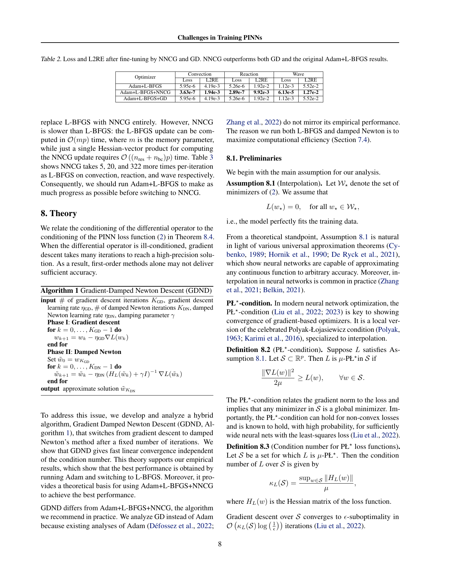

# L01质量合同的文献依据与可达性缺口

原三个所选最终解均未达1%，这是已核事实；但“没有达到本题目标”和“没有复现原论文的已知精度”并非同一个判据。本轮只查原PDF、addendum与既有产物，没有新训练、求解、checker、候选或独审，也没有改旧线。

## 原论文实际报告什么

随包[原PDF](../../../public/paper/paper.pdf)第5页Table1报告Adam+L-BFGS的相对L2误差：convection 0.00419、reaction 0.0192、wave 0.0552。第8页Table2在NNCG后报告0.00194、0.00992、0.0127。第8页已实际渲染并view；[数值/来源事实](evidence.json)记录原页和当前合同字段，原论文归属/CC BY4.0与PaperBench来源见[SOURCE](../../../public/SOURCE.md)。

这些数字不提供“所有问题1%”的文献可达见证：wave即便原报告NNCG结果仍为1.27%。同时，论文与本题评价网格不同，不能把这些数字当作本题checker的实际通过/失败结果，更不能据此证明本题1%不可能达到。

## 派生协议改变了哪些条件

| 维度 | 原文/上游addendum | 本题公开合同 |
| --- | --- | --- |
| 搜索 | 4种width、每组合5seed、多学习率/切换点 | width100；三问题默认seed345；额外seed/学习率只覆盖convection |
| 图3/7选优 | 固定11k切换后按L2RE选LR/seed/width；addendum最佳width200，三问题最佳seed345/456/567 | convection seed345混合父按训练loss；最终解同seed345合格final按训练loss，不后选评价误差 |
| 续训 | addendum记GD/NNCG再2000步；Table2列三个问题 | 只convection、每支200步 |
| 解误差网格 | 原文第3节全255×100内部点及初边值点 | 本题129×65、8385点 |
| 质量线依据 | 实际论文结果及原研究复现范围 | 事前独立提出的1%与0.01物理教学目标；quality-policy明确可达性pending |

TASK/SOURCE原本已说明这是派生研究，不能现在把它说成偷偷改了原文或评分器bug。缺的是：缩窄协议后，没有独立证据支持新增统一1%目标的可达性。原作者矩阵失败没有补上它。仅凭同架构结构对照也补不上，因为那些权重不在合法随机优化轨迹内。

## 真实产物与评价应保留什么

[原24配置与正式数值检查](../native-matrix-terminal-20261101/README.md)完整保留：所选解误差3.05%/2.59%/36.80%；评价残差均过0.01，wave初值/两端边界另失败；14质量8过6失败；原报告阶段退出码1另列。研究协议完成、解质量、交付失败与可达性是不同事实。

据此可认定当前“成熟benchmark对齐/质量校准已完成”的证据不足；不能认定“所有算法均不可能达标”，也不能将作者参考失败直接归因于某模型能力。换seed、放宽至1.27%或36.80%、延长预算或重新训练，都不能事后修复本次效度。

本调查不制定新线、不撤销原质量失败、不授予分数。未来若形成新完整任务，须在首个候选前独立登记科学目标、允许自由度、选优与评价口径，并提供对应可达证据；不能以此次看到的误差倒填门槛。当前原任务仍未冻结，十题重型/有效小时目标未达。
