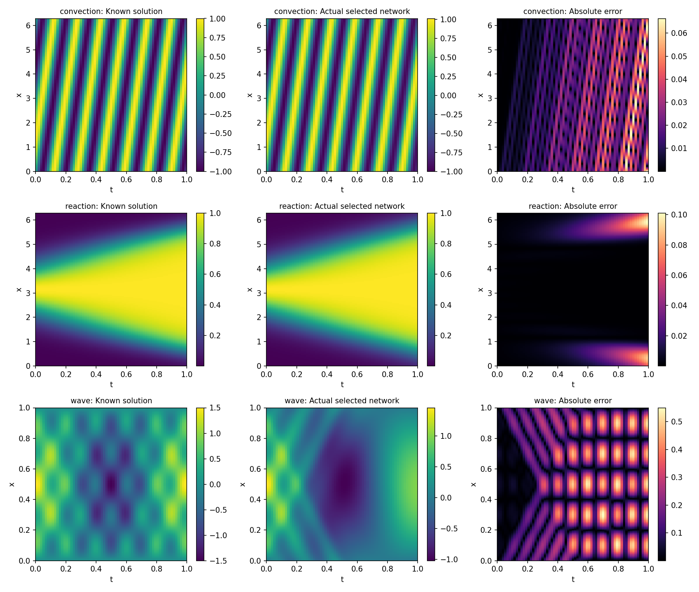

# L01原矩阵终态：数值目标失败，报告已补交

这不是新的Codex/OC对照。原作者矩阵24配置已到终态；三个按原规则选择的最终解均未达事前1%相对误差目标。原进程生成报告时失败，补交报告不改变原退出码。没有冻结、总分、候选有效小时或十题重型资格。

| 原选择的方程 / final | 相对L2误差 | 独立评价残差RMSE | 其余条件 |
| --- | --- | --- | --- |
| convection / nncg-continuation-0.1 | 0.03051163129 | 0.000602473112 | 初值0.000501478038、周期边界0.007773369496，均过0.01 |
| reaction / hybrid-s345-lr1e-03 | 0.02593014695 | 0.001159851923 | 初值0.001135092176、周期边界0.000193228532，均过0.01 |
| wave / hybrid-s345-lr1e-03 | 0.36803703815 | 0.005298476778 | 初值0.02982112488、左边界0.10236587135、右边界0.11063934016失败；初速度0.001779639660通过 |

唯一正式检查器从原封存source/native独立重建：24份实际attempt/closure/最终权重计数均`verified`，14项质量8通过、6失败；原exit1另使`L01-E-full-clean-retraining`失败。[实际facts](original-full-checker/actual-facts.json)、[assessment](original-full-checker/assessment.json)保留`total=null`、`study_complete=false`、`solution_reproduced=false`、`good=false`和其余未独评项。prepare实际exit4表示未完整评定/未冻结。

## 原始失败与交付修复

原Windows训练于2026-10-31 05:06:46.942899→23:43:42.115812 UTC执行，exit1；owner于23:56:26封存结束。真实训练PID18416、owner23296与venv启动器16256/14828分列。原Linux首格41000步及1,384,525,016byte完整原件外部保；`first-retained`确认本次保留原记录/数组，不冒同OS冷运行。

23格`max_updates`、1格NNCG0.01实际`pcg_iteration_limit`/0接受更新。convection seed567 hybrid的L2RE0.01001922893保留在[24行summary](results/summary.csv)，不能替代原seed345合法选择。算法失败和负结果不通过换seed、混选final、放宽线或加预算改写。

[原stderr](original-native/stderr.txt)定位`finish_study.make_report`首次import Matplotlib调用`Path.home()`失败。native owner最小环境未提供用户home，也未设置绘图库配置目录。训练、原数字诊断、谱/同系统PCG和两恢复子进程已完成；报告失败不是生产调度异常或科学成功。[原execution](original-native/execution.json)、[owner终态](original-native/owner-terminal.json)、[study error](results/study-error.json)和完整14,542,623,805byte原ZIP不可回写。

终态后只为owner显式设置自有`MPLCONFIGDIR`，复用同一producer的report-only入口。原报告段首次成功21.2966秒/native0，未重复训练/谱/PCG/恢复。它首次执行原报告内结构对照，[结果单列](results/structure-controls.json)，不属于原Xavier轨迹，不能补三个合法解的失败。

首PDF实际渲染发现旧writer把Markdown表/JSON直接排版；同一writer改为真实表格、逐条件质量和原图。pdf-only两次3.2835/3.3368秒/native0，只读取既有报告，未重数值/图/结构对照。[首PDF](publication-repair/paper.v1.pdf)、中间版本、源边界/命令/原页保留；主方实际view两PNG和四页最终[论文](results/paper.pdf)。Poppler有Symbol/ArialUnicode系统字体发现警告，实际英文/数字/原图清晰，未用exit0替代目视。

首次prepare误用不存在的cases/L01路径，native3在读取合同前结束；[原错误](publication-repair/first-facility-path-error.json)保。只改为README声明的根public路径后，原source/native进入同checker；没有改原向量、阈值或分数。

## 从产物反推评价边界

小loss、完整计数、18.6小时作者进程和图表均不能证明成果质量。三个评价残差都过0.01，三个解误差仍失败，波方程还漏初值/边界质量；必须保同final的解、残差与各条件，不能用方法分抵消。

本次没有证明任意方法不可能达到目标，也没有证明固定初始化/优化限制下1%目标已可达。原一次必要full prepare已结束；质量可达性仍缺，没有启动新整审、candidate或机械升版。作者时间不加入候选小时；真实Codex比较仍见[既有结果](../../../CODEX-COMPARISON-RESULTS.md)。

## 原件范围

外部唯一根`D:/opencorvus-benchmark-runs/l01-full-case-20261031`，原native在`author-study/native-remaining-registered-cells`，修复在`report-publication-repair`。全部NPZ/PT/逐尝试/closure、两阶段完整capsule、源/原料/环境/cache外部保。

[scope.json](scope.json)逐成员列实际仓库投影字节和外部ZIP边界；约4.7MB投影不冒14.54GB完整运行。full checker绑定训练前源和原失败native，后补论文与修源另列，不偷换成成功cold执行。独立整题研究判断/科学可达/重型资格仍未满足。
