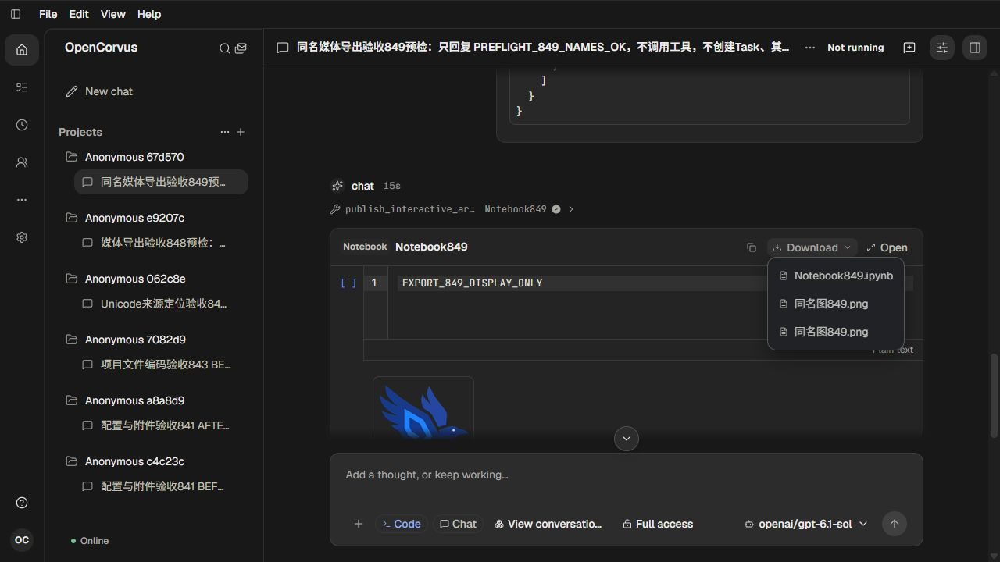
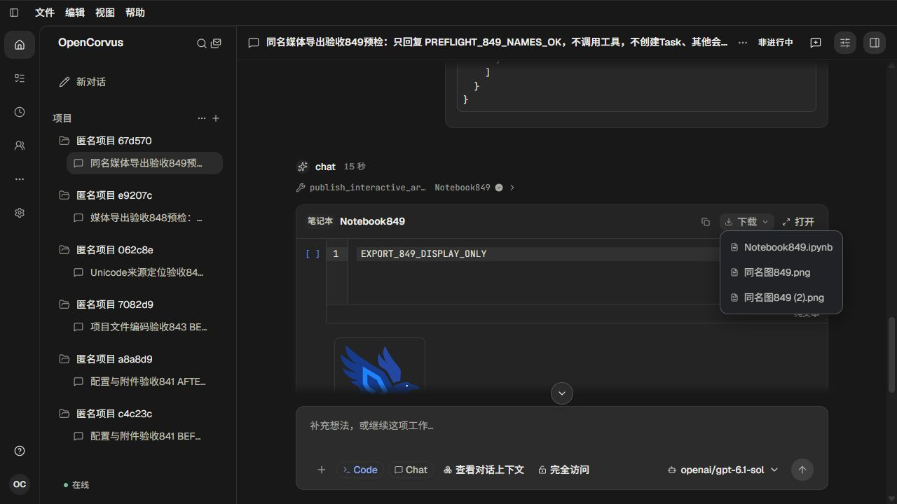

# 产物导出同名文件身份

对应[调查与验收](../../records/2026-11/2026-11-01-artifact-export-filename-identity.md)。单 agent；真实 OpenAI/gpt-6.1-sol 使用两次 publish_interactive_artifact 发表原 Notebook/Presentation；修复后重启复用同一消息和完整产物，零新模型请求。

- `inputs/alpha/`、`inputs/bravo/`：原128×128及64×64仓库图标的真实PNG字节，分别10627、4821字节，副本均叫“同名图849.png”，未编辑图片。
- `before/`：实际浏览器下载文件。两原图在分目录保留同一原名，Notebook/Markdown的两条引用均指向同一名字。浏览器自动生成的第二份下载后缀没有进入这些引用，数据checker返回MEDIA_REFERENCE_COLLISION。
- `after/`：修复后真实浏览器下载文件。两图片在实际Downloads中分别保存为“同名图849.png”和“同名图849 (2).png”，归档按各自真实basename原字节复制；两格式引用分别解析到正确原件。
- [verification.json](verification.json)：实际文件格式、字节映射、原消息/产物、模型和数据保全的结果。文件数据检查不作为界面自动化验收。

01为实际模型预检；02—03为原重复菜单；04为修复后原图预览；05—06为修复后英文不同名称菜单；07—08为修复后中文菜单。八张截图均已人工查看，只证明实际菜单和当前可见媒体区域，不外推完整幻灯布局。中英文Notebook/Markdown再次实际下载且字节一致。

基线四份自有Downloads文件在核对归档逐字节一致后退休，避免浏览器已有文件重名影响修复后保存名。输入、归档及所有无关Downloads文件保持。

