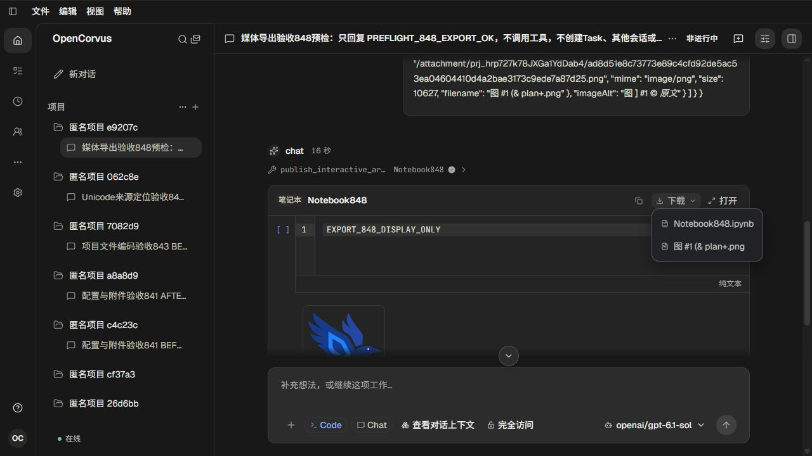
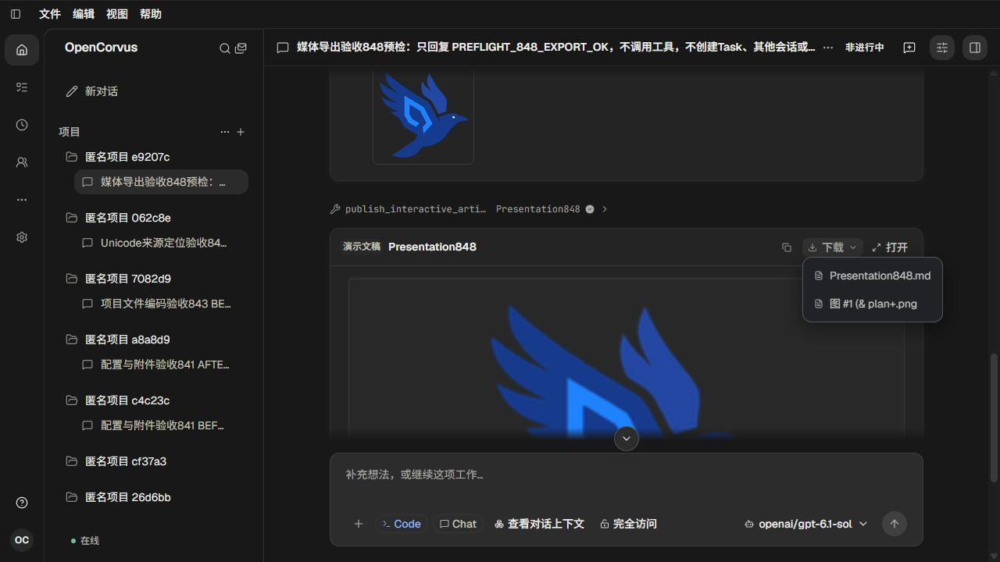

# Notebook 与演示媒体导出引用

对应[调查、根因和验收](../../records/2026-11/2026-11-01-artifact-media-reference-export.md)。单 agent；真实 OpenAI / gpt-6.1-sol；两个产物由原生工具发表，修复后重启使用原持久消息与产物，没有重新生成替代内容。

- `inputs/`：仓库图标的真实 PNG 原字节，10627 字节；只更改副本文件名以覆盖中文、空格、`#`、`&`、`+` 与不成对圆括号。
- `before/`：修复前真实浏览器下载的 Notebook、演示 Markdown 与原图。两个媒体引用均无法被标准 Markdown 数据解析器识别；原图字节正确。
- `after/`：修复后同一批产物的真实下载。Notebook 保持普通链接、演示保持图片引用；两者均指向同名原图，纯文本描述逐字保留。中英文下载字节一致。
- [verification.json](verification.json)：实际下载格式检查、模型请求和数据保全结果。格式检查是文件数据验收，不是界面自动化测试。

截图均由真实页面截图并人工查看，按时间编号：01 为精确模型预检，02—03 为修复前下载菜单，04—05 为修复后英文菜单，06—07 为修复后中文菜单。截图证明当前菜单、可见媒体区域与语言；不外推完整幻灯布局。没有截图差异、组件渲染或浏览器自动化测试。

