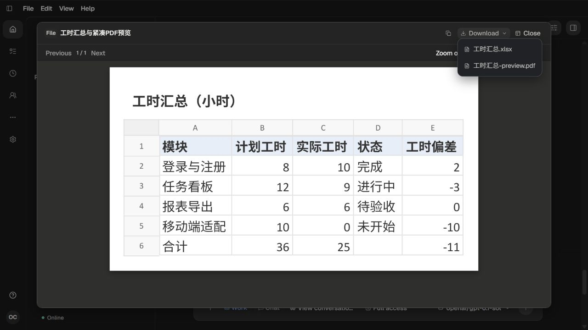
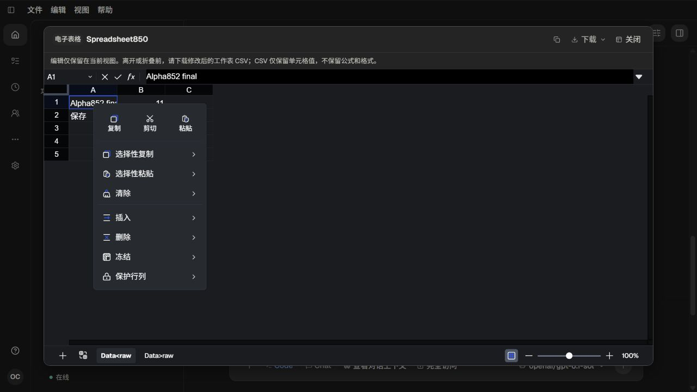

# 应用内普通预览窗

对应[根因、实施与验收](../../records/2026-11/2026-11-01-in-app-preview-dialogs.md)。用户要求预览默认使用普通弹窗、保留当前窗口，只用一个 agent 实测后提交推送。本轮没有新增模型请求。

原故障输入见[851真实 Office 页面](../2026-11-01-native-office-card-review/README.md)：旧“打开”会调用浏览器全屏，图片则固定铺满应用。修复将同一个产物节点展开为页面内有边距窗口，图片使用现有普通 Dialog。编辑器的右键浮层也跟随实际展开节点。

21张原始截图均已亲自查看，未作像素比较或自动化断言：

- 01—03：英文Office普通窗、下载菜单与Esc回到原页面。
- 04—06：图片普通窗、实际放大及中文控件，实际下载原图并Esc返回原缩略图。
- 07—09：中文DOCX完整阅读、原件下载及实际复制后原生粘贴（未发送、已清空）。
- 10—13：原工作表实际编辑、发现右键菜单被遮挡的12原图，以及收起重开后仍保留编辑值。12为失败证据。
- 14—15：最终构建main-p29xDJyQ.js的Office和图片普通窗；实际下载及点击外部关闭。
- 16—18：最终构建实际工作表菜单、子菜单与当前编辑导出。
- 19—21：同一编辑器中文菜单、导出和关闭后仍保留Alpha852 final；未重建工作表或改写持久payload。

`after/`为实际浏览器下载：DOCX、XLSX、单页PDF、原PNG及两份当前编辑CSV。Office/PDF/PNG与canonical attachment逐字节一致；CSV在中英文实际下载中逐字节一致。成熟文件解析器读取DOCX正文、XLSX状态/36／25／−11、PDF页面及内容、PNG尺寸和两CSV完整单元格。数据读取与人工视觉验收分别说明，不互相替代。

范围边界：本轮未运行真实MCP App或其他全部renderer的实页流程；其共享入口和显示模式投影已修改并通过类型/构建。没有重新调用Office生成工具，也不宣称Microsoft Office像素对齐。没有UI自动化、模型伪消息或用户数据库访问。原QA数据、附件、项目文件/Git和自然消息经完整checker保全，自有页面及服务均已退出，配对auth/models已退休。

详见[verification.json](verification.json)。CSV原始回车/换行通过根目录精确属性保留。

