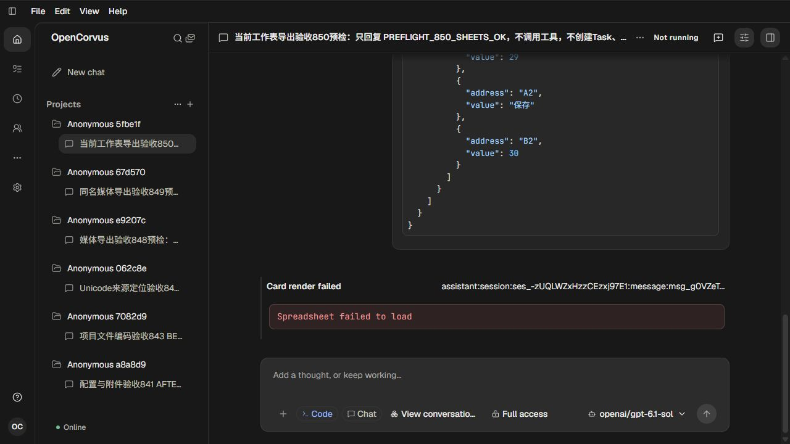
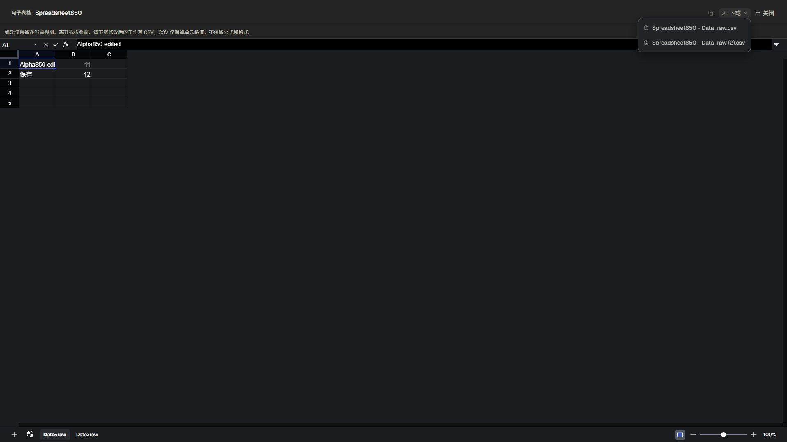

# 当前工作表导出文件身份

对应[调查、根因及验收边界](../../records/2026-11/2026-11-01-live-spreadsheet-export-identity.md)。真实gpt-6.1-sol发表原可编辑Spreadsheet850，修复后使用同一五条自然消息和完整产物，零新模型请求。

- `inputs/Spreadsheet850.json`：真实HTTP回读的原持久产物payload，原A1为Alpha850。
- `after/`：实际浏览器下载的两CSV，第一个含真实编辑值Alpha850 edited，第二个保留Bravo850；名称不同、字节及单元格分别核对。中文再次实际下载并与这两文件逐字节相等。
- `replayed-media/`：新构建中实际下载的原849 Notebook/演示，逐字节等于849已验证版本。
- [verification.json](verification.json)：请求、文件数据、原持久事实、物理结清与保全结果。24项测试是纯文件数据正向合同，没有UI自动化。

十二张原始截图均已人工查看：01真实模型预检，02原首次渲染失败，03修复后同一产物挂载，04—05实际编辑及完整公式栏，06英文两个CSV菜单，07第二原工作表，08实际复制后原生粘贴的未发送草稿（已清空），09—10中文保留编辑值与下载菜单，11—12原媒体菜单。截图不作为像素断言或自动化测试。

本份数据没有原生Office交付卡，本轮没有Office实页截图；该项未完成，不用媒体或电子表格画面代替。

两份实际CSV按37/30字节原件保存；根目录属性仅对本目录的这两份下载禁用换行转换，保留原始回车/换行，不改变程序或检查结果。

