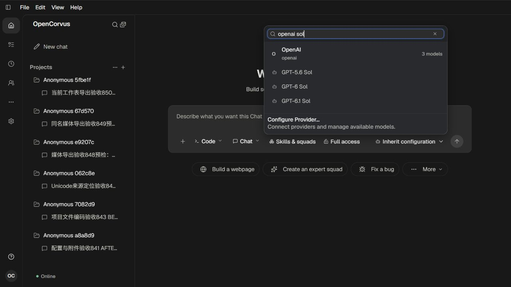
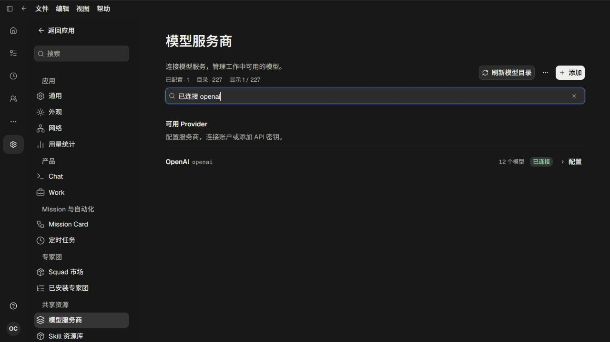

# 元数据多词筛选实页

[根因、范围与验收](../../records/2026-11/2026-11-01-multi-term-metadata-search.md)。命令、模型和Provider发现使用同一个多词匹配器，每个词都须在当前候选的既有真实字段中出现；顺序和多余空白不影响结果，字符保留字面含义。

21张公开原图均实际呈现并亲自查看：

- 01—06：旧完整子串的查询限制。02是加载中间画面，06才是goal budget稳定空结果；03—05确认十二真实模型和已连接Provider存在，组合查询仍无结果。
- 07—10：多词/逆序通用设置命令实际选择，以及目标预算查询打开同一表单、保留原未发送草稿。
- 11—13：真实Provider/模型组合返回三Sol，精确组合后实际选中原openai/gpt-6.1-sol。
- 14—15：Provider名称与连接状态组合、逆序大小写查询均为同一原卡片。
- 16—21：中文命令、原目标表单、模型组合及清除恢复、中文Provider组合及清除恢复。公开18为关闭账户信息浮层后重新实拍的原图；该含账户浮层的中间图保私有。

原9Goal、92表234309行、140附件及62项目文件/Git均保持；本轮模型请求0，配对副本全部退休，自有页和两服务均退出。聚焦的9项纯数据测试及类型/双语/普通构建通过；没有UI自动化或像素断言。内容/日志/表格/Work Ledger仍为原字面查询，不用这些图片替代其全流程重验。

详见[verification.json](verification.json)。

