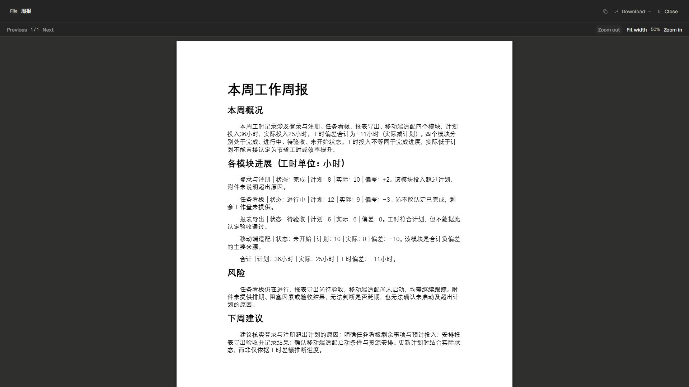

# 原生Office预览与全屏问题的原始输入

对应[851调查](../../records/2026-11/2026-11-01-native-office-card-review.md)，后续已按用户最新要求收敛到[普通预览弹窗修复](../../records/2026-11/2026-11-01-in-app-preview-dialogs.md)，停止其他迭代。

11张原图取自当前版本读取原真实Sol交付的三张Office卡片，没有新模型请求或伪造消息。02—03及07—08记录旧展开变成系统全屏；05、09和11记录实际复制原件文件名并原生粘贴到未发送草稿（已清空）。04的首次复制探测读到旧剪贴板内容，保留失败事实；随后在当前可见按钮重验成功，不把04当成功截图。

原58附件完整续存，原8项目/Git及schema8/92表/24573行全部业务字段保持。新隔离副本按当前版本自动迁至schema9，新增两条控制激活事实后24575行；原库仍为8，未触及用户数据库。旧598收尾余量失败没有重写；851新轮次按期限退出、shutdown200、native/launcher0、配对auth/models退休，剩余3024606ms。

[verification.json](verification.json)是851数据及收尾核对；下载原件和最终普通窗口的真实验收统一见后续852记录，不宣称851已经修复默认全屏。

