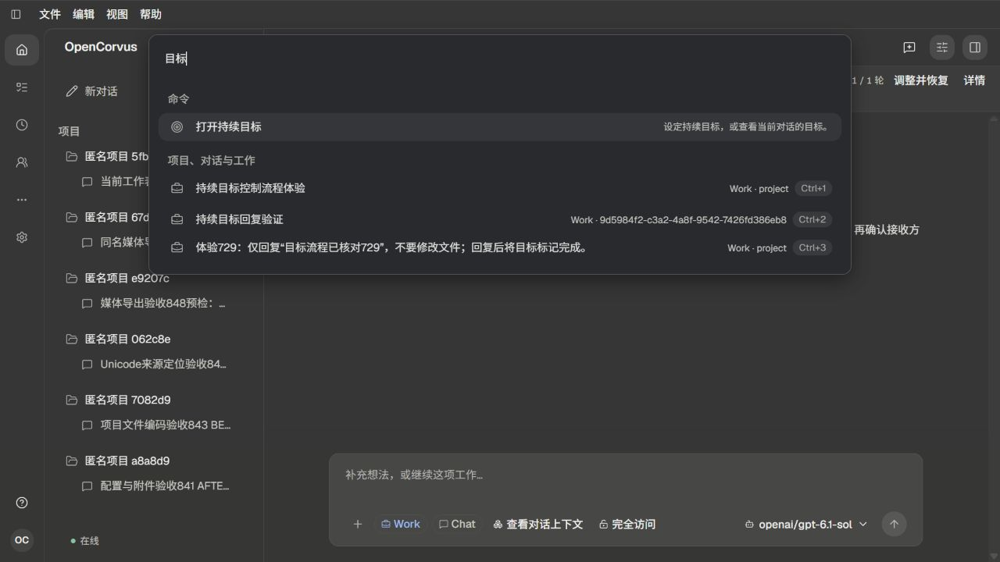
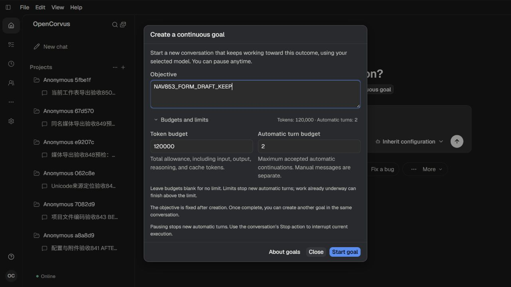

# 全局导航与目标发现

[方案及根因](../../records/2026-11/2026-11-01-workspace-navigation-review.md)。新全局Goal命令复用当前页面唯一目标表单，不会在选择命令时创建目标或执行模型。

17张原始截图均实际呈现并亲自查看，无自动化断言或像素比较：

- 01—03：旧命令集合中goal只返回真实历史工作，以及已有首页目标表单。
- 04—07：英文Open goal命令、Enter打开原表单、指南、编辑目标和120000/2预算后关闭重开仍保持。
- 08—11：真实暂停目标的英文详情、中文查询/详情及本地化指南。原目标用量36322/1和暂停状态保持。
- 12—13：当前对话查找“阶段二”并准确定位原模型正文。
- 14—16：Mission看板、其全局工作查询与Ctrl+1回到原对话；不以旧状态标题替代运行机制审计。
- 17：原通用设置命令及页面，随后返回原对话。

本轮最大模型请求0，原九目标公开完整事实及选中Work两消息/selection保持；92表、140附件、62项目文件/Git和源库经真实checker核对。所有自有页与两服务退出，四份配对auth/models副本退休，用户窗口与服务未操作。未实页覆盖Task、Mission会话、归档owner及SideChat的新命令入口；不宣称它们都已完成视觉验收。

详见[verification.json](verification.json)。

