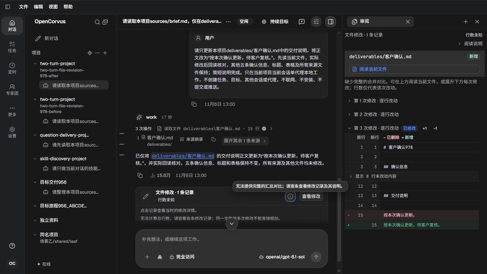

# 文件修改摘要的比较说明

真实原生开发页面，1280×720桌面，本人查看全部19张截图。两语言仅修改同一既有说明词条，当前架构同步语义。没有新增或运行界面自动化；本轮新模型0，阅读的是保留的真实Sol工作历史。最终中英说明见09/10，摘要与原比较同屏见12，刷新见19。

前态提示声称原始前后比较缺失，而实际三次原比较+15/-0、+3/-3、+1/-1均完整可读；当前真正不可用的是统一汇总比较。新提示准确陈述汇总限制，原始记录、具体原因、待加载说明、1/3条记录数量与各次行数均保留。Office908非文本原版本、936三条完整记录总+6/-3及选中重命名+3/-1也实际查看。

独立真实HTTP/数据库/磁盘检查保留六会话28完整原Tool与11份Source，明确验证260→269→287字节原端点链及最后after等于公开读口/磁盘。全部原行和每份源库、133项目文件/Git/配置、307物理附件保持，结构10/92表，318071→318073→318075仅各实例正常租约/授予各1新增。两个公开shutdown200、原生/启动器exit0、物理/输出/请求结清、4份成对认证/模型目录副本退役，82/83本人页关闭，预留final未分配。

after初次预检早于真实ready，沿原启动句柄等到就绪后成功；旧失败日志保留。资格校验以唯一实际账号200/精确模型投影回执及原发生轮次/时间为准，不以固定命令标签代替准入事实。用户现用窗口、18571和真实数据库未操作。具体原因所有组合、待加载与第二调用者空记录状态未新建独立视觉样本，不冒称覆盖。详细见[资格](qualification.json)和[方案](../../records/2026-11/2026-11-06-file-comparison-explanation.md)。

| 实页截图 | 本人观察 |
| --- | --- |
| [01-before-english-summary-hint.png](01-before-english-summary-hint.png) | 点击信息按钮后的前态英文摘要；本图尚未显示提示框，不单独证明其文字。 |
| [02-before-english-tooltip.png](02-before-english-tooltip.png) | 键盘聚焦后真实英文提示声称部分修改没有完整前后对比。 |
| [03-before-chinese-tooltip.png](03-before-chinese-tooltip.png) | 同一记录的中文提示同样声称缺少完整前后对比。 |
| [04-before-first-original-comparison.png](04-before-first-original-comparison.png) | 同一条汇总中的首份原比较完整显示15行新增。 |
| [05-before-second-original-comparison.png](05-before-second-original-comparison.png) | 第二份原比较+3/-3标题，正文尚在本视口下方。 |
| [06-before-second-comparison-body.png](06-before-second-comparison-body.png) | 滚动后实际阅读第二份比较的日期、行动二和说明变化。 |
| [07-before-third-original-comparison.png](07-before-third-original-comparison.png) | 第三份+1/-1标题和正文开头，末尾变化尚未进入视口。 |
| [08-before-third-comparison-body.png](08-before-third-comparison-body.png) | 滚动后第三份说明从更新变为待客户复核，原前后内容完整。 |
| [09-after-english-summary-tooltip.png](09-after-english-summary-tooltip.png) | 最终英文通用说明明确是汇总比较不可用。 |
| [10-after-chinese-summary-tooltip.png](10-after-chinese-summary-tooltip.png) | 最终中文汇总说明和逐条阅读指引。 |
| [11-after-third-original-comparison.png](11-after-third-original-comparison.png) | 修后仍可打开第三份原比较，+1/-1与实际说明变化保持。 |
| [12-after-summary-and-original-comparison.png](12-after-summary-and-original-comparison.png) | 修后汇总限制提示与可读的原始第三次比较同屏，语义一致。 |
| [13-after-first-original-comparison.png](13-after-first-original-comparison.png) | 修后首版原始15行、+15/-0和原日期/行动保持。 |
| [14-after-second-original-comparison.png](14-after-second-original-comparison.png) | 修后第二份+3/-3和前两处变化；说明末尾在视口下方。 |
| [15-after-second-comparison-body.png](15-after-second-comparison-body.png) | 修后第二份说明变化和第三份原比较在滚动区域可读。 |
| [16-after-office-mixed-file-summary.png](16-after-office-mixed-file-summary.png) | Office908三条真实文本/表格记录使用同一通用汇总说明。 |
| [17-after-office-record-specific-detail.png](17-after-office-record-specific-detail.png) | 表格记录仍明确非文本与创建时文件版本，可下载原版本；未点击下载。 |
| [18-after-complete-rename-records.png](18-after-complete-rename-records.png) | 936完整三记录总+6/-3，选中重命名+3/-1及原/目标路径保持。 |
| [19-after-reload-chinese-tooltip.png](19-after-reload-chinese-tooltip.png) | 本人页刷新后中文说明、原一条记录及来源历史恢复。 |

