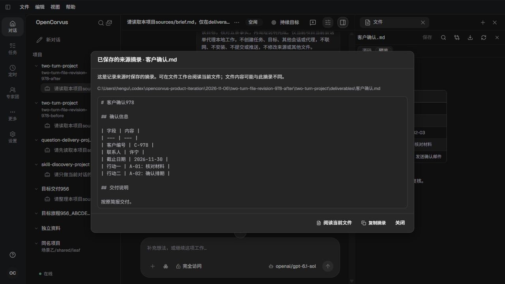
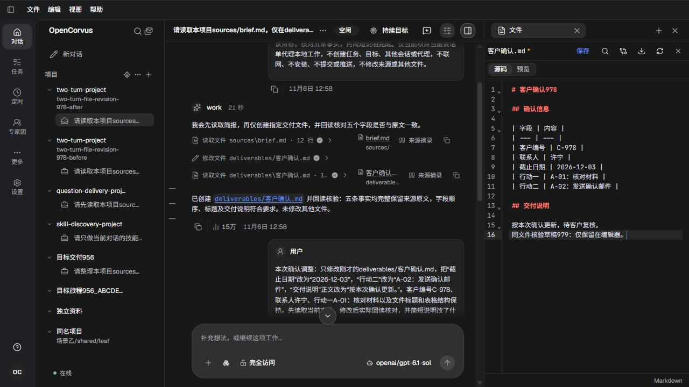

# 来源摘录到当前文件的阅读

真实原生开发页面，1280×720桌面，本人查看全部22张截图。未新增或运行界面自动化。旧来源来自真实Sol工作历史，本轮新模型请求0；不能把旧执行当作本轮新执行。最终提示见18/19，正文改进是文件摘录弹窗中可直接阅读当前文件，且保持既有草稿/导航所有者。

原同文件五次摘录分别259/259/268/268/286字节，保持当时版本；完整当前文件287字节，摘录合同不含末尾换行。六会话28完整原Tool与11份公开Source/当前文件读回通过。已移动原路径404、当前真实交付路径200/227字节，原摘录保持。全库318065→318067→318069→318071，原133项目/307物理附件、文件/Git/配置/原行与每份源库保持，结构10/92表，只有每实例正常租约及授予各1增加。

三实例全部正常公开关闭200、原生和启动器exit0、物理/输出/请求结清，6份成对认证/模型目录副本退役，79/80/81本人页关闭。未操作现用窗口、18571、真实用户数据库，不改版本或发布。详细结果见[资格记录](qualification.json)和[方案](../../records/2026-11/2026-11-06-source-current-file-navigation.md)。附件摘录分支没有本轮真实样本，不冒称视觉通过。

| 实页截图 | 本人观察 |
| --- | --- |
| [01-before-saved-excerpt.png](01-before-saved-excerpt.png) | 前态：保存摘录说明可打开当前文件，弹窗只有复制和关闭。 |
| [02-before-current-file.png](02-before-current-file.png) | 前态：先关闭再激活原来源，当前文件实际为12月3日和待客户复核。 |
| [03-after-english-excerpt-action.png](03-after-english-excerpt-action.png) | 首版修后英文直接阅读动作，首轮原摘录保持。 |
| [04-after-english-current-file.png](04-after-english-current-file.png) | 英文动作进入原工作台的当前文件。 |
| [05-after-chinese-excerpt-action.png](05-after-chinese-excerpt-action.png) | 首版修后中文动作和保存内容/当前文件区分。 |
| [06-after-chinese-current-file.png](06-after-chinese-current-file.png) | 中文动作进入最新已记录的交付正文。 |
| [07-unsaved-draft.png](07-unsaved-draft.png) | 仅编辑器内加入本人核验草稿，未保存。 |
| [08-brief-excerpt-before-switch.png](08-brief-excerpt-before-switch.png) | 脏文件存在时打开另一个真实来源的摘录。 |
| [09-unsaved-navigation-decision.png](09-unsaved-navigation-decision.png) | 新动作先关闭摘录，再由原未保存确认拥有决定。 |
| [10-cancel-keeps-draft.png](10-cancel-keeps-draft.png) | 取消切换后原文件及草稿保持，焦点回来源入口；原悬停提示同时可见。 |
| [11-discard-opens-brief.png](11-discard-opens-brief.png) | 明确放弃后打开所选brief，原材料仍是原日期和行动。 |
| [12-two-readings-one-file.png](12-two-readings-one-file.png) | 同一路径两次来源展开，保留1/2和其余来源数量；与文件修改数量分开。 |
| [13-later-reading-excerpt.png](13-later-reading-excerpt.png) | 后一次读取仍保存当时的更新说明，尚无后续待复核追加。 |
| [14-later-reading-current-file.png](14-later-reading-current-file.png) | 从后一次摘录进入当前文件，显示后续待客户复核追加。 |
| [15-moved-source-saved-excerpt.png](15-moved-source-saved-excerpt.png) | 原936真实已移动文件仍保留当时草稿摘录。 |
| [16-moved-source-current-path-error.png](16-moved-source-current-path-error.png) | 新动作读取原路径，工作台显示实际找不到文件及重试。 |
| [17-moved-source-excerpt-preserved.png](17-moved-source-excerpt-preserved.png) | 当前路径404后再开原摘录仍可阅读；Escape后焦点回原入口。 |
| [18-final-english-hint.png](18-final-english-hint.png) | 最终英文明确阅读目的地为文件工作台，不把草稿称为磁盘最新。 |
| [19-final-chinese-hint.png](19-final-chinese-hint.png) | 最终中文说明与直接阅读动作，原首版摘录保持。 |
| [20-same-file-excerpt-over-draft.png](20-same-file-excerpt-over-draft.png) | 最终构建，同一当前文件有未保存草稿时查看原摘录。 |
| [21-same-file-action-keeps-draft.png](21-same-file-action-keeps-draft.png) | 点击新动作返回同一工作台并保留原未保存草稿。 |
| [22-final-original-file-restored.png](22-final-original-file-restored.png) | 明确放弃并重新加载后读取原287字节正文，星号消失；磁盘从未保存临时草稿。 |

